# Cloud architecture diagram examples

Example architecture diagrams for AWS, Azure and Google Cloud, drawn by TerraVision with each provider's official icons. Every example comes with a prompt you can give to Claude or ChatGPT to draw something similar, and the source file that reproduces it exactly. Use them as starting points: ask your assistant to change one, or download it and edit it in draw.io.

They are drawn the way enterprises deploy: workloads sit in VPCs, subnets and availability zones, and reach managed services through private endpoints (VPC endpoints, Azure private endpoints, Private Service Connect) rather than the internet. Each provider's official grouping conventions are built in, not generic boxes. Every network and subnet is labelled with its CIDR range, and numbered steps with a legend show how requests and data move through the design.

!!! note "Your results will vary"
    A diagram drawn from a prompt depends on the AI model behind your assistant. Larger, more capable models follow the prompt more closely and add more of the detail shown here; smaller models may leave services out or group them differently. Ask for what is missing in a follow-up message, or use the source file under each example to reproduce it exactly.

| Example | Cloud |
|---|---|
| [AWS three-tier web application architecture diagram](#aws-three-tier-web-application-architecture-diagram) | AWS |
| [Amazon EKS with Karpenter architecture diagram](#amazon-eks-karpenter-architecture-diagram) | AWS |
| [AWS serverless event-driven architecture diagram](#aws-serverless-event-driven-architecture-diagram) | AWS |
| [AWS data lake architecture diagram](#aws-data-lake-architecture-diagram) | AWS |
| [AWS multi-region failover architecture diagram](#aws-multi-region-failover-architecture-diagram) | AWS |
| [AWS multi-account network with Direct Connect architecture diagram](#aws-multi-account-network-architecture-diagram) | AWS |
| [AWS event-driven order processing architecture diagram](#aws-event-driven-order-processing-architecture-diagram) | AWS |
| [Amazon ECS on Fargate API architecture diagram](#amazon-ecs-fargate-api-architecture-diagram) | AWS |
| [AWS real-time streaming analytics architecture diagram](#aws-streaming-analytics-architecture-diagram) | AWS |
| [Amazon SageMaker MLOps architecture diagram](#amazon-sagemaker-mlops-architecture-diagram) | AWS |
| [AWS IoT telemetry architecture diagram](#aws-iot-telemetry-architecture-diagram) | AWS |
| [AWS Direct Connect hybrid architecture diagram](#aws-direct-connect-hybrid-architecture-diagram) | AWS |
| [AWS static website with CI/CD architecture diagram](#aws-static-site-cicd-architecture-diagram) | AWS |
| [AWS Batch HPC architecture diagram](#aws-batch-hpc-architecture-diagram) | AWS |
| [AWS SaaS multi-tenant architecture diagram](#aws-saas-multi-tenant-architecture-diagram) | AWS |
| [AWS payments processing architecture diagram](#aws-payments-processing-architecture-diagram) | AWS |
| [AWS security logging architecture diagram](#aws-security-logging-architecture-diagram) | AWS |
| [AWS video processing architecture diagram](#aws-media-processing-architecture-diagram) | AWS |
| [AWS VM lift-and-shift migration architecture diagram](#aws-vm-lift-and-shift-architecture-diagram) | AWS |
| [Azure three-tier web application architecture diagram](#azure-three-tier-web-application-architecture-diagram) | Azure |
| [Azure hub-and-spoke network architecture diagram](#azure-hub-and-spoke-architecture-diagram) | Azure |
| [Azure AKS microservices architecture diagram](#azure-aks-architecture-diagram) | Azure |
| [Azure App Service customer portal architecture diagram](#azure-app-service-customer-portal-architecture-diagram) | Azure |
| [Azure Container Apps microservices architecture diagram](#azure-container-apps-microservices-architecture-diagram) | Azure |
| [Azure serverless event-driven architecture diagram](#azure-serverless-event-driven-architecture-diagram) | Azure |
| [Azure Databricks lakehouse architecture diagram](#azure-databricks-lakehouse-architecture-diagram) | Azure |
| [Azure real-time streaming analytics architecture diagram](#azure-streaming-analytics-architecture-diagram) | Azure |
| [Azure Machine Learning MLOps architecture diagram](#azure-machine-learning-mlops-architecture-diagram) | Azure |
| [Azure IoT telemetry architecture diagram](#azure-iot-telemetry-architecture-diagram) | Azure |
| [Azure ExpressRoute hybrid network architecture diagram](#azure-expressroute-hybrid-architecture-diagram) | Azure |
| [Azure multi-region disaster recovery architecture diagram](#azure-multi-region-disaster-recovery-architecture-diagram) | Azure |
| [Azure Static Web Apps with CI/CD architecture diagram](#azure-static-web-apps-cicd-architecture-diagram) | Azure |
| [Azure Batch HPC architecture diagram](#azure-batch-hpc-architecture-diagram) | Azure |
| [Azure SaaS multi-tenant architecture diagram](#azure-saas-multi-tenant-architecture-diagram) | Azure |
| [Azure payments processing architecture diagram](#azure-payments-processing-architecture-diagram) | Azure |
| [Azure security monitoring with Microsoft Sentinel architecture diagram](#azure-security-monitoring-architecture-diagram) | Azure |
| [Azure video processing architecture diagram](#azure-video-processing-architecture-diagram) | Azure |
| [Azure VM Scale Sets web application migration architecture diagram](#azure-vm-scale-sets-migration-architecture-diagram) | Azure |
| [Google Cloud three-tier web application architecture diagram](#google-cloud-three-tier-web-application-architecture-diagram) | Google Cloud |
| [Google Cloud GKE microservices architecture diagram](#google-cloud-gke-architecture-diagram) | Google Cloud |
| [Google Cloud data pipeline architecture diagram](#google-cloud-data-pipeline-architecture-diagram) | Google Cloud |
| [Google Cloud serverless API architecture diagram](#google-cloud-serverless-api-architecture-diagram) | Google Cloud |
| [Google Cloud Shared VPC landing zone architecture diagram](#google-cloud-shared-vpc-landing-zone-architecture-diagram) | Google Cloud |
| [Google Cloud Run microservices architecture diagram](#google-cloud-run-microservices-architecture-diagram) | Google Cloud |
| [Google Cloud event-driven architecture diagram](#google-cloud-event-driven-architecture-diagram) | Google Cloud |
| [Google Cloud streaming analytics with BigQuery architecture diagram](#google-cloud-streaming-bigquery-architecture-diagram) | Google Cloud |
| [Google Cloud Vertex AI MLOps architecture diagram](#google-cloud-vertex-ai-mlops-architecture-diagram) | Google Cloud |
| [Google Cloud IoT telemetry architecture diagram](#google-cloud-iot-telemetry-architecture-diagram) | Google Cloud |
| [Google Cloud Interconnect hybrid network architecture diagram](#google-cloud-interconnect-hybrid-architecture-diagram) | Google Cloud |
| [Google Cloud multi-region disaster recovery architecture diagram](#google-cloud-multi-region-disaster-recovery-architecture-diagram) | Google Cloud |
| [Google Cloud static website with CI/CD architecture diagram](#google-cloud-static-site-cicd-architecture-diagram) | Google Cloud |
| [Google Cloud Batch HPC architecture diagram](#google-cloud-batch-hpc-architecture-diagram) | Google Cloud |
| [Google Cloud SaaS multi-tenant architecture diagram](#google-cloud-saas-multi-tenant-architecture-diagram) | Google Cloud |
| [Google Cloud payments processing architecture diagram](#google-cloud-payments-processing-architecture-diagram) | Google Cloud |
| [Google Cloud Security Command Center architecture diagram](#google-cloud-security-command-center-architecture-diagram) | Google Cloud |
| [Google Cloud video processing architecture diagram](#google-cloud-video-processing-architecture-diagram) | Google Cloud |
| [Google Cloud VM three-tier migration architecture diagram](#google-cloud-vm-three-tier-migration-architecture-diagram) | Google Cloud |

All examples are also published as a dataset on Hugging Face, with each prompt, graph, annotations file and rendered image: [patrickchugh/terravision-cloud-diagrams](https://huggingface.co/datasets/patrickchugh/terravision-cloud-diagrams).

!!! tip "The quickest way to make one of these your own"
    Install TerraVision in [Claude Desktop or the ChatGPT desktop app](ai-assistants.md), paste the prompt under any example, then keep talking: *"add a WAF"*, *"make it multi-region"*, *"show how a request flows through it"*, *"write the Terraform for this"*.

## AWS three-tier web application architecture diagram { #aws-three-tier-web-application-architecture-diagram }

A classic three-tier web application on AWS. CloudFront serves a static site from S3 and routes requests to Application Load Balancers in two availability zones. Each zone has a public subnet (load balancer and NAT gateway), a private subnet (EC2 application servers in an Auto Scaling group) and a data subnet (Aurora PostgreSQL and ElastiCache). A CloudWatch alarm on CPU drives a target-tracking policy that scales the group out and in. The app servers reach S3 through a gateway VPC endpoint and Secrets Manager through an interface endpoint in each private subnet, so that traffic never crosses the internet.

[{ width=1400 height=1595 .no-lightbox }](https://raw.githubusercontent.com/patrickchugh/terravision/main/examples/graphs/three-tier-web.png)

**Ask your AI assistant:**

> Draw an AWS three-tier web app: CloudFront in front of an S3 static site and an Application Load Balancer, EC2 app servers in an Auto Scaling group across private subnets in two availability zones, scaled by a CloudWatch CPU alarm, Aurora PostgreSQL and ElastiCache in data subnets, NAT gateways in the public subnets, an S3 gateway endpoint for an uploads bucket and a Secrets Manager interface endpoint in each private subnet.

**Or reproduce it exactly** from the source file [three-tier-web.tvg.json](https://github.com/patrickchugh/terravision/blob/main/examples/graphs/three-tier-web.tvg.json) and its title, CIDR ranges, arrow labels and numbered flow steps in [three-tier-web.annotations.yml](https://github.com/patrickchugh/terravision/blob/main/examples/graphs/three-tier-web.annotations.yml):

```bash
terravision draw --source three-tier-web.tvg.json --annotate three-tier-web.annotations.yml --format svg      # or png, pdf
terravision draw --source three-tier-web.tvg.json --annotate three-tier-web.annotations.yml --format drawio   # editable in draw.io or Lucidchart
```

Download: [PNG](https://raw.githubusercontent.com/patrickchugh/terravision/main/examples/graphs/three-tier-web.png) · [SVG](https://raw.githubusercontent.com/patrickchugh/terravision/main/examples/graphs/three-tier-web.svg) · [source graph](https://raw.githubusercontent.com/patrickchugh/terravision/main/examples/graphs/three-tier-web.tvg.json) · [annotations: title, CIDR ranges, labels, flows](https://raw.githubusercontent.com/patrickchugh/terravision/main/examples/graphs/three-tier-web.annotations.yml)

## Amazon EKS with Karpenter architecture diagram { #amazon-eks-karpenter-architecture-diagram }

A Kubernetes platform on Amazon EKS that scales its nodes with Karpenter. The VPC spans three availability zones. In each zone, a public subnet holds an Application Load Balancer and a NAT gateway, and a private subnet holds the Karpenter controller, a Karpenter NodePool of On-Demand and Spot nodes, and interface VPC endpoints for ECR, EC2 and SQS. A data subnet holds an Aurora PostgreSQL instance. Nodes pull image layers through an S3 gateway endpoint. The EKS control plane sits in its own AWS-managed account, and an EventBridge rule sends Spot interruption warnings to the SQS queue Karpenter reads.

[{ width=1400 height=1089 loading=lazy .no-lightbox }](https://raw.githubusercontent.com/patrickchugh/terravision/main/examples/graphs/aws-eks-karpenter.png)

**Ask your AI assistant:**

> Draw an EKS cluster that uses Karpenter for node autoscaling, across three availability zones: an ALB and NAT gateway in each public subnet; the Karpenter controller, a NodePool of On-Demand and Spot nodes and interface VPC endpoints for ECR, EC2 and SQS in each private subnet; Aurora PostgreSQL in data subnets; an S3 gateway endpoint; Route 53 in front; and the EventBridge rule and SQS queue Karpenter uses for Spot interruptions.

**Or reproduce it exactly** from the source file [aws-eks-karpenter.tvg.json](https://github.com/patrickchugh/terravision/blob/main/examples/graphs/aws-eks-karpenter.tvg.json) and its title, CIDR ranges, arrow labels and numbered flow steps in [aws-eks-karpenter.annotations.yml](https://github.com/patrickchugh/terravision/blob/main/examples/graphs/aws-eks-karpenter.annotations.yml):

```bash
terravision draw --source aws-eks-karpenter.tvg.json --annotate aws-eks-karpenter.annotations.yml --format svg      # or png, pdf
terravision draw --source aws-eks-karpenter.tvg.json --annotate aws-eks-karpenter.annotations.yml --format drawio   # editable in draw.io or Lucidchart
```

Download: [PNG](https://raw.githubusercontent.com/patrickchugh/terravision/main/examples/graphs/aws-eks-karpenter.png) · [SVG](https://raw.githubusercontent.com/patrickchugh/terravision/main/examples/graphs/aws-eks-karpenter.svg) · [source graph](https://raw.githubusercontent.com/patrickchugh/terravision/main/examples/graphs/aws-eks-karpenter.tvg.json) · [annotations: title, CIDR ranges, labels, flows](https://raw.githubusercontent.com/patrickchugh/terravision/main/examples/graphs/aws-eks-karpenter.annotations.yml)

## AWS serverless event-driven architecture diagram { #aws-serverless-event-driven-architecture-diagram }

A serverless order platform whose Lambda functions run inside a VPC, as most enterprises require. Customers call an HTTP API on API Gateway, authenticated with Cognito, which invokes order Lambdas in private subnets across two availability zones. The functions reach DynamoDB through a gateway VPC endpoint, and EventBridge, SNS and Secrets Manager through interface endpoints in a dedicated endpoints subnet in each zone. Only the payment step leaves the VPC, through NAT gateways, to reach an external payment provider. The EventBridge bus fans out to a Step Functions fulfilment workflow, an SQS notifications queue with a dead-letter queue, and Firehose to an S3 event lake catalogued by Glue and queried with Athena.

[{ width=1400 height=1108 loading=lazy .no-lightbox }](https://raw.githubusercontent.com/patrickchugh/terravision/main/examples/graphs/aws-serverless-event-driven.png)

**Ask your AI assistant:**

> Draw an AWS serverless event-driven order system with every Lambda in a VPC across two availability zones: API Gateway with Cognito invoking order Lambdas in private subnets, a DynamoDB gateway endpoint, interface endpoints for EventBridge, SNS and Secrets Manager in an endpoints subnet per zone, and NAT gateways only for the payment provider. The EventBridge bus fans out to a Step Functions fulfilment workflow, an SQS notifications queue with a DLQ, and Firehose to an S3 data lake with Glue and Athena.

**Or reproduce it exactly** from the source file [aws-serverless-event-driven.tvg.json](https://github.com/patrickchugh/terravision/blob/main/examples/graphs/aws-serverless-event-driven.tvg.json) and its title, CIDR ranges, arrow labels and numbered flow steps in [aws-serverless-event-driven.annotations.yml](https://github.com/patrickchugh/terravision/blob/main/examples/graphs/aws-serverless-event-driven.annotations.yml):

```bash
terravision draw --source aws-serverless-event-driven.tvg.json --annotate aws-serverless-event-driven.annotations.yml --format svg      # or png, pdf
terravision draw --source aws-serverless-event-driven.tvg.json --annotate aws-serverless-event-driven.annotations.yml --format drawio   # editable in draw.io or Lucidchart
```

Download: [PNG](https://raw.githubusercontent.com/patrickchugh/terravision/main/examples/graphs/aws-serverless-event-driven.png) · [SVG](https://raw.githubusercontent.com/patrickchugh/terravision/main/examples/graphs/aws-serverless-event-driven.svg) · [source graph](https://raw.githubusercontent.com/patrickchugh/terravision/main/examples/graphs/aws-serverless-event-driven.tvg.json) · [annotations: title, CIDR ranges, labels, flows](https://raw.githubusercontent.com/patrickchugh/terravision/main/examples/graphs/aws-serverless-event-driven.annotations.yml)

## AWS data lake architecture diagram { #aws-data-lake-architecture-diagram }

A data lake and analytics platform on AWS whose processing runs inside a VPC. Across two availability zones, private subnets hold DMS replication from an Aurora MySQL source, Glue jobs, EMR Serverless Spark, Amazon MWAA (Airflow) orchestration and Redshift Serverless. All of them read and write S3 through a gateway VPC endpoint, and reach the Glue Data Catalog and Secrets Manager through interface endpoints in each zone. Outside the VPC, Kinesis, Firehose and Transfer Family ingest clickstream and partner files into the raw S3 zone, Lake Formation governs access, and analysts use QuickSight over Athena.

[{ width=1400 height=1089 loading=lazy .no-lightbox }](https://raw.githubusercontent.com/patrickchugh/terravision/main/examples/graphs/aws-data-lake.png)

**Ask your AI assistant:**

> Draw an AWS data lake with processing in a VPC across two availability zones: DMS from Aurora MySQL, Glue jobs, EMR Serverless, MWAA and Redshift Serverless in private subnets, an S3 gateway endpoint, and Glue and Secrets Manager interface endpoints in each zone. Kinesis, Firehose and Transfer Family land data in a raw S3 zone, Glue writes a curated zone, Lake Formation governs it, and QuickSight and Athena serve analysts.

**Or reproduce it exactly** from the source file [aws-data-lake.tvg.json](https://github.com/patrickchugh/terravision/blob/main/examples/graphs/aws-data-lake.tvg.json) and its title, CIDR ranges, arrow labels and numbered flow steps in [aws-data-lake.annotations.yml](https://github.com/patrickchugh/terravision/blob/main/examples/graphs/aws-data-lake.annotations.yml):

```bash
terravision draw --source aws-data-lake.tvg.json --annotate aws-data-lake.annotations.yml --format svg      # or png, pdf
terravision draw --source aws-data-lake.tvg.json --annotate aws-data-lake.annotations.yml --format drawio   # editable in draw.io or Lucidchart
```

Download: [PNG](https://raw.githubusercontent.com/patrickchugh/terravision/main/examples/graphs/aws-data-lake.png) · [SVG](https://raw.githubusercontent.com/patrickchugh/terravision/main/examples/graphs/aws-data-lake.svg) · [source graph](https://raw.githubusercontent.com/patrickchugh/terravision/main/examples/graphs/aws-data-lake.tvg.json) · [annotations: title, CIDR ranges, labels, flows](https://raw.githubusercontent.com/patrickchugh/terravision/main/examples/graphs/aws-data-lake.annotations.yml)

## AWS multi-region failover architecture diagram { #aws-multi-region-failover-architecture-diagram }

An active-passive multi-region design on AWS. Route 53 failover routing sends users to the primary region (us-east-1) and switches to the standby region (eu-west-1) when health checks fail. Each region has a VPC across two availability zones, with Application Load Balancers in public subnets, ECS on Fargate services in application subnets and Aurora PostgreSQL in data subnets. The services reach DynamoDB through a gateway VPC endpoint in their own region. Aurora Global Database replicates from the primary to the standby, DynamoDB global tables replicate session data, and S3 cross-region replication copies assets.

[{ width=1400 height=1779 loading=lazy .no-lightbox }](https://raw.githubusercontent.com/patrickchugh/terravision/main/examples/graphs/aws-multi-region.png)

**Ask your AI assistant:**

> Draw an AWS active-passive multi-region architecture: Route 53 failover between a primary region and a standby region, each with a VPC across two availability zones, ALBs in public subnets, ECS Fargate services in app subnets, Aurora PostgreSQL in data subnets and a DynamoDB gateway endpoint. Show Aurora Global Database replication, DynamoDB global tables and S3 cross-region replication between the regions.

**Or reproduce it exactly** from the source file [aws-multi-region.tvg.json](https://github.com/patrickchugh/terravision/blob/main/examples/graphs/aws-multi-region.tvg.json) and its title, CIDR ranges, arrow labels and numbered flow steps in [aws-multi-region.annotations.yml](https://github.com/patrickchugh/terravision/blob/main/examples/graphs/aws-multi-region.annotations.yml):

```bash
terravision draw --source aws-multi-region.tvg.json --annotate aws-multi-region.annotations.yml --format svg      # or png, pdf
terravision draw --source aws-multi-region.tvg.json --annotate aws-multi-region.annotations.yml --format drawio   # editable in draw.io or Lucidchart
```

Download: [PNG](https://raw.githubusercontent.com/patrickchugh/terravision/main/examples/graphs/aws-multi-region.png) · [SVG](https://raw.githubusercontent.com/patrickchugh/terravision/main/examples/graphs/aws-multi-region.svg) · [source graph](https://raw.githubusercontent.com/patrickchugh/terravision/main/examples/graphs/aws-multi-region.tvg.json) · [annotations: title, CIDR ranges, labels, flows](https://raw.githubusercontent.com/patrickchugh/terravision/main/examples/graphs/aws-multi-region.annotations.yml)

## AWS multi-account network with Direct Connect architecture diagram { #aws-multi-account-network-architecture-diagram }

A hub-and-spoke network for an AWS organisation, connected to the corporate data centre. The data centre's router reaches AWS over a 10 Gbps Direct Connect connection and a transit virtual interface to a Direct Connect gateway, associated with a Transit Gateway in the network account, with a site-to-site VPN to the Transit Gateway as the backup path. All traffic between the data centre, the production, development and shared services spoke VPCs and the internet passes through AWS Network Firewall in a central inspection VPC, whose Transit Gateway attachments run in appliance mode in two availability zones; a central egress VPC holds the NAT gateways and the internet gateway. The flows show office staff reaching an internal Application Load Balancer and ECS Fargate orders service, that service calling the on-premises ERP system's REST API over Direct Connect, and a development instance reaching the internet through central inspection and egress.

[{ width=1400 height=1629 loading=lazy .no-lightbox }](https://raw.githubusercontent.com/patrickchugh/terravision/main/examples/graphs/aws-multi-account-network.png)

**Ask your AI assistant:**

> Draw an AWS multi-account network: a corporate data centre with office staff, an ERP server and a router connected by Direct Connect and a Direct Connect gateway to a Transit Gateway in a network account, with a site-to-site VPN as backup; an inspection VPC with Network Firewall in two availability zones; a central egress VPC with NAT gateways; and spoke VPCs for production (internal ALB, ECS Fargate, RDS), development (EC2) and shared services (VPC endpoints, Directory Service).

**Or reproduce it exactly** from the source file [aws-multi-account-network.tvg.json](https://github.com/patrickchugh/terravision/blob/main/examples/graphs/aws-multi-account-network.tvg.json) and its title, CIDR ranges, arrow labels and numbered flow steps in [aws-multi-account-network.annotations.yml](https://github.com/patrickchugh/terravision/blob/main/examples/graphs/aws-multi-account-network.annotations.yml):

```bash
terravision draw --source aws-multi-account-network.tvg.json --annotate aws-multi-account-network.annotations.yml --format svg      # or png, pdf
terravision draw --source aws-multi-account-network.tvg.json --annotate aws-multi-account-network.annotations.yml --format drawio   # editable in draw.io or Lucidchart
```

Download: [PNG](https://raw.githubusercontent.com/patrickchugh/terravision/main/examples/graphs/aws-multi-account-network.png) · [SVG](https://raw.githubusercontent.com/patrickchugh/terravision/main/examples/graphs/aws-multi-account-network.svg) · [source graph](https://raw.githubusercontent.com/patrickchugh/terravision/main/examples/graphs/aws-multi-account-network.tvg.json) · [annotations: title, CIDR ranges, labels, flows](https://raw.githubusercontent.com/patrickchugh/terravision/main/examples/graphs/aws-multi-account-network.annotations.yml)

## AWS event-driven order processing architecture diagram { #aws-event-driven-order-processing-architecture-diagram }

An order processing system on AWS built from queues and functions, with every Lambda inside a VPC. Mobile clients call an API Gateway REST API, protected by AWS WAF and a Cognito authorizer, which invokes a create-order Lambda in private subnets across two availability zones. The functions reach DynamoDB through a gateway VPC endpoint and SQS and SNS through interface endpoints in an endpoints subnet per zone, so the VPC needs no internet route at all. An SQS queue drives the fulfilment Lambda, which notifies customers through SNS; both the queue and the notifications have dead-letter queues. DynamoDB streams every order change through Kinesis Data Streams and Firehose to an S3 archive, catalogued by a Glue crawler and queried with Athena.

[{ width=1400 height=2813 loading=lazy .no-lightbox }](https://raw.githubusercontent.com/patrickchugh/terravision/main/examples/graphs/aws-event-driven.png)

**Ask your AI assistant:**

> Draw an AWS event-driven order system with Lambdas in a VPC across two availability zones: mobile clients call an API Gateway REST API with WAF and a Cognito authorizer, a create-order Lambda saves to DynamoDB through a gateway endpoint and queues on SQS, a fulfilment Lambda notifies through SNS, SQS and SNS are reached through interface endpoints and have dead-letter queues, and DynamoDB changes flow through Kinesis and Firehose to an S3 archive with Glue and Athena.

**Or reproduce it exactly** from the source file [aws-event-driven.tvg.json](https://github.com/patrickchugh/terravision/blob/main/examples/graphs/aws-event-driven.tvg.json) and its title, CIDR ranges, arrow labels and numbered flow steps in [aws-event-driven.annotations.yml](https://github.com/patrickchugh/terravision/blob/main/examples/graphs/aws-event-driven.annotations.yml):

```bash
terravision draw --source aws-event-driven.tvg.json --annotate aws-event-driven.annotations.yml --format svg      # or png, pdf
terravision draw --source aws-event-driven.tvg.json --annotate aws-event-driven.annotations.yml --format drawio   # editable in draw.io or Lucidchart
```

Download: [PNG](https://raw.githubusercontent.com/patrickchugh/terravision/main/examples/graphs/aws-event-driven.png) · [SVG](https://raw.githubusercontent.com/patrickchugh/terravision/main/examples/graphs/aws-event-driven.svg) · [source graph](https://raw.githubusercontent.com/patrickchugh/terravision/main/examples/graphs/aws-event-driven.tvg.json) · [annotations: title, CIDR ranges, labels, flows](https://raw.githubusercontent.com/patrickchugh/terravision/main/examples/graphs/aws-event-driven.annotations.yml)

## Amazon ECS on Fargate API architecture diagram { #amazon-ecs-fargate-api-architecture-diagram }

A containerised API on Amazon ECS with AWS Fargate, spread across two availability zones. Route 53 points clients at an Application Load Balancer, protected by AWS WAF, in the public subnets, which sends requests to API tasks in private subnets. The tasks cache in ElastiCache and store orders in Aurora PostgreSQL in data subnets, and reach SQS, Secrets Manager and ECR through interface endpoints and S3 through a gateway endpoint. A worker service consumes the SQS queue, with a dead-letter queue for failures, and is the only part that leaves the VPC, through the NAT gateways, to call an email provider.

[{ width=1400 height=990 loading=lazy .no-lightbox }](https://raw.githubusercontent.com/patrickchugh/terravision/main/examples/graphs/aws-ecs-fargate-api.png)

**Ask your AI assistant:**

> Draw an Amazon ECS on Fargate API across two availability zones: Route 53 and an Application Load Balancer with AWS WAF in public subnets, API and worker tasks in private subnets, Aurora PostgreSQL and ElastiCache in data subnets, interface endpoints for ECR, SQS and Secrets Manager, an S3 gateway endpoint, an SQS job queue with a dead-letter queue feeding the worker, and NAT gateways for the worker's calls to an email provider.

**Or reproduce it exactly** from the source file [aws-ecs-fargate-api.tvg.json](https://github.com/patrickchugh/terravision/blob/main/examples/graphs/aws-ecs-fargate-api.tvg.json) and its title, CIDR ranges, arrow labels and numbered flow steps in [aws-ecs-fargate-api.annotations.yml](https://github.com/patrickchugh/terravision/blob/main/examples/graphs/aws-ecs-fargate-api.annotations.yml):

```bash
terravision draw --source aws-ecs-fargate-api.tvg.json --annotate aws-ecs-fargate-api.annotations.yml --format svg      # or png, pdf
terravision draw --source aws-ecs-fargate-api.tvg.json --annotate aws-ecs-fargate-api.annotations.yml --format drawio   # editable in draw.io or Lucidchart
```

Download: [PNG](https://raw.githubusercontent.com/patrickchugh/terravision/main/examples/graphs/aws-ecs-fargate-api.png) · [SVG](https://raw.githubusercontent.com/patrickchugh/terravision/main/examples/graphs/aws-ecs-fargate-api.svg) · [source graph](https://raw.githubusercontent.com/patrickchugh/terravision/main/examples/graphs/aws-ecs-fargate-api.tvg.json) · [annotations: title, CIDR ranges, labels, flows](https://raw.githubusercontent.com/patrickchugh/terravision/main/examples/graphs/aws-ecs-fargate-api.annotations.yml)

## AWS real-time streaming analytics architecture diagram { #aws-streaming-analytics-architecture-diagram }

A streaming analytics platform on AWS that serves the same click stream to search, a warehouse and a lake. Mobile apps write events to Kinesis Data Streams. Inside a VPC across two availability zones, a Managed Service for Apache Flink application reads the stream through an interface endpoint, enriches the events and indexes them in Amazon OpenSearch Service, checkpointing to S3 through a gateway endpoint. Redshift Serverless ingests the same stream into a materialised view that QuickSight queries over a VPC connection. Firehose delivers every event as Parquet to an S3 event lake, catalogued by Glue and queried with Athena.

[{ width=1400 height=1944 loading=lazy .no-lightbox }](https://raw.githubusercontent.com/patrickchugh/terravision/main/examples/graphs/aws-streaming-analytics.png)

**Ask your AI assistant:**

> Draw an AWS real-time streaming analytics platform: mobile apps writing to Kinesis Data Streams, a Managed Service for Apache Flink application in private subnets across two availability zones reading through a Kinesis interface endpoint and indexing into OpenSearch, Redshift Serverless with streaming ingestion queried by QuickSight, an S3 gateway endpoint for Flink checkpoints, and Firehose delivering Parquet to an S3 event lake with a Glue crawler and Athena.

**Or reproduce it exactly** from the source file [aws-streaming-analytics.tvg.json](https://github.com/patrickchugh/terravision/blob/main/examples/graphs/aws-streaming-analytics.tvg.json) and its title, CIDR ranges, arrow labels and numbered flow steps in [aws-streaming-analytics.annotations.yml](https://github.com/patrickchugh/terravision/blob/main/examples/graphs/aws-streaming-analytics.annotations.yml):

```bash
terravision draw --source aws-streaming-analytics.tvg.json --annotate aws-streaming-analytics.annotations.yml --format svg      # or png, pdf
terravision draw --source aws-streaming-analytics.tvg.json --annotate aws-streaming-analytics.annotations.yml --format drawio   # editable in draw.io or Lucidchart
```

Download: [PNG](https://raw.githubusercontent.com/patrickchugh/terravision/main/examples/graphs/aws-streaming-analytics.png) · [SVG](https://raw.githubusercontent.com/patrickchugh/terravision/main/examples/graphs/aws-streaming-analytics.svg) · [source graph](https://raw.githubusercontent.com/patrickchugh/terravision/main/examples/graphs/aws-streaming-analytics.tvg.json) · [annotations: title, CIDR ranges, labels, flows](https://raw.githubusercontent.com/patrickchugh/terravision/main/examples/graphs/aws-streaming-analytics.annotations.yml)

## Amazon SageMaker MLOps architecture diagram { #amazon-sagemaker-mlops-architecture-diagram }

An MLOps platform on Amazon SageMaker with no path to the internet. Data scientists reach SageMaker Studio, running in VPC-only mode across two availability zones, through Client VPN, and build features in Feature Store. Each week an EventBridge Scheduler schedule starts a Step Functions workflow that runs a SageMaker pipeline, registers the evaluated model in the Model Registry and deploys the approved version to a real-time endpoint with a blue/green update. The customer app calls API Gateway, whose Lambda function in the VPC scores customers through the SageMaker runtime interface endpoint. Studio and training reach S3 through a gateway endpoint and the SageMaker API through interface endpoints.

[{ width=1400 height=1074 loading=lazy .no-lightbox }](https://raw.githubusercontent.com/patrickchugh/terravision/main/examples/graphs/aws-sagemaker-mlops.png)

**Ask your AI assistant:**

> Draw an Amazon SageMaker MLOps platform in a VPC across two availability zones: SageMaker Studio in VPC-only mode reached through Client VPN, Feature Store, a Step Functions retraining workflow started weekly by EventBridge Scheduler that runs SageMaker Pipelines and registers models in the Model Registry, a real-time endpoint called by a Lambda function behind API Gateway, SageMaker API and runtime interface endpoints, and an S3 gateway endpoint for training data and model artifacts.

**Or reproduce it exactly** from the source file [aws-sagemaker-mlops.tvg.json](https://github.com/patrickchugh/terravision/blob/main/examples/graphs/aws-sagemaker-mlops.tvg.json) and its title, CIDR ranges, arrow labels and numbered flow steps in [aws-sagemaker-mlops.annotations.yml](https://github.com/patrickchugh/terravision/blob/main/examples/graphs/aws-sagemaker-mlops.annotations.yml):

```bash
terravision draw --source aws-sagemaker-mlops.tvg.json --annotate aws-sagemaker-mlops.annotations.yml --format svg      # or png, pdf
terravision draw --source aws-sagemaker-mlops.tvg.json --annotate aws-sagemaker-mlops.annotations.yml --format drawio   # editable in draw.io or Lucidchart
```

Download: [PNG](https://raw.githubusercontent.com/patrickchugh/terravision/main/examples/graphs/aws-sagemaker-mlops.png) · [SVG](https://raw.githubusercontent.com/patrickchugh/terravision/main/examples/graphs/aws-sagemaker-mlops.svg) · [source graph](https://raw.githubusercontent.com/patrickchugh/terravision/main/examples/graphs/aws-sagemaker-mlops.tvg.json) · [annotations: title, CIDR ranges, labels, flows](https://raw.githubusercontent.com/patrickchugh/terravision/main/examples/graphs/aws-sagemaker-mlops.annotations.yml)

## AWS IoT telemetry architecture diagram { #aws-iot-telemetry-architecture-diagram }

An IoT telemetry platform on AWS for a wind farm. Turbine sensors report to an AWS IoT Greengrass gateway on site, which publishes to AWS IoT Core over MQTT with TLS, using device certificates and policies from the registry. One IoT rule sends readings to Kinesis Data Streams, where Lambda functions in a VPC across two availability zones aggregate them and write to Amazon Timestream through an interface endpoint, for operators watching Amazon Managed Grafana. A second rule feeds an IoT Events detector model that raises over-speed alarms through SNS, and a third archives every message to S3 through Firehose.

[{ width=1400 height=2281 loading=lazy .no-lightbox }](https://raw.githubusercontent.com/patrickchugh/terravision/main/examples/graphs/aws-iot-telemetry.png)

**Ask your AI assistant:**

> Draw an AWS IoT telemetry platform for a wind farm: turbine sensors and an IoT Greengrass gateway on site publishing to IoT Core, IoT rules routing readings to Kinesis Data Streams, alarms to an IoT Events detector model with SNS alerts, and everything to Firehose and an S3 archive, with Lambda functions in a VPC across two availability zones writing to Timestream through an interface endpoint for operators using Amazon Managed Grafana.

**Or reproduce it exactly** from the source file [aws-iot-telemetry.tvg.json](https://github.com/patrickchugh/terravision/blob/main/examples/graphs/aws-iot-telemetry.tvg.json) and its title, CIDR ranges, arrow labels and numbered flow steps in [aws-iot-telemetry.annotations.yml](https://github.com/patrickchugh/terravision/blob/main/examples/graphs/aws-iot-telemetry.annotations.yml):

```bash
terravision draw --source aws-iot-telemetry.tvg.json --annotate aws-iot-telemetry.annotations.yml --format svg      # or png, pdf
terravision draw --source aws-iot-telemetry.tvg.json --annotate aws-iot-telemetry.annotations.yml --format drawio   # editable in draw.io or Lucidchart
```

Download: [PNG](https://raw.githubusercontent.com/patrickchugh/terravision/main/examples/graphs/aws-iot-telemetry.png) · [SVG](https://raw.githubusercontent.com/patrickchugh/terravision/main/examples/graphs/aws-iot-telemetry.svg) · [source graph](https://raw.githubusercontent.com/patrickchugh/terravision/main/examples/graphs/aws-iot-telemetry.tvg.json) · [annotations: title, CIDR ranges, labels, flows](https://raw.githubusercontent.com/patrickchugh/terravision/main/examples/graphs/aws-iot-telemetry.annotations.yml)

## AWS Direct Connect hybrid architecture diagram { #aws-direct-connect-hybrid-architecture-diagram }

A hybrid design that runs an ERP system in AWS for a head office, with all traffic on private links. The office router reaches a Transit Gateway over Direct Connect, a transit virtual interface and a Direct Connect gateway, with a site-to-site VPN as the backup path. Staff use the application through an internal Application Load Balancer and EC2 servers in two availability zones, backed by Multi-AZ RDS for Oracle. Route 53 Resolver inbound and outbound endpoints resolve names in both directions, an on-premises File Gateway stores SMB shares in S3 through Storage Gateway and S3 interface endpoints, and AWS Backup protects the servers and database.

[{ width=1400 height=1962 loading=lazy .no-lightbox }](https://raw.githubusercontent.com/patrickchugh/terravision/main/examples/graphs/aws-hybrid-direct-connect.png)

**Ask your AI assistant:**

> Draw an AWS hybrid network for a head office: staff, DNS servers, a File Gateway and a router connected by Direct Connect, a transit VIF and a Direct Connect gateway to a Transit Gateway, with a site-to-site VPN as backup, and a VPC across two availability zones with an internal ALB, EC2 app servers, Multi-AZ RDS for Oracle, Route 53 Resolver inbound and outbound endpoints with a private hosted zone, Storage Gateway and S3 interface endpoints, and AWS Backup.

**Or reproduce it exactly** from the source file [aws-hybrid-direct-connect.tvg.json](https://github.com/patrickchugh/terravision/blob/main/examples/graphs/aws-hybrid-direct-connect.tvg.json) and its title, CIDR ranges, arrow labels and numbered flow steps in [aws-hybrid-direct-connect.annotations.yml](https://github.com/patrickchugh/terravision/blob/main/examples/graphs/aws-hybrid-direct-connect.annotations.yml):

```bash
terravision draw --source aws-hybrid-direct-connect.tvg.json --annotate aws-hybrid-direct-connect.annotations.yml --format svg      # or png, pdf
terravision draw --source aws-hybrid-direct-connect.tvg.json --annotate aws-hybrid-direct-connect.annotations.yml --format drawio   # editable in draw.io or Lucidchart
```

Download: [PNG](https://raw.githubusercontent.com/patrickchugh/terravision/main/examples/graphs/aws-hybrid-direct-connect.png) · [SVG](https://raw.githubusercontent.com/patrickchugh/terravision/main/examples/graphs/aws-hybrid-direct-connect.svg) · [source graph](https://raw.githubusercontent.com/patrickchugh/terravision/main/examples/graphs/aws-hybrid-direct-connect.tvg.json) · [annotations: title, CIDR ranges, labels, flows](https://raw.githubusercontent.com/patrickchugh/terravision/main/examples/graphs/aws-hybrid-direct-connect.annotations.yml)

## AWS static website with CI/CD architecture diagram { #aws-static-site-cicd-architecture-diagram }

A static website on AWS with a fully automated release. Route 53 points visitors at CloudFront, protected by AWS WAF and serving an ACM certificate, which reads the site from a private S3 bucket through origin access control and fails over to a replica bucket in a second Region. Lambda@Edge adds security headers, and access logs go to S3. A push to GitHub starts CodePipeline through a CodeConnections connection: CodeBuild builds the site, deploys it to a staging bucket and distribution, runs browser tests, then syncs production and invalidates the cache. SNS and AWS Chatbot post releases and error-rate alarms to Slack.

[{ width=1400 height=1563 loading=lazy .no-lightbox }](https://raw.githubusercontent.com/patrickchugh/terravision/main/examples/graphs/aws-static-site-cicd.png)

**Ask your AI assistant:**

> Draw an AWS static website with CI/CD: Route 53, AWS WAF and an ACM certificate on a CloudFront distribution reading a private S3 bucket through origin access control, with a cross-Region replica bucket as failover origin, Lambda@Edge security headers and an access-log bucket, and a release where a GitHub push through CodeConnections starts CodePipeline, whose CodeBuild projects build, deploy to a staging bucket and distribution, run browser tests and deploy production, with SNS and AWS Chatbot notifying Slack.

**Or reproduce it exactly** from the source file [aws-static-site-cicd.tvg.json](https://github.com/patrickchugh/terravision/blob/main/examples/graphs/aws-static-site-cicd.tvg.json) and its title, CIDR ranges, arrow labels and numbered flow steps in [aws-static-site-cicd.annotations.yml](https://github.com/patrickchugh/terravision/blob/main/examples/graphs/aws-static-site-cicd.annotations.yml):

```bash
terravision draw --source aws-static-site-cicd.tvg.json --annotate aws-static-site-cicd.annotations.yml --format svg      # or png, pdf
terravision draw --source aws-static-site-cicd.tvg.json --annotate aws-static-site-cicd.annotations.yml --format drawio   # editable in draw.io or Lucidchart
```

Download: [PNG](https://raw.githubusercontent.com/patrickchugh/terravision/main/examples/graphs/aws-static-site-cicd.png) · [SVG](https://raw.githubusercontent.com/patrickchugh/terravision/main/examples/graphs/aws-static-site-cicd.svg) · [source graph](https://raw.githubusercontent.com/patrickchugh/terravision/main/examples/graphs/aws-static-site-cicd.tvg.json) · [annotations: title, CIDR ranges, labels, flows](https://raw.githubusercontent.com/patrickchugh/terravision/main/examples/graphs/aws-static-site-cicd.annotations.yml)

## AWS Batch HPC architecture diagram { #aws-batch-hpc-architecture-diagram }

A genomics pipeline on AWS Batch that runs thousands of jobs on EC2 Spot. Uploading a sequencing run to S3 fires an EventBridge rule that starts a Step Functions workflow, which submits array jobs to Batch compute environments in private subnets across two availability zones and tracks the run in DynamoDB. The Spot workers pull their container image through an ECR interface endpoint, send logs through a CloudWatch Logs endpoint and read their input from FSx for Lustre, which lazy-loads it from the upload bucket. Results go to S3 through a gateway endpoint, and SNS tells the researchers when the run is done.

[{ width=1400 height=2122 loading=lazy .no-lightbox }](https://raw.githubusercontent.com/patrickchugh/terravision/main/examples/graphs/aws-batch-hpc.png)

**Ask your AI assistant:**

> Draw an AWS Batch HPC genomics pipeline: an S3 upload triggering an EventBridge rule and a Step Functions workflow that submits array jobs to AWS Batch compute environments running EC2 Spot instances in private subnets across two availability zones, FSx for Lustre linked to the upload bucket, ECR and CloudWatch Logs interface endpoints, an S3 gateway endpoint for results, a DynamoDB run table and SNS notifications to researchers.

**Or reproduce it exactly** from the source file [aws-batch-hpc.tvg.json](https://github.com/patrickchugh/terravision/blob/main/examples/graphs/aws-batch-hpc.tvg.json) and its title, CIDR ranges, arrow labels and numbered flow steps in [aws-batch-hpc.annotations.yml](https://github.com/patrickchugh/terravision/blob/main/examples/graphs/aws-batch-hpc.annotations.yml):

```bash
terravision draw --source aws-batch-hpc.tvg.json --annotate aws-batch-hpc.annotations.yml --format svg      # or png, pdf
terravision draw --source aws-batch-hpc.tvg.json --annotate aws-batch-hpc.annotations.yml --format drawio   # editable in draw.io or Lucidchart
```

Download: [PNG](https://raw.githubusercontent.com/patrickchugh/terravision/main/examples/graphs/aws-batch-hpc.png) · [SVG](https://raw.githubusercontent.com/patrickchugh/terravision/main/examples/graphs/aws-batch-hpc.svg) · [source graph](https://raw.githubusercontent.com/patrickchugh/terravision/main/examples/graphs/aws-batch-hpc.tvg.json) · [annotations: title, CIDR ranges, labels, flows](https://raw.githubusercontent.com/patrickchugh/terravision/main/examples/graphs/aws-batch-hpc.annotations.yml)

## AWS SaaS multi-tenant architecture diagram { #aws-saas-multi-tenant-architecture-diagram }

A multi-tenant SaaS product on AWS that mixes pooled and silo tenancy. Tenant users call an API Gateway HTTP API, which validates their token against Cognito and passes the request over a VPC link to internal load balancers in two availability zones. Shared-tier tenants go to a pooled ECS Fargate service that keeps each tenant in its own schema in an Aurora PostgreSQL cluster, while a premium tenant has its own service and cluster; every service reads the tenant registry in DynamoDB and tenant files in S3 through gateway endpoints. The tenant management service publishes lifecycle events through an EventBridge interface endpoint, starting a Step Functions provisioning workflow and metering usage through Firehose to S3.

[{ width=1400 height=1701 loading=lazy .no-lightbox }](https://raw.githubusercontent.com/patrickchugh/terravision/main/examples/graphs/aws-saas-multi-tenant.png)

**Ask your AI assistant:**

> Draw an AWS multi-tenant SaaS platform: API Gateway HTTP API with a Cognito JWT authorizer and a VPC link to internal ALBs across two availability zones, ECS Fargate services for a pooled tier, a premium silo tenant and tenant management, Aurora PostgreSQL with a schema per tenant plus a dedicated premium cluster, a DynamoDB tenant registry and S3 tenant files through gateway endpoints, EventBridge and Secrets Manager interface endpoints, a Step Functions provisioning workflow and Firehose usage metering.

**Or reproduce it exactly** from the source file [aws-saas-multi-tenant.tvg.json](https://github.com/patrickchugh/terravision/blob/main/examples/graphs/aws-saas-multi-tenant.tvg.json) and its title, CIDR ranges, arrow labels and numbered flow steps in [aws-saas-multi-tenant.annotations.yml](https://github.com/patrickchugh/terravision/blob/main/examples/graphs/aws-saas-multi-tenant.annotations.yml):

```bash
terravision draw --source aws-saas-multi-tenant.tvg.json --annotate aws-saas-multi-tenant.annotations.yml --format svg      # or png, pdf
terravision draw --source aws-saas-multi-tenant.tvg.json --annotate aws-saas-multi-tenant.annotations.yml --format drawio   # editable in draw.io or Lucidchart
```

Download: [PNG](https://raw.githubusercontent.com/patrickchugh/terravision/main/examples/graphs/aws-saas-multi-tenant.png) · [SVG](https://raw.githubusercontent.com/patrickchugh/terravision/main/examples/graphs/aws-saas-multi-tenant.svg) · [source graph](https://raw.githubusercontent.com/patrickchugh/terravision/main/examples/graphs/aws-saas-multi-tenant.tvg.json) · [annotations: title, CIDR ranges, labels, flows](https://raw.githubusercontent.com/patrickchugh/terravision/main/examples/graphs/aws-saas-multi-tenant.annotations.yml)

## AWS payments processing architecture diagram { #aws-payments-processing-architecture-diagram }

A card payments platform on AWS designed for the resilience and isolation that PCI DSS workloads need. Merchants call an API Gateway REST API over mutual TLS, behind AWS WAF, which reaches Network Load Balancers through a VPC link; authorisation and settlement services run on ECS Fargate across three availability zones. Authorisation records an idempotency key in DynamoDB through a gateway endpoint, uses CloudHSM for card keys, asks the card network for approval over PrivateLink and writes to an Aurora PostgreSQL ledger with readers in every zone. Approved payments go through an SQS FIFO queue to the settlement service, and Secrets Manager and SQS are reached through interface endpoints.

[{ width=1400 height=1177 loading=lazy .no-lightbox }](https://raw.githubusercontent.com/patrickchugh/terravision/main/examples/graphs/aws-payments-processing.png)

**Ask your AI assistant:**

> Draw an AWS card payments platform across three availability zones: API Gateway with mutual TLS and AWS WAF, a VPC link to Network Load Balancers, ECS Fargate authorisation and settlement services, Aurora PostgreSQL Multi-AZ with a writer and readers, a DynamoDB idempotency table through a gateway endpoint, an SQS FIFO settlement queue with a dead-letter queue, CloudHSM in its own subnets, KMS, a Secrets Manager interface endpoint and a PrivateLink endpoint to the card network.

**Or reproduce it exactly** from the source file [aws-payments-processing.tvg.json](https://github.com/patrickchugh/terravision/blob/main/examples/graphs/aws-payments-processing.tvg.json) and its title, CIDR ranges, arrow labels and numbered flow steps in [aws-payments-processing.annotations.yml](https://github.com/patrickchugh/terravision/blob/main/examples/graphs/aws-payments-processing.annotations.yml):

```bash
terravision draw --source aws-payments-processing.tvg.json --annotate aws-payments-processing.annotations.yml --format svg      # or png, pdf
terravision draw --source aws-payments-processing.tvg.json --annotate aws-payments-processing.annotations.yml --format drawio   # editable in draw.io or Lucidchart
```

Download: [PNG](https://raw.githubusercontent.com/patrickchugh/terravision/main/examples/graphs/aws-payments-processing.png) · [SVG](https://raw.githubusercontent.com/patrickchugh/terravision/main/examples/graphs/aws-payments-processing.svg) · [source graph](https://raw.githubusercontent.com/patrickchugh/terravision/main/examples/graphs/aws-payments-processing.tvg.json) · [annotations: title, CIDR ranges, labels, flows](https://raw.githubusercontent.com/patrickchugh/terravision/main/examples/graphs/aws-payments-processing.annotations.yml)

## AWS security logging architecture diagram { #aws-security-logging-architecture-diagram }

Security logging and threat detection for an AWS organisation, laid out by account as AWS Control Tower does. An organisation trail in the management account, and Config and VPC flow logs from the workload accounts, write to S3 buckets with Object Lock in a dedicated log archive account, where investigators query them with Athena through Glue tables. In the security tooling account, a delegated GuardDuty administrator and Config rules feed Security Hub. An EventBridge rule sends high and critical findings to a remediation Lambda function, to Slack through SNS and AWS Chatbot, and through Firehose to an OpenSearch domain in a private VPC.

[{ width=1400 height=2567 loading=lazy .no-lightbox }](https://raw.githubusercontent.com/patrickchugh/terravision/main/examples/graphs/aws-security-logging.png)

**Ask your AI assistant:**

> Draw AWS organisation security logging by account: an organisation CloudTrail trail in the management account; Config, GuardDuty and VPC flow logs in workload accounts; a log archive account with S3 buckets using Object Lock; and a security tooling account with the delegated GuardDuty administrator, Security Hub, Config rules, an EventBridge rule for high-severity findings driving a remediation Lambda, SNS and AWS Chatbot to Slack, Firehose to OpenSearch in a VPC, and Athena with Glue.

**Or reproduce it exactly** from the source file [aws-security-logging.tvg.json](https://github.com/patrickchugh/terravision/blob/main/examples/graphs/aws-security-logging.tvg.json) and its title, CIDR ranges, arrow labels and numbered flow steps in [aws-security-logging.annotations.yml](https://github.com/patrickchugh/terravision/blob/main/examples/graphs/aws-security-logging.annotations.yml):

```bash
terravision draw --source aws-security-logging.tvg.json --annotate aws-security-logging.annotations.yml --format svg      # or png, pdf
terravision draw --source aws-security-logging.tvg.json --annotate aws-security-logging.annotations.yml --format drawio   # editable in draw.io or Lucidchart
```

Download: [PNG](https://raw.githubusercontent.com/patrickchugh/terravision/main/examples/graphs/aws-security-logging.png) · [SVG](https://raw.githubusercontent.com/patrickchugh/terravision/main/examples/graphs/aws-security-logging.svg) · [source graph](https://raw.githubusercontent.com/patrickchugh/terravision/main/examples/graphs/aws-security-logging.tvg.json) · [annotations: title, CIDR ranges, labels, flows](https://raw.githubusercontent.com/patrickchugh/terravision/main/examples/graphs/aws-security-logging.annotations.yml)

## AWS video processing architecture diagram { #aws-media-processing-architecture-diagram }

A serverless video-on-demand platform on AWS. Creators get presigned URLs from an API Gateway HTTP API, authenticated with Cognito, and upload master files straight to S3, where masters move to S3 Glacier after 30 days. An EventBridge rule starts a Step Functions workflow that probes the file with Lambda, transcodes an adaptive bitrate ladder with AWS Elemental MediaConvert, moderates and tags it with Rekognition, publishes it to a DynamoDB catalogue and notifies the creator through SNS. Members browse the catalogue through the same API, which signs short-lived CloudFront URLs, and CloudFront with AWS WAF serves the HLS segments from S3 through origin access control.

[{ width=1400 height=2653 loading=lazy .no-lightbox }](https://raw.githubusercontent.com/patrickchugh/terravision/main/examples/graphs/aws-media-processing.png)

**Ask your AI assistant:**

> Draw an AWS video-on-demand platform: creators uploading through presigned URLs from an API Gateway HTTP API with Cognito, an S3 upload bucket archiving masters to Glacier, an EventBridge rule starting a Step Functions workflow with a Lambda probe, MediaConvert, Rekognition moderation, a DynamoDB catalogue and SNS notifications, and viewers streaming HLS from S3 through CloudFront with signed URLs, origin access control, AWS WAF and Route 53.

**Or reproduce it exactly** from the source file [aws-media-processing.tvg.json](https://github.com/patrickchugh/terravision/blob/main/examples/graphs/aws-media-processing.tvg.json) and its title, CIDR ranges, arrow labels and numbered flow steps in [aws-media-processing.annotations.yml](https://github.com/patrickchugh/terravision/blob/main/examples/graphs/aws-media-processing.annotations.yml):

```bash
terravision draw --source aws-media-processing.tvg.json --annotate aws-media-processing.annotations.yml --format svg      # or png, pdf
terravision draw --source aws-media-processing.tvg.json --annotate aws-media-processing.annotations.yml --format drawio   # editable in draw.io or Lucidchart
```

Download: [PNG](https://raw.githubusercontent.com/patrickchugh/terravision/main/examples/graphs/aws-media-processing.png) · [SVG](https://raw.githubusercontent.com/patrickchugh/terravision/main/examples/graphs/aws-media-processing.svg) · [source graph](https://raw.githubusercontent.com/patrickchugh/terravision/main/examples/graphs/aws-media-processing.tvg.json) · [annotations: title, CIDR ranges, labels, flows](https://raw.githubusercontent.com/patrickchugh/terravision/main/examples/graphs/aws-media-processing.annotations.yml)

## AWS VM lift-and-shift migration architecture diagram { #aws-vm-lift-and-shift-architecture-diagram }

A Windows three-tier application moved from a data centre to AWS with AWS Application Migration Service. The agent on each on-premises server replicates its disks over a site-to-site VPN to a replication server in a staging subnet, and at cutover the web and app tiers launch as EC2 instances in Auto Scaling groups across two availability zones. Customers reach the IIS web tier through an internet-facing Application Load Balancer, the web tier calls the app tier through an internal one, and the app tier uses Multi-AZ RDS for SQL Server and FSx for Windows File Server joined to AWS Managed Microsoft AD. Systems Manager patches the instances through interface endpoints, AWS Backup protects the data, and NAT gateways give the app tier outbound access.

[{ width=1400 height=2277 loading=lazy .no-lightbox }](https://raw.githubusercontent.com/patrickchugh/terravision/main/examples/graphs/aws-vm-lift-and-shift.png)

**Ask your AI assistant:**

> Draw an AWS lift-and-shift of a Windows three-tier app: on-premises web, app, SQL Server and file servers replicating with Application Migration Service over a site-to-site VPN to a replication server in a staging subnet; then, across two availability zones, an internet-facing ALB, EC2 web and app Auto Scaling groups with an internal ALB, Multi-AZ RDS for SQL Server, FSx for Windows File Server with AWS Managed Microsoft AD, NAT gateways, Systems Manager patching through interface endpoints and AWS Backup.

**Or reproduce it exactly** from the source file [aws-vm-lift-and-shift.tvg.json](https://github.com/patrickchugh/terravision/blob/main/examples/graphs/aws-vm-lift-and-shift.tvg.json) and its title, CIDR ranges, arrow labels and numbered flow steps in [aws-vm-lift-and-shift.annotations.yml](https://github.com/patrickchugh/terravision/blob/main/examples/graphs/aws-vm-lift-and-shift.annotations.yml):

```bash
terravision draw --source aws-vm-lift-and-shift.tvg.json --annotate aws-vm-lift-and-shift.annotations.yml --format svg      # or png, pdf
terravision draw --source aws-vm-lift-and-shift.tvg.json --annotate aws-vm-lift-and-shift.annotations.yml --format drawio   # editable in draw.io or Lucidchart
```

Download: [PNG](https://raw.githubusercontent.com/patrickchugh/terravision/main/examples/graphs/aws-vm-lift-and-shift.png) · [SVG](https://raw.githubusercontent.com/patrickchugh/terravision/main/examples/graphs/aws-vm-lift-and-shift.svg) · [source graph](https://raw.githubusercontent.com/patrickchugh/terravision/main/examples/graphs/aws-vm-lift-and-shift.tvg.json) · [annotations: title, CIDR ranges, labels, flows](https://raw.githubusercontent.com/patrickchugh/terravision/main/examples/graphs/aws-vm-lift-and-shift.annotations.yml)

## Azure three-tier web application architecture diagram { #azure-three-tier-web-application-architecture-diagram }

A three-tier web application on Azure. DNS and Front Door with WAF sit in front of a Static Web App and an Application Gateway in its own subnet. Container Apps run across two zones inside a virtual network, Azure SQL sits behind a private endpoint in the data subnet, and a NAT gateway provides outbound access. Key Vault, Log Analytics and the container registry are drawn as shared services.

[{ width=1400 height=2190 loading=lazy .no-lightbox }](https://raw.githubusercontent.com/patrickchugh/terravision/main/examples/graphs/azure-three-tier.png)

**Ask your AI assistant:**

> Draw an Azure three-tier web app: Front Door with WAF, a Static Web App, Application Gateway in its own subnet, Container Apps across two zones, Azure SQL behind a private endpoint, a NAT gateway, and Key Vault, Log Analytics and a container registry as shared services.

**Or reproduce it exactly** from the source file [azure-three-tier.tvg.json](https://github.com/patrickchugh/terravision/blob/main/examples/graphs/azure-three-tier.tvg.json) and its title, CIDR ranges, arrow labels and numbered flow steps in [azure-three-tier.annotations.yml](https://github.com/patrickchugh/terravision/blob/main/examples/graphs/azure-three-tier.annotations.yml):

```bash
terravision draw --source azure-three-tier.tvg.json --annotate azure-three-tier.annotations.yml --format svg      # or png, pdf
terravision draw --source azure-three-tier.tvg.json --annotate azure-three-tier.annotations.yml --format drawio   # editable in draw.io or Lucidchart
```

Download: [PNG](https://raw.githubusercontent.com/patrickchugh/terravision/main/examples/graphs/azure-three-tier.png) · [SVG](https://raw.githubusercontent.com/patrickchugh/terravision/main/examples/graphs/azure-three-tier.svg) · [source graph](https://raw.githubusercontent.com/patrickchugh/terravision/main/examples/graphs/azure-three-tier.tvg.json) · [annotations: title, CIDR ranges, labels, flows](https://raw.githubusercontent.com/patrickchugh/terravision/main/examples/graphs/azure-three-tier.annotations.yml)

## Azure hub-and-spoke network architecture diagram { #azure-hub-and-spoke-architecture-diagram }

An Azure hub-and-spoke landing zone. The hub virtual network, in a connectivity resource group, holds a VPN gateway to the head office, Azure Firewall with a central firewall policy, Azure Bastion for administration and a Private DNS Resolver. Two spoke virtual networks are peered to the hub. The web workload spoke has an Application Gateway in front of a virtual machine scale set across two zones, which an autoscale setting scales out above 70% CPU and in below 30%, with Azure SQL behind a private endpoint. The internal apps spoke has a Windows virtual machine and PostgreSQL Flexible Server behind a private endpoint. Outbound traffic leaves through the firewall's public IP.

[{ width=1400 height=1846 loading=lazy .no-lightbox }](https://raw.githubusercontent.com/patrickchugh/terravision/main/examples/graphs/azure-hub-spoke.png)

**Ask your AI assistant:**

> Draw an Azure hub-and-spoke landing zone: a hub VNet with a VPN gateway to the head office, Azure Firewall with a firewall policy, Bastion and a Private DNS Resolver, peered to two spokes. One spoke runs a public web app (Application Gateway, a VM scale set across two zones with a CPU autoscale setting, Azure SQL via private endpoint). The other runs an internal Windows VM with PostgreSQL Flexible Server via private endpoint. Send outbound traffic through the firewall.

**Or reproduce it exactly** from the source file [azure-hub-spoke.tvg.json](https://github.com/patrickchugh/terravision/blob/main/examples/graphs/azure-hub-spoke.tvg.json) and its title, CIDR ranges, arrow labels and numbered flow steps in [azure-hub-spoke.annotations.yml](https://github.com/patrickchugh/terravision/blob/main/examples/graphs/azure-hub-spoke.annotations.yml):

```bash
terravision draw --source azure-hub-spoke.tvg.json --annotate azure-hub-spoke.annotations.yml --format svg      # or png, pdf
terravision draw --source azure-hub-spoke.tvg.json --annotate azure-hub-spoke.annotations.yml --format drawio   # editable in draw.io or Lucidchart
```

Download: [PNG](https://raw.githubusercontent.com/patrickchugh/terravision/main/examples/graphs/azure-hub-spoke.png) · [SVG](https://raw.githubusercontent.com/patrickchugh/terravision/main/examples/graphs/azure-hub-spoke.svg) · [source graph](https://raw.githubusercontent.com/patrickchugh/terravision/main/examples/graphs/azure-hub-spoke.tvg.json) · [annotations: title, CIDR ranges, labels, flows](https://raw.githubusercontent.com/patrickchugh/terravision/main/examples/graphs/azure-hub-spoke.annotations.yml)

## Azure AKS microservices architecture diagram { #azure-aks-architecture-diagram }

Microservices on Azure Kubernetes Service. Front Door with a WAF policy routes customers to an Application Gateway in its own subnet, which sends traffic to AKS node pools across three availability zones; the cluster autoscaler adds and removes nodes as pods need them. The services reach Cosmos DB, Service Bus and Azure Managed Redis only through private endpoints in a dedicated subnet. A NAT gateway handles outbound traffic. Container Registry, Key Vault, Log Analytics and Azure Monitor are shared services.

[{ width=1400 height=1108 loading=lazy .no-lightbox }](https://raw.githubusercontent.com/patrickchugh/terravision/main/examples/graphs/azure-aks.png)

**Ask your AI assistant:**

> Draw an AKS microservices platform on Azure: Front Door with WAF in front of an Application Gateway, an AKS cluster with autoscaling node pools across three zones, Cosmos DB, Service Bus and Redis reached through private endpoints in their own subnet, a NAT gateway for egress, and ACR, Key Vault, Log Analytics and Azure Monitor as shared services.

**Or reproduce it exactly** from the source file [azure-aks.tvg.json](https://github.com/patrickchugh/terravision/blob/main/examples/graphs/azure-aks.tvg.json) and its title, CIDR ranges, arrow labels and numbered flow steps in [azure-aks.annotations.yml](https://github.com/patrickchugh/terravision/blob/main/examples/graphs/azure-aks.annotations.yml):

```bash
terravision draw --source azure-aks.tvg.json --annotate azure-aks.annotations.yml --format svg      # or png, pdf
terravision draw --source azure-aks.tvg.json --annotate azure-aks.annotations.yml --format drawio   # editable in draw.io or Lucidchart
```

Download: [PNG](https://raw.githubusercontent.com/patrickchugh/terravision/main/examples/graphs/azure-aks.png) · [SVG](https://raw.githubusercontent.com/patrickchugh/terravision/main/examples/graphs/azure-aks.svg) · [source graph](https://raw.githubusercontent.com/patrickchugh/terravision/main/examples/graphs/azure-aks.tvg.json) · [annotations: title, CIDR ranges, labels, flows](https://raw.githubusercontent.com/patrickchugh/terravision/main/examples/graphs/azure-aks.annotations.yml)

## Azure App Service customer portal architecture diagram { #azure-app-service-customer-portal-architecture-diagram }

A customer portal on Azure App Service with no public endpoints behind Front Door. Azure DNS points customers at Front Door, whose WAF policy filters requests before they reach a Linux web app over a Private Link origin. The web app sits in its own VNet integration subnet and calls an API Function App through the API's private endpoint; the API and a worker Function App share a second integration subnet. Azure SQL, Service Bus, Blob Storage and Azure Managed Redis are reached only through private endpoints in a dedicated subnet. The flows show a claim being saved and queued, then the worker writing its PDF and emailing the customer through a NAT gateway with a fixed public IP.

[{ width=1400 height=2013 loading=lazy .no-lightbox }](https://raw.githubusercontent.com/patrickchugh/terravision/main/examples/graphs/azure-web-app.png)

**Ask your AI assistant:**

> Draw an Azure customer portal: Azure DNS and Front Door with a WAF policy reaching a Linux App Service over a Private Link origin, the web app and two Function Apps (API and worker) in VNet integration subnets, private endpoints for the API, Azure SQL, Service Bus, Blob Storage and Redis in their own subnet, a NAT gateway with a public IP for outbound email, and Key Vault, Application Insights, Log Analytics and private DNS zones as shared services.

**Or reproduce it exactly** from the source file [azure-web-app.tvg.json](https://github.com/patrickchugh/terravision/blob/main/examples/graphs/azure-web-app.tvg.json) and its title, CIDR ranges, arrow labels and numbered flow steps in [azure-web-app.annotations.yml](https://github.com/patrickchugh/terravision/blob/main/examples/graphs/azure-web-app.annotations.yml):

```bash
terravision draw --source azure-web-app.tvg.json --annotate azure-web-app.annotations.yml --format svg      # or png, pdf
terravision draw --source azure-web-app.tvg.json --annotate azure-web-app.annotations.yml --format drawio   # editable in draw.io or Lucidchart
```

Download: [PNG](https://raw.githubusercontent.com/patrickchugh/terravision/main/examples/graphs/azure-web-app.png) · [SVG](https://raw.githubusercontent.com/patrickchugh/terravision/main/examples/graphs/azure-web-app.svg) · [source graph](https://raw.githubusercontent.com/patrickchugh/terravision/main/examples/graphs/azure-web-app.tvg.json) · [annotations: title, CIDR ranges, labels, flows](https://raw.githubusercontent.com/patrickchugh/terravision/main/examples/graphs/azure-web-app.annotations.yml)

## Azure Container Apps microservices architecture diagram { #azure-container-apps-microservices-architecture-diagram }

Microservices on Azure Container Apps in an internal, zone-redundant environment injected into a virtual network. Azure Front Door with a WAF policy reaches the environment over Private Link, so nothing in the virtual network has a public endpoint. The storefront calls the orders and payments apps on their internal ingress, and every data service, Cosmos DB, Azure SQL, Service Bus and Azure Managed Redis, is reached through a private endpoint. KEDA scales the fulfilment app on the Service Bus queue length, and a scheduled Container Apps job reconciles payments each night. Only the payments app leaves the network, through a NAT gateway, to call the payment provider.

[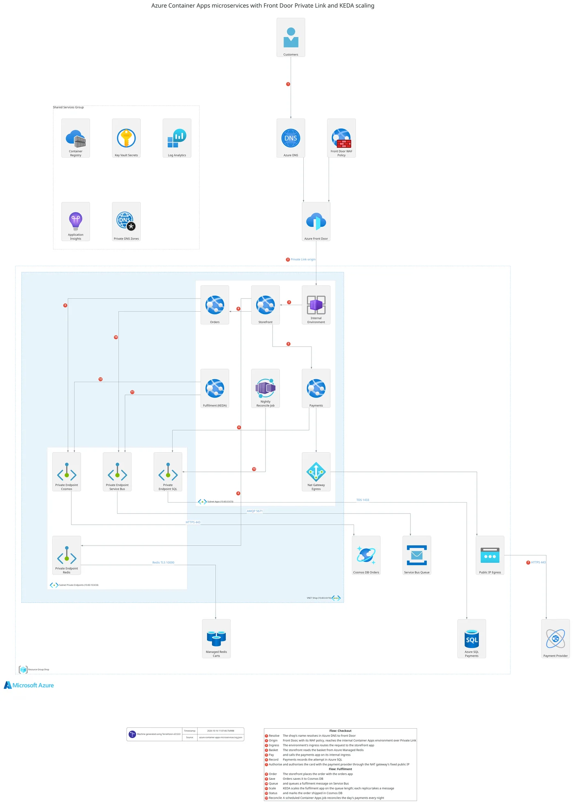{ width=1400 height=1963 loading=lazy .no-lightbox }](https://raw.githubusercontent.com/patrickchugh/terravision/main/examples/graphs/azure-container-apps-microservices.png)

**Ask your AI assistant:**

> Draw Azure Container Apps microservices in an internal zone-redundant environment in a virtual network, with Azure DNS and Front Door with WAF over Private Link, storefront, orders, payments and KEDA-scaled fulfilment apps, a nightly Container Apps job, private endpoints for Cosmos DB, Azure SQL, Service Bus and Azure Managed Redis, a NAT gateway to the payment provider, and Container Registry, Key Vault, Log Analytics and Application Insights as shared services.

**Or reproduce it exactly** from the source file [azure-container-apps-microservices.tvg.json](https://github.com/patrickchugh/terravision/blob/main/examples/graphs/azure-container-apps-microservices.tvg.json) and its title, CIDR ranges, arrow labels and numbered flow steps in [azure-container-apps-microservices.annotations.yml](https://github.com/patrickchugh/terravision/blob/main/examples/graphs/azure-container-apps-microservices.annotations.yml):

```bash
terravision draw --source azure-container-apps-microservices.tvg.json --annotate azure-container-apps-microservices.annotations.yml --format svg      # or png, pdf
terravision draw --source azure-container-apps-microservices.tvg.json --annotate azure-container-apps-microservices.annotations.yml --format drawio   # editable in draw.io or Lucidchart
```

Download: [PNG](https://raw.githubusercontent.com/patrickchugh/terravision/main/examples/graphs/azure-container-apps-microservices.png) · [SVG](https://raw.githubusercontent.com/patrickchugh/terravision/main/examples/graphs/azure-container-apps-microservices.svg) · [source graph](https://raw.githubusercontent.com/patrickchugh/terravision/main/examples/graphs/azure-container-apps-microservices.tvg.json) · [annotations: title, CIDR ranges, labels, flows](https://raw.githubusercontent.com/patrickchugh/terravision/main/examples/graphs/azure-container-apps-microservices.annotations.yml)

## Azure serverless event-driven architecture diagram { #azure-serverless-event-driven-architecture-diagram }

An event-driven order system on Azure Functions Flex Consumption with virtual network integration. API Management in its own subnet forwards orders to the orders function through a private endpoint, and the function saves them to Cosmos DB. A change feed trigger publishes each new order to an Event Grid topic, whose subscription delivers it to a Service Bus topic with a managed identity. Fulfilment and notification functions and a Logic App each take their own subscription's copy, writing receipts to Blob Storage, emailing through Azure Communication Services and posting to the ERP. Every data service is reached through a private endpoint, and outbound calls leave through a NAT gateway.

[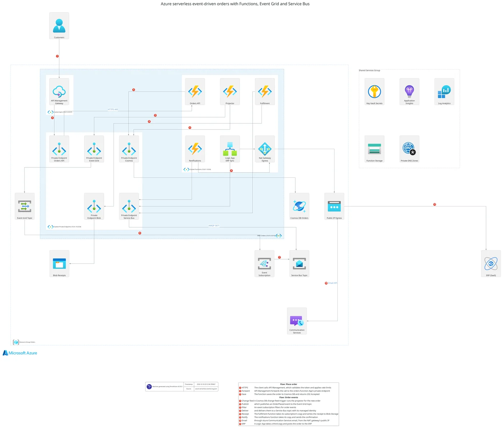{ width=1400 height=1194 loading=lazy .no-lightbox }](https://raw.githubusercontent.com/patrickchugh/terravision/main/examples/graphs/azure-serverless-events.png)

**Ask your AI assistant:**

> Draw an Azure serverless event-driven order system with API Management in a subnet, Flex Consumption Function Apps for the orders API, a Cosmos DB change feed projector, fulfilment and notifications, a Logic App to the ERP, an Event Grid topic delivering to a Service Bus topic, private endpoints for the API, Cosmos DB, Event Grid, Service Bus and Blob Storage, a NAT gateway to Communication Services email, and Key Vault and Application Insights as shared services.

**Or reproduce it exactly** from the source file [azure-serverless-events.tvg.json](https://github.com/patrickchugh/terravision/blob/main/examples/graphs/azure-serverless-events.tvg.json) and its title, CIDR ranges, arrow labels and numbered flow steps in [azure-serverless-events.annotations.yml](https://github.com/patrickchugh/terravision/blob/main/examples/graphs/azure-serverless-events.annotations.yml):

```bash
terravision draw --source azure-serverless-events.tvg.json --annotate azure-serverless-events.annotations.yml --format svg      # or png, pdf
terravision draw --source azure-serverless-events.tvg.json --annotate azure-serverless-events.annotations.yml --format drawio   # editable in draw.io or Lucidchart
```

Download: [PNG](https://raw.githubusercontent.com/patrickchugh/terravision/main/examples/graphs/azure-serverless-events.png) · [SVG](https://raw.githubusercontent.com/patrickchugh/terravision/main/examples/graphs/azure-serverless-events.svg) · [source graph](https://raw.githubusercontent.com/patrickchugh/terravision/main/examples/graphs/azure-serverless-events.tvg.json) · [annotations: title, CIDR ranges, labels, flows](https://raw.githubusercontent.com/patrickchugh/terravision/main/examples/graphs/azure-serverless-events.annotations.yml)

## Azure Databricks lakehouse architecture diagram { #azure-databricks-lakehouse-architecture-diagram }

A medallion lakehouse on Azure Databricks and Azure Data Lake Storage Gen2, fed nightly from an on-premises data centre. A Data Factory pipeline hands its copy activity to a self-hosted integration runtime in the virtual network, which reads the ERP and CRM databases over a site-to-site VPN and lands them in the bronze container. The pipeline then runs a Databricks job, in a VNet-injected workspace with Unity Catalog, that refines bronze into silver and gold Delta tables. Data Factory, Databricks and the lake are all reached through private endpoints, and the clusters download packages through a NAT gateway. Analysts query the gold tables from Power BI, and Purview catalogues the lake.

[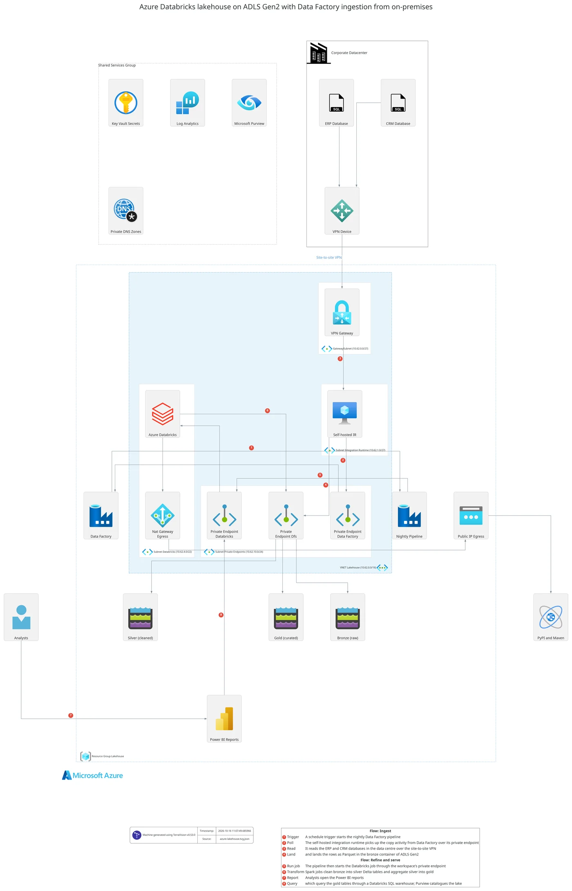{ width=1400 height=2179 loading=lazy .no-lightbox }](https://raw.githubusercontent.com/patrickchugh/terravision/main/examples/graphs/azure-lakehouse.png)

**Ask your AI assistant:**

> Draw an Azure Databricks lakehouse with ERP and CRM databases in an on-premises data centre connected by site-to-site VPN, a VPN gateway, a self-hosted integration runtime VM and a VNet-injected Databricks workspace in their own subnets, a Data Factory pipeline, ADLS Gen2 bronze, silver and gold containers, private endpoints for Data Factory, Databricks and the lake, a NAT gateway, Power BI for analysts, and Key Vault and Purview as shared services.

**Or reproduce it exactly** from the source file [azure-lakehouse.tvg.json](https://github.com/patrickchugh/terravision/blob/main/examples/graphs/azure-lakehouse.tvg.json) and its title, CIDR ranges, arrow labels and numbered flow steps in [azure-lakehouse.annotations.yml](https://github.com/patrickchugh/terravision/blob/main/examples/graphs/azure-lakehouse.annotations.yml):

```bash
terravision draw --source azure-lakehouse.tvg.json --annotate azure-lakehouse.annotations.yml --format svg      # or png, pdf
terravision draw --source azure-lakehouse.tvg.json --annotate azure-lakehouse.annotations.yml --format drawio   # editable in draw.io or Lucidchart
```

Download: [PNG](https://raw.githubusercontent.com/patrickchugh/terravision/main/examples/graphs/azure-lakehouse.png) · [SVG](https://raw.githubusercontent.com/patrickchugh/terravision/main/examples/graphs/azure-lakehouse.svg) · [source graph](https://raw.githubusercontent.com/patrickchugh/terravision/main/examples/graphs/azure-lakehouse.tvg.json) · [annotations: title, CIDR ranges, labels, flows](https://raw.githubusercontent.com/patrickchugh/terravision/main/examples/graphs/azure-lakehouse.annotations.yml)

## Azure real-time streaming analytics architecture diagram { #azure-streaming-analytics-architecture-diagram }

Real-time clickstream analytics for an online store on Azure. The storefront web app, behind Front Door with a WAF, sends every click to Event Hubs over its Kafka endpoint through a private endpoint. Event Hubs Capture archives the raw events in the data lake, and a data connection streams them into Azure Data Explorer for interactive queries. A Stream Analytics job in the virtual network turns clicks into sessions and updates each shopper's profile in Cosmos DB, which the storefront reads to personalise the next page. A function watches conversion in Data Explorer and pages the on-call team, and analysts follow live funnels in Managed Grafana.

[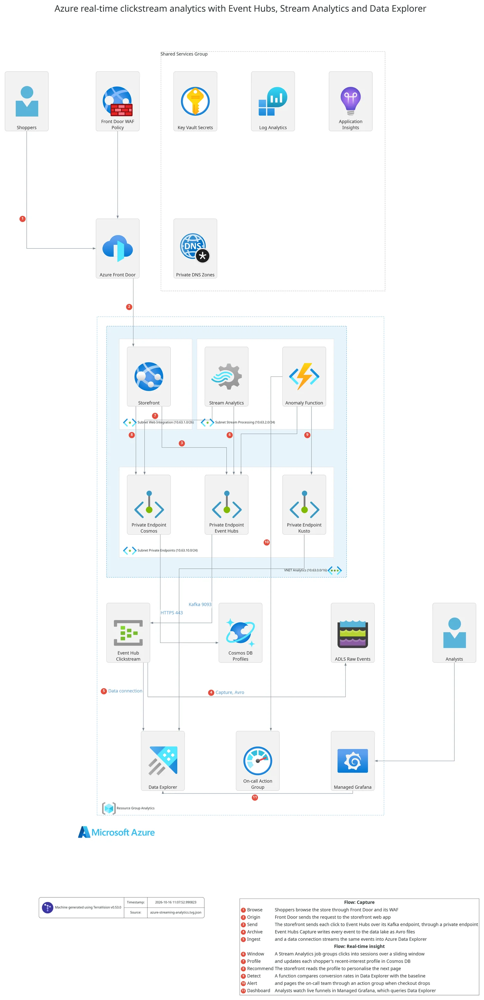{ width=1400 height=2887 loading=lazy .no-lightbox }](https://raw.githubusercontent.com/patrickchugh/terravision/main/examples/graphs/azure-streaming-analytics.png)

**Ask your AI assistant:**

> Draw Azure real-time clickstream analytics with Front Door and WAF in front of an App Service storefront that sends clicks to Event Hubs, Event Hubs Capture to ADLS Gen2, a data connection to Azure Data Explorer, a Stream Analytics job and an anomaly Function App in a stream processing subnet, Cosmos DB shopper profiles, private endpoints for Event Hubs, Cosmos DB and Data Explorer, Managed Grafana dashboards, and a Monitor action group for alerts.

**Or reproduce it exactly** from the source file [azure-streaming-analytics.tvg.json](https://github.com/patrickchugh/terravision/blob/main/examples/graphs/azure-streaming-analytics.tvg.json) and its title, CIDR ranges, arrow labels and numbered flow steps in [azure-streaming-analytics.annotations.yml](https://github.com/patrickchugh/terravision/blob/main/examples/graphs/azure-streaming-analytics.annotations.yml):

```bash
terravision draw --source azure-streaming-analytics.tvg.json --annotate azure-streaming-analytics.annotations.yml --format svg      # or png, pdf
terravision draw --source azure-streaming-analytics.tvg.json --annotate azure-streaming-analytics.annotations.yml --format drawio   # editable in draw.io or Lucidchart
```

Download: [PNG](https://raw.githubusercontent.com/patrickchugh/terravision/main/examples/graphs/azure-streaming-analytics.png) · [SVG](https://raw.githubusercontent.com/patrickchugh/terravision/main/examples/graphs/azure-streaming-analytics.svg) · [source graph](https://raw.githubusercontent.com/patrickchugh/terravision/main/examples/graphs/azure-streaming-analytics.tvg.json) · [annotations: title, CIDR ranges, labels, flows](https://raw.githubusercontent.com/patrickchugh/terravision/main/examples/graphs/azure-streaming-analytics.annotations.yml)

## Azure Machine Learning MLOps architecture diagram { #azure-machine-learning-mlops-architecture-diagram }

An MLOps platform on Azure Machine Learning with every part kept off the public internet. Data scientists connect over point-to-site VPN to compute instances, and reach the workspace, which has public access disabled, through its private endpoint. A merge to main runs a GitHub workflow on self-hosted runners in the virtual network, which submit the training pipeline to a GPU compute cluster that reads data from Blob Storage and registers the model. After approval the runners deploy it to an online endpoint on AKS with the Azure ML extension. The claims app scores each claim over the virtual network, and Container Registry, Key Vault and Application Insights serve the workspace.

[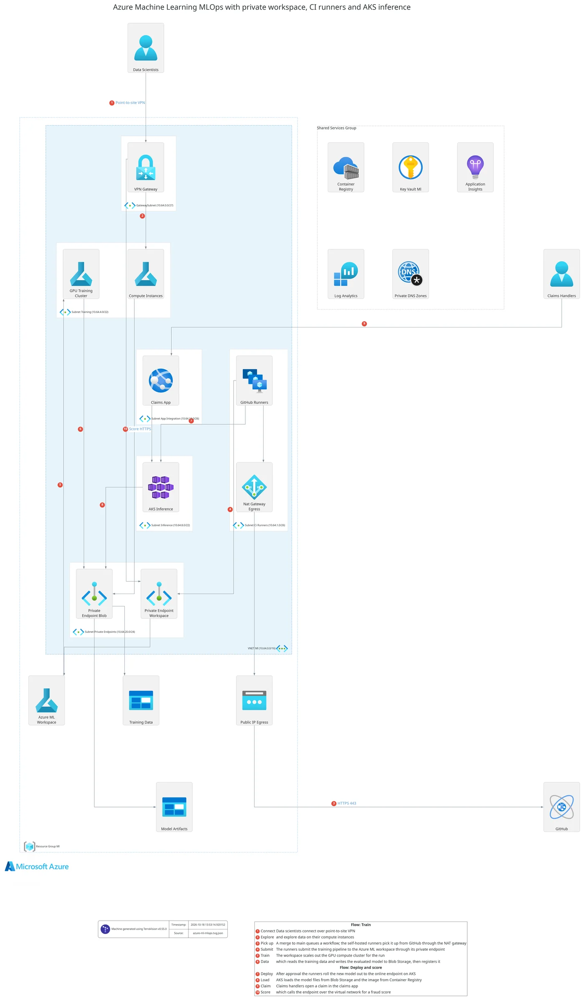{ width=1400 height=2394 loading=lazy .no-lightbox }](https://raw.githubusercontent.com/patrickchugh/terravision/main/examples/graphs/azure-ml-mlops.png)

**Ask your AI assistant:**

> Draw Azure Machine Learning MLOps with data scientists on point-to-site VPN, a VPN gateway, self-hosted GitHub runners on a VM scale set with a NAT gateway, a GPU compute cluster and compute instances in a training subnet, AKS inference with the Azure ML extension, an App Service claims app, private endpoints for the workspace and Blob Storage training data and models, and Container Registry, Key Vault and Application Insights as shared services.

**Or reproduce it exactly** from the source file [azure-ml-mlops.tvg.json](https://github.com/patrickchugh/terravision/blob/main/examples/graphs/azure-ml-mlops.tvg.json) and its title, CIDR ranges, arrow labels and numbered flow steps in [azure-ml-mlops.annotations.yml](https://github.com/patrickchugh/terravision/blob/main/examples/graphs/azure-ml-mlops.annotations.yml):

```bash
terravision draw --source azure-ml-mlops.tvg.json --annotate azure-ml-mlops.annotations.yml --format svg      # or png, pdf
terravision draw --source azure-ml-mlops.tvg.json --annotate azure-ml-mlops.annotations.yml --format drawio   # editable in draw.io or Lucidchart
```

Download: [PNG](https://raw.githubusercontent.com/patrickchugh/terravision/main/examples/graphs/azure-ml-mlops.png) · [SVG](https://raw.githubusercontent.com/patrickchugh/terravision/main/examples/graphs/azure-ml-mlops.svg) · [source graph](https://raw.githubusercontent.com/patrickchugh/terravision/main/examples/graphs/azure-ml-mlops.tvg.json) · [annotations: title, CIDR ranges, labels, flows](https://raw.githubusercontent.com/patrickchugh/terravision/main/examples/graphs/azure-ml-mlops.annotations.yml)

## Azure IoT telemetry architecture diagram { #azure-iot-telemetry-architecture-diagram }

Factory telemetry on Azure IoT. On the factory floor an IoT Edge gateway reads machine values from the PLCs' OPC UA server, gets its identity from the Device Provisioning Service and sends readings to IoT Hub over MQTT. IoT Hub routes every reading to Blob Storage for the archive and streams it into Azure Data Explorer, which plant engineers chart in Managed Grafana. Stream Analytics in the virtual network detects anomalies per machine and writes them to an Event Hub, where a function raises maintenance alerts. Another function keeps each machine's state in Azure Digital Twins, and the processing services reach IoT Hub, Event Hubs and Digital Twins through private endpoints.

[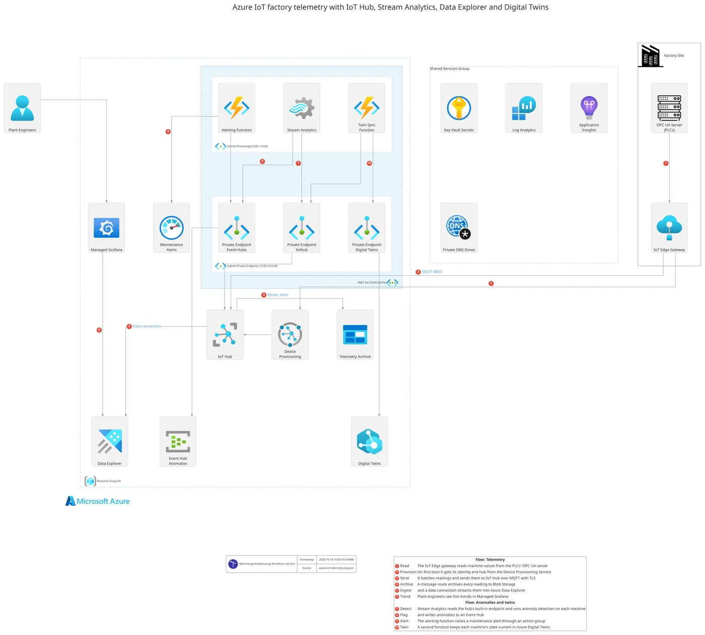{ width=1400 height=1264 loading=lazy .no-lightbox }](https://raw.githubusercontent.com/patrickchugh/terravision/main/examples/graphs/azure-iot-telemetry.png)

**Ask your AI assistant:**

> Draw Azure IoT factory telemetry with an OPC UA server and an IoT Edge gateway on the factory site, the Device Provisioning Service, IoT Hub routing to Blob Storage and a data connection to Azure Data Explorer, Stream Analytics anomaly detection writing to an Event Hub, alerting and Digital Twins sync Function Apps in a processing subnet, private endpoints, Managed Grafana for plant engineers, and a Monitor action group for maintenance alerts.

**Or reproduce it exactly** from the source file [azure-iot-telemetry.tvg.json](https://github.com/patrickchugh/terravision/blob/main/examples/graphs/azure-iot-telemetry.tvg.json) and its title, CIDR ranges, arrow labels and numbered flow steps in [azure-iot-telemetry.annotations.yml](https://github.com/patrickchugh/terravision/blob/main/examples/graphs/azure-iot-telemetry.annotations.yml):

```bash
terravision draw --source azure-iot-telemetry.tvg.json --annotate azure-iot-telemetry.annotations.yml --format svg      # or png, pdf
terravision draw --source azure-iot-telemetry.tvg.json --annotate azure-iot-telemetry.annotations.yml --format drawio   # editable in draw.io or Lucidchart
```

Download: [PNG](https://raw.githubusercontent.com/patrickchugh/terravision/main/examples/graphs/azure-iot-telemetry.png) · [SVG](https://raw.githubusercontent.com/patrickchugh/terravision/main/examples/graphs/azure-iot-telemetry.svg) · [source graph](https://raw.githubusercontent.com/patrickchugh/terravision/main/examples/graphs/azure-iot-telemetry.tvg.json) · [annotations: title, CIDR ranges, labels, flows](https://raw.githubusercontent.com/patrickchugh/terravision/main/examples/graphs/azure-iot-telemetry.annotations.yml)

## Azure ExpressRoute hybrid network architecture diagram { #azure-expressroute-hybrid-architecture-diagram }

A corporate data centre connected to an Azure hub-and-spoke network over ExpressRoute, with a site-to-site VPN as backup. The data centre's edge routers exchange routes with the ExpressRoute gateway over the circuit's private peering, and BGP moves traffic to the VPN gateway if the circuit fails. A route table on the gateway subnet sends traffic for the spokes through Azure Firewall, which allows it to an internal load balancer in front of ERP VMs in two availability zones, with SQL Managed Instance in a delegated subnet. The data centre's DNS servers forward Azure private zones to a DNS Private Resolver in the hub. Administrators reach the VMs only through Azure Bastion.

[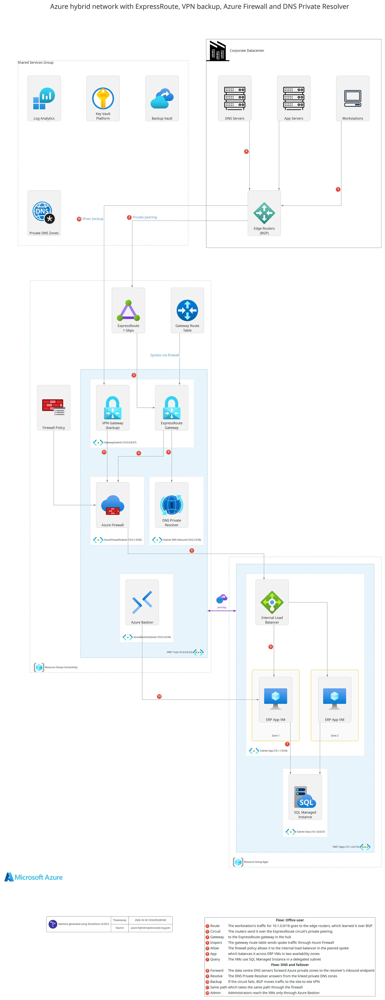{ width=1400 height=3627 loading=lazy .no-lightbox }](https://raw.githubusercontent.com/patrickchugh/terravision/main/examples/graphs/azure-hybrid-expressroute.png)

**Ask your AI assistant:**

> Draw an Azure ExpressRoute hybrid network with workstations, DNS and app servers and BGP edge routers in a corporate data centre, an ExpressRoute circuit to an ExpressRoute gateway, a backup site-to-site VPN gateway, a hub with Azure Firewall and its policy, a DNS Private Resolver and Bastion, a peered spoke with an internal load balancer, ERP VMs in two zones and SQL Managed Instance, and Log Analytics and a backup vault as shared services.

**Or reproduce it exactly** from the source file [azure-hybrid-expressroute.tvg.json](https://github.com/patrickchugh/terravision/blob/main/examples/graphs/azure-hybrid-expressroute.tvg.json) and its title, CIDR ranges, arrow labels and numbered flow steps in [azure-hybrid-expressroute.annotations.yml](https://github.com/patrickchugh/terravision/blob/main/examples/graphs/azure-hybrid-expressroute.annotations.yml):

```bash
terravision draw --source azure-hybrid-expressroute.tvg.json --annotate azure-hybrid-expressroute.annotations.yml --format svg      # or png, pdf
terravision draw --source azure-hybrid-expressroute.tvg.json --annotate azure-hybrid-expressroute.annotations.yml --format drawio   # editable in draw.io or Lucidchart
```

Download: [PNG](https://raw.githubusercontent.com/patrickchugh/terravision/main/examples/graphs/azure-hybrid-expressroute.png) · [SVG](https://raw.githubusercontent.com/patrickchugh/terravision/main/examples/graphs/azure-hybrid-expressroute.svg) · [source graph](https://raw.githubusercontent.com/patrickchugh/terravision/main/examples/graphs/azure-hybrid-expressroute.tvg.json) · [annotations: title, CIDR ranges, labels, flows](https://raw.githubusercontent.com/patrickchugh/terravision/main/examples/graphs/azure-hybrid-expressroute.annotations.yml)

## Azure multi-region disaster recovery architecture diagram { #azure-multi-region-disaster-recovery-architecture-diagram }

An active-passive web application across two Azure regions, East US 2 and Central US. Azure Front Door with a WAF sends customers to the primary region's App Service while its health probes pass, and to the standby in Central US when they fail. Orders are in an Azure SQL failover group that geo-replicates to Central US and moves its read-write listener on failover, and documents are copied to the paired region by RA-GZRS storage. Sessions are in Cosmos DB replicated to both regions, so customers stay signed in through a failover. Traffic Manager does the same for partner webhooks to the worker Function Apps, and each region reaches its data through private endpoints.

[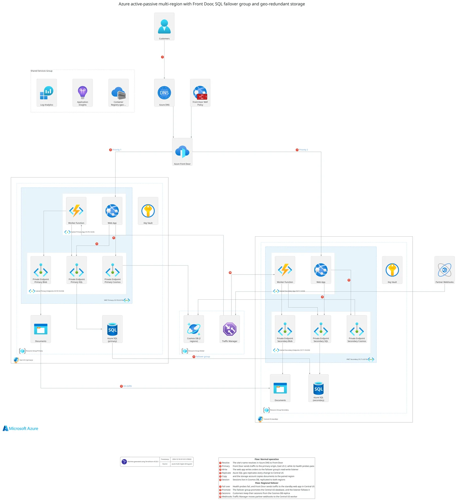{ width=1400 height=1535 loading=lazy .no-lightbox }](https://raw.githubusercontent.com/patrickchugh/terravision/main/examples/graphs/azure-multi-region-dr.png)

**Ask your AI assistant:**

> Draw an Azure active-passive multi-region design across East US 2 and Central US with Azure DNS and Front Door with WAF routing by priority to App Service web apps, worker Function Apps behind Traffic Manager for partner webhooks, an Azure SQL failover group, RA-GZRS Blob Storage, Cosmos DB in both regions, private endpoints and Key Vault in each region, and Log Analytics and a geo-replicated Container Registry as shared services.

**Or reproduce it exactly** from the source file [azure-multi-region-dr.tvg.json](https://github.com/patrickchugh/terravision/blob/main/examples/graphs/azure-multi-region-dr.tvg.json) and its title, CIDR ranges, arrow labels and numbered flow steps in [azure-multi-region-dr.annotations.yml](https://github.com/patrickchugh/terravision/blob/main/examples/graphs/azure-multi-region-dr.annotations.yml):

```bash
terravision draw --source azure-multi-region-dr.tvg.json --annotate azure-multi-region-dr.annotations.yml --format svg      # or png, pdf
terravision draw --source azure-multi-region-dr.tvg.json --annotate azure-multi-region-dr.annotations.yml --format drawio   # editable in draw.io or Lucidchart
```

Download: [PNG](https://raw.githubusercontent.com/patrickchugh/terravision/main/examples/graphs/azure-multi-region-dr.png) · [SVG](https://raw.githubusercontent.com/patrickchugh/terravision/main/examples/graphs/azure-multi-region-dr.svg) · [source graph](https://raw.githubusercontent.com/patrickchugh/terravision/main/examples/graphs/azure-multi-region-dr.tvg.json) · [annotations: title, CIDR ranges, labels, flows](https://raw.githubusercontent.com/patrickchugh/terravision/main/examples/graphs/azure-multi-region-dr.annotations.yml)

## Azure Static Web Apps with CI/CD architecture diagram { #azure-static-web-apps-cicd-architecture-diagram }

A content site on Azure Static Web Apps, delivered through Azure Front Door with a WAF and released by GitHub Actions. Front Door serves the pages from Static Web Apps and the media from a Blob container over Private Link, and visitors sign in with Entra External ID. Calls to /api go to a linked Function App with virtual network integration, which reads content from Cosmos DB and queues contact messages on Service Bus through private endpoints. A second function emails the team through Azure Communication Services from the NAT gateway's fixed IP. GitHub Actions deploys the site with pull request preview environments, and the API with an OIDC federated identity.

[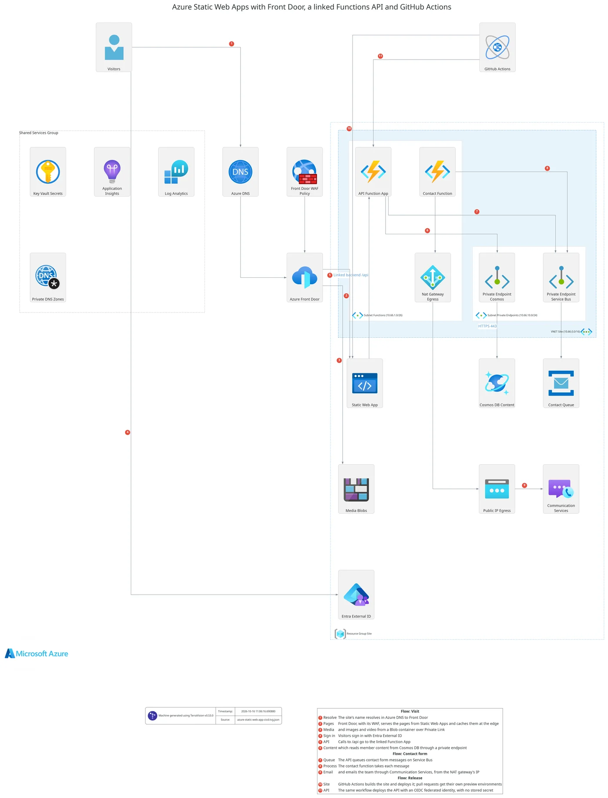{ width=1400 height=1836 loading=lazy .no-lightbox }](https://raw.githubusercontent.com/patrickchugh/terravision/main/examples/graphs/azure-static-web-app-cicd.png)

**Ask your AI assistant:**

> Draw Azure Static Web Apps with CI/CD: Azure DNS and Front Door with WAF serving the site and a Blob media container, Entra External ID sign-in, a linked API Function App and a contact Function App in a VNet integration subnet, private endpoints for Cosmos DB and a Service Bus queue, a NAT gateway to Communication Services email, GitHub Actions deploying with OIDC, and Key Vault and Application Insights as shared services.

**Or reproduce it exactly** from the source file [azure-static-web-app-cicd.tvg.json](https://github.com/patrickchugh/terravision/blob/main/examples/graphs/azure-static-web-app-cicd.tvg.json) and its title, CIDR ranges, arrow labels and numbered flow steps in [azure-static-web-app-cicd.annotations.yml](https://github.com/patrickchugh/terravision/blob/main/examples/graphs/azure-static-web-app-cicd.annotations.yml):

```bash
terravision draw --source azure-static-web-app-cicd.tvg.json --annotate azure-static-web-app-cicd.annotations.yml --format svg      # or png, pdf
terravision draw --source azure-static-web-app-cicd.tvg.json --annotate azure-static-web-app-cicd.annotations.yml --format drawio   # editable in draw.io or Lucidchart
```

Download: [PNG](https://raw.githubusercontent.com/patrickchugh/terravision/main/examples/graphs/azure-static-web-app-cicd.png) · [SVG](https://raw.githubusercontent.com/patrickchugh/terravision/main/examples/graphs/azure-static-web-app-cicd.svg) · [source graph](https://raw.githubusercontent.com/patrickchugh/terravision/main/examples/graphs/azure-static-web-app-cicd.tvg.json) · [annotations: title, CIDR ranges, labels, flows](https://raw.githubusercontent.com/patrickchugh/terravision/main/examples/graphs/azure-static-web-app-cicd.annotations.yml)

## Azure Batch HPC architecture diagram { #azure-batch-hpc-architecture-diagram }

Engineering simulation on Azure Batch, with the solver licences still served from the corporate data centre. Engineers submit jobs in a portal on App Service, which uploads the input model to Blob Storage and creates a Batch job through private endpoints. Batch schedules the tasks on a dedicated HBv4 pool that autoscales on pending work, and on a Spot pool for low-priority tasks, requeuing any that are evicted. The nodes share scratch files on Azure NetApp Files in its delegated subnet, pull solver images from Container Registry, and check out licences from the FlexLM server over a site-to-site VPN. Results go back to Blob Storage for engineers to download.

[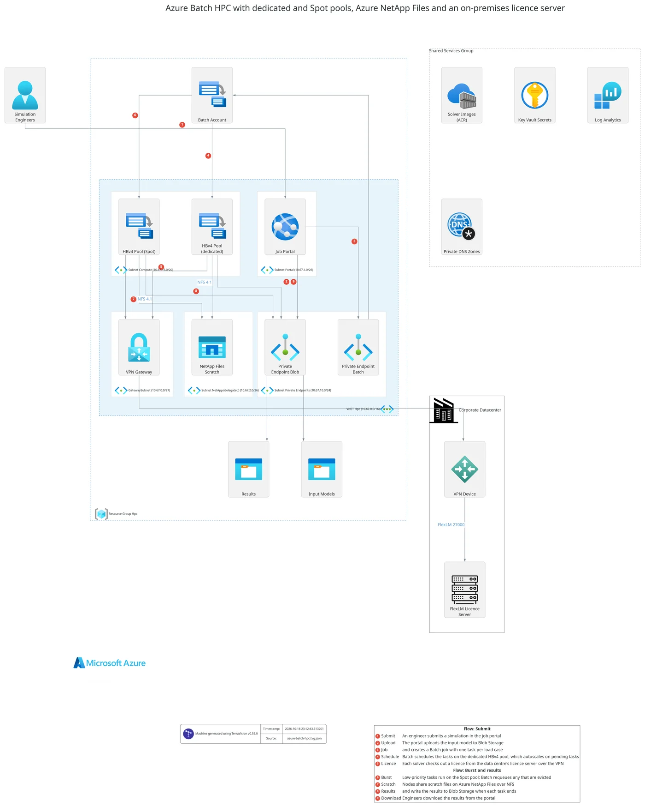{ width=1400 height=1748 loading=lazy .no-lightbox }](https://raw.githubusercontent.com/patrickchugh/terravision/main/examples/graphs/azure-batch-hpc.png)

**Ask your AI assistant:**

> Draw Azure Batch HPC with simulation engineers using an App Service job portal, a Batch account with dedicated and Spot HBv4 pools in a compute subnet, Azure NetApp Files scratch in a delegated subnet, Blob Storage inputs and results, private endpoints for Batch and Blob Storage, a VPN gateway to a FlexLM licence server in the corporate data centre, and Container Registry, Key Vault and Log Analytics as shared services.

**Or reproduce it exactly** from the source file [azure-batch-hpc.tvg.json](https://github.com/patrickchugh/terravision/blob/main/examples/graphs/azure-batch-hpc.tvg.json) and its title, CIDR ranges, arrow labels and numbered flow steps in [azure-batch-hpc.annotations.yml](https://github.com/patrickchugh/terravision/blob/main/examples/graphs/azure-batch-hpc.annotations.yml):

```bash
terravision draw --source azure-batch-hpc.tvg.json --annotate azure-batch-hpc.annotations.yml --format svg      # or png, pdf
terravision draw --source azure-batch-hpc.tvg.json --annotate azure-batch-hpc.annotations.yml --format drawio   # editable in draw.io or Lucidchart
```

Download: [PNG](https://raw.githubusercontent.com/patrickchugh/terravision/main/examples/graphs/azure-batch-hpc.png) · [SVG](https://raw.githubusercontent.com/patrickchugh/terravision/main/examples/graphs/azure-batch-hpc.svg) · [source graph](https://raw.githubusercontent.com/patrickchugh/terravision/main/examples/graphs/azure-batch-hpc.tvg.json) · [annotations: title, CIDR ranges, labels, flows](https://raw.githubusercontent.com/patrickchugh/terravision/main/examples/graphs/azure-batch-hpc.annotations.yml)

## Azure SaaS multi-tenant architecture diagram { #azure-saas-multi-tenant-architecture-diagram }

A multi-tenant SaaS application on a shared AKS cluster, with a database per tenant. Azure Front Door serves every tenant's subdomain or custom domain with its own certificate and a WAF, and reaches the cluster's internal load balancer through a Private Link service. Tenant users sign in with Entra External ID, and the app reads each tenant's tier and feature flags from App Configuration. A tenant catalog in Azure SQL maps each tenant to its database, in an elastic pool for standard tenants or a dedicated database for premium ones. An onboarding function takes sign-ups from a Service Bus queue, creates the tenant's database and registers it, all through private endpoints.

[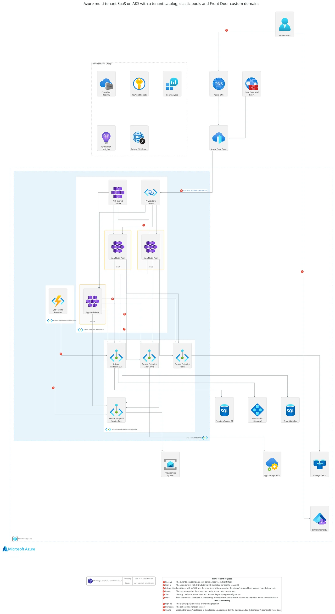{ width=1400 height=2560 loading=lazy .no-lightbox }](https://raw.githubusercontent.com/patrickchugh/terravision/main/examples/graphs/azure-saas-multi-tenant.png)

**Ask your AI assistant:**

> Draw an Azure multi-tenant SaaS application with Azure DNS and Front Door with WAF and custom domains per tenant, a Private Link service to an AKS cluster with node pools in three zones, Entra External ID sign-in, private endpoints for a tenant catalog in Azure SQL, an elastic pool and a premium tenant database, Azure Managed Redis, App Configuration and a Service Bus provisioning queue, an onboarding Function App, and Container Registry and Key Vault as shared services.

**Or reproduce it exactly** from the source file [azure-saas-multi-tenant.tvg.json](https://github.com/patrickchugh/terravision/blob/main/examples/graphs/azure-saas-multi-tenant.tvg.json) and its title, CIDR ranges, arrow labels and numbered flow steps in [azure-saas-multi-tenant.annotations.yml](https://github.com/patrickchugh/terravision/blob/main/examples/graphs/azure-saas-multi-tenant.annotations.yml):

```bash
terravision draw --source azure-saas-multi-tenant.tvg.json --annotate azure-saas-multi-tenant.annotations.yml --format svg      # or png, pdf
terravision draw --source azure-saas-multi-tenant.tvg.json --annotate azure-saas-multi-tenant.annotations.yml --format drawio   # editable in draw.io or Lucidchart
```

Download: [PNG](https://raw.githubusercontent.com/patrickchugh/terravision/main/examples/graphs/azure-saas-multi-tenant.png) · [SVG](https://raw.githubusercontent.com/patrickchugh/terravision/main/examples/graphs/azure-saas-multi-tenant.svg) · [source graph](https://raw.githubusercontent.com/patrickchugh/terravision/main/examples/graphs/azure-saas-multi-tenant.tvg.json) · [annotations: title, CIDR ranges, labels, flows](https://raw.githubusercontent.com/patrickchugh/terravision/main/examples/graphs/azure-saas-multi-tenant.annotations.yml)

## Azure payments processing architecture diagram { #azure-payments-processing-architecture-diagram }

A PCI DSS card payments platform with the cardholder data environment in its own spoke virtual network. Merchant checkouts reach the payment API on a private AKS cluster in two zones through Application Gateway with WAF v2, under a DDoS protection plan. The API tokenises card numbers with keys held in Managed HSM and stores tokens and transactions in Azure SQL with Always Encrypted, all through private endpoints. Every outbound call to the card networks and the acquirer leaves through Azure Firewall in the peered hub, which allows only those destinations. A settlement function batches captured payments from Service Bus and writes an audit trail to immutable Blob Storage, while Defender for Cloud and a PCI DSS policy assignment watch the environment.

[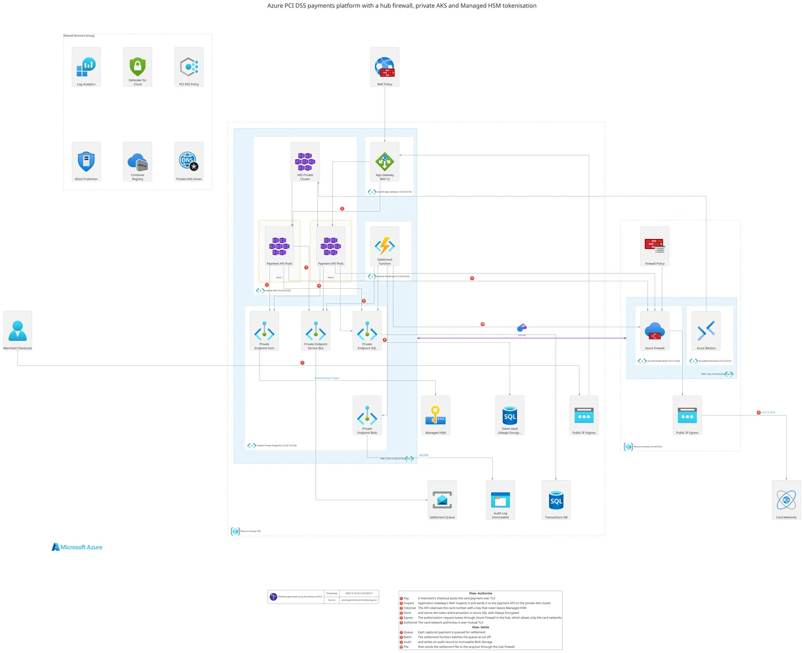{ width=1400 height=1137 loading=lazy .no-lightbox }](https://raw.githubusercontent.com/patrickchugh/terravision/main/examples/graphs/azure-payments-processing.png)

**Ask your AI assistant:**

> Draw an Azure PCI DSS payments platform with a hub virtual network holding Azure Firewall with its policy and Bastion, a peered cardholder data spoke with Application Gateway WAF v2, a private AKS cluster in two zones and a settlement Function App, private endpoints for Managed HSM, Azure SQL with Always Encrypted, a Service Bus queue and immutable Blob audit logs, egress to the card networks, and Defender for Cloud and DDoS protection as shared services.

**Or reproduce it exactly** from the source file [azure-payments-processing.tvg.json](https://github.com/patrickchugh/terravision/blob/main/examples/graphs/azure-payments-processing.tvg.json) and its title, CIDR ranges, arrow labels and numbered flow steps in [azure-payments-processing.annotations.yml](https://github.com/patrickchugh/terravision/blob/main/examples/graphs/azure-payments-processing.annotations.yml):

```bash
terravision draw --source azure-payments-processing.tvg.json --annotate azure-payments-processing.annotations.yml --format svg      # or png, pdf
terravision draw --source azure-payments-processing.tvg.json --annotate azure-payments-processing.annotations.yml --format drawio   # editable in draw.io or Lucidchart
```

Download: [PNG](https://raw.githubusercontent.com/patrickchugh/terravision/main/examples/graphs/azure-payments-processing.png) · [SVG](https://raw.githubusercontent.com/patrickchugh/terravision/main/examples/graphs/azure-payments-processing.svg) · [source graph](https://raw.githubusercontent.com/patrickchugh/terravision/main/examples/graphs/azure-payments-processing.tvg.json) · [annotations: title, CIDR ranges, labels, flows](https://raw.githubusercontent.com/patrickchugh/terravision/main/examples/graphs/azure-payments-processing.annotations.yml)

## Azure security monitoring with Microsoft Sentinel architecture diagram { #azure-security-monitoring-architecture-diagram }

Security monitoring for an Azure estate and a corporate data centre, centred on Microsoft Sentinel. Data centre firewalls and proxies send syslog across a site-to-site VPN to log forwarders in the hub, whose Azure Monitor Agent sends the events to the Sentinel workspace. Azure Firewall logs arrive through a diagnostic setting, VNet flow logs through traffic analytics, the subscription's activity log through an export, and Entra ID and Defender for Cloud through their data connectors. When an analytics rule finds an impossible-travel sign-in, an automation rule runs a Logic App playbook that blocks the source address in the firewall policy and notifies the SOC in Teams. Data export keeps the raw logs in Blob Storage for long-term retention.

[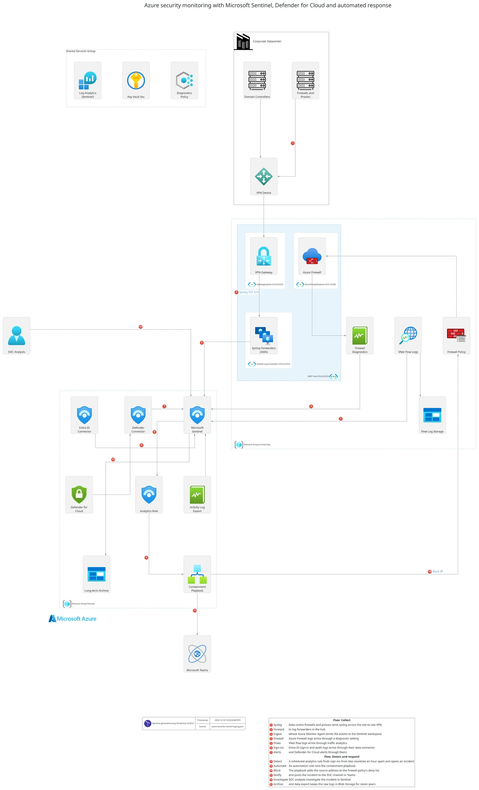{ width=1400 height=2308 loading=lazy .no-lightbox }](https://raw.githubusercontent.com/patrickchugh/terravision/main/examples/graphs/azure-security-monitoring.png)

**Ask your AI assistant:**

> Draw Azure security monitoring with Microsoft Sentinel collecting syslog from data centre firewalls over a site-to-site VPN to log forwarder VMs in the hub, Azure Firewall diagnostics, VNet flow logs, the activity log export, Entra ID and Defender for Cloud data connectors, an analytics rule triggering a Logic App containment playbook that blocks IPs in the firewall policy and notifies Teams, SOC analysts, and Blob Storage archive.

**Or reproduce it exactly** from the source file [azure-security-monitoring.tvg.json](https://github.com/patrickchugh/terravision/blob/main/examples/graphs/azure-security-monitoring.tvg.json) and its title, CIDR ranges, arrow labels and numbered flow steps in [azure-security-monitoring.annotations.yml](https://github.com/patrickchugh/terravision/blob/main/examples/graphs/azure-security-monitoring.annotations.yml):

```bash
terravision draw --source azure-security-monitoring.tvg.json --annotate azure-security-monitoring.annotations.yml --format svg      # or png, pdf
terravision draw --source azure-security-monitoring.tvg.json --annotate azure-security-monitoring.annotations.yml --format drawio   # editable in draw.io or Lucidchart
```

Download: [PNG](https://raw.githubusercontent.com/patrickchugh/terravision/main/examples/graphs/azure-security-monitoring.png) · [SVG](https://raw.githubusercontent.com/patrickchugh/terravision/main/examples/graphs/azure-security-monitoring.svg) · [source graph](https://raw.githubusercontent.com/patrickchugh/terravision/main/examples/graphs/azure-security-monitoring.tvg.json) · [annotations: title, CIDR ranges, labels, flows](https://raw.githubusercontent.com/patrickchugh/terravision/main/examples/graphs/azure-security-monitoring.annotations.yml)

## Azure video processing architecture diagram { #azure-video-processing-architecture-diagram }

Video upload, transcoding and streaming on Azure without a media service. Creators upload source videos straight to Blob Storage with a SAS URL from the studio app, and Event Grid delivers each BlobCreated event to a Service Bus queue. The queue starts a Container Apps job on a GPU workload profile, which runs FFmpeg to write an adaptive bitrate ladder as HLS and DASH, sends the video to Video Indexer for captions and topics, and publishes the title in a Cosmos DB catalogue. A second job makes the thumbnails. Viewers stream the segments through Azure Front Door, which reaches the renditions container over Private Link and caches it at the edge.

[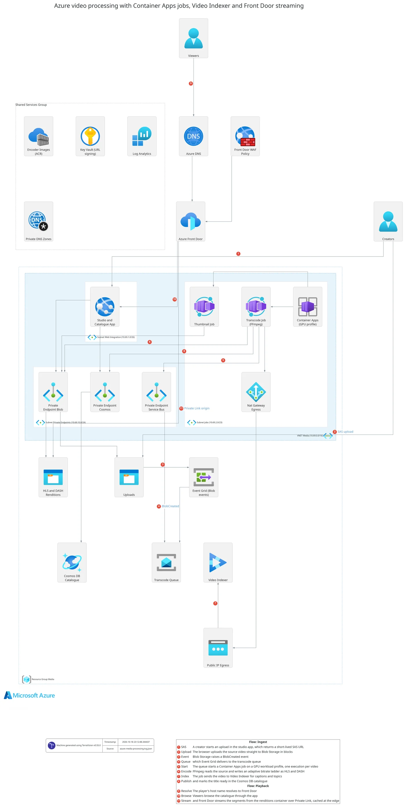{ width=1400 height=2775 loading=lazy .no-lightbox }](https://raw.githubusercontent.com/patrickchugh/terravision/main/examples/graphs/azure-media-processing.png)

**Ask your AI assistant:**

> Draw Azure video processing with creators uploading to Blob Storage with SAS from an App Service studio app, Event Grid Blob events to a Service Bus transcode queue, FFmpeg transcode and thumbnail Container Apps jobs on a GPU profile, Video Indexer through a NAT gateway, a Cosmos DB catalogue, private endpoints, Azure DNS and Front Door with WAF streaming HLS and DASH renditions over Private Link, and Container Registry and Key Vault as shared services.

**Or reproduce it exactly** from the source file [azure-media-processing.tvg.json](https://github.com/patrickchugh/terravision/blob/main/examples/graphs/azure-media-processing.tvg.json) and its title, CIDR ranges, arrow labels and numbered flow steps in [azure-media-processing.annotations.yml](https://github.com/patrickchugh/terravision/blob/main/examples/graphs/azure-media-processing.annotations.yml):

```bash
terravision draw --source azure-media-processing.tvg.json --annotate azure-media-processing.annotations.yml --format svg      # or png, pdf
terravision draw --source azure-media-processing.tvg.json --annotate azure-media-processing.annotations.yml --format drawio   # editable in draw.io or Lucidchart
```

Download: [PNG](https://raw.githubusercontent.com/patrickchugh/terravision/main/examples/graphs/azure-media-processing.png) · [SVG](https://raw.githubusercontent.com/patrickchugh/terravision/main/examples/graphs/azure-media-processing.svg) · [source graph](https://raw.githubusercontent.com/patrickchugh/terravision/main/examples/graphs/azure-media-processing.tvg.json) · [annotations: title, CIDR ranges, labels, flows](https://raw.githubusercontent.com/patrickchugh/terravision/main/examples/graphs/azure-media-processing.annotations.yml)

## Azure VM Scale Sets web application migration architecture diagram { #azure-vm-scale-sets-migration-architecture-diagram }

A web shop moved from a corporate data centre to Azure Virtual Machine Scale Sets across three availability zones. Azure Migrate replicates the web servers across a site-to-site VPN to its vault through a private endpoint, and Database Migration Service keeps Azure SQL in sync with the source SQL Server until cutover. Application Gateway with WAF v2 balances customers across the scale set, which autoscales on CPU and builds from images in a Compute Gallery. The instances share sessions in Azure Managed Redis and content on Azure Files, and query a zone-redundant Azure SQL database, all through private endpoints. Outbound payment calls leave through a NAT gateway, and administrators use Azure Bastion.

[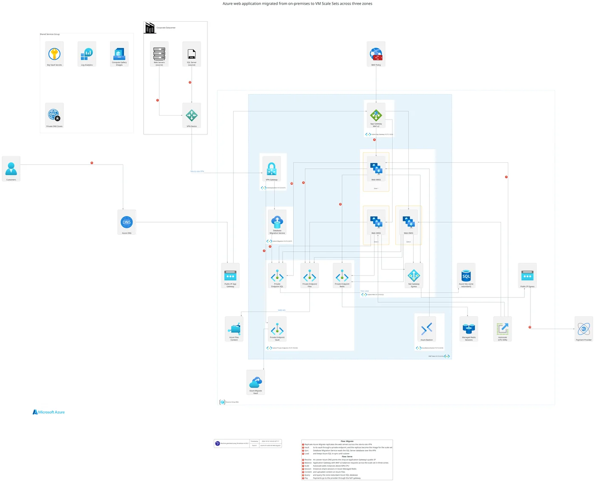{ width=1400 height=1134 loading=lazy .no-lightbox }](https://raw.githubusercontent.com/patrickchugh/terravision/main/examples/graphs/azure-vm-scale-set-web.png)

**Ask your AI assistant:**

> Draw an Azure web application migrated from a corporate data centre with web servers and SQL Server over a site-to-site VPN, an Azure Migrate vault and Database Migration Service, Azure DNS and Application Gateway WAF v2 in front of a Linux VM Scale Set across three zones with autoscale, private endpoints for zone-redundant Azure SQL, Azure Files and Managed Redis, a NAT gateway to the payment provider, Bastion, and a Compute Gallery as a shared service.

**Or reproduce it exactly** from the source file [azure-vm-scale-set-web.tvg.json](https://github.com/patrickchugh/terravision/blob/main/examples/graphs/azure-vm-scale-set-web.tvg.json) and its title, CIDR ranges, arrow labels and numbered flow steps in [azure-vm-scale-set-web.annotations.yml](https://github.com/patrickchugh/terravision/blob/main/examples/graphs/azure-vm-scale-set-web.annotations.yml):

```bash
terravision draw --source azure-vm-scale-set-web.tvg.json --annotate azure-vm-scale-set-web.annotations.yml --format svg      # or png, pdf
terravision draw --source azure-vm-scale-set-web.tvg.json --annotate azure-vm-scale-set-web.annotations.yml --format drawio   # editable in draw.io or Lucidchart
```

Download: [PNG](https://raw.githubusercontent.com/patrickchugh/terravision/main/examples/graphs/azure-vm-scale-set-web.png) · [SVG](https://raw.githubusercontent.com/patrickchugh/terravision/main/examples/graphs/azure-vm-scale-set-web.svg) · [source graph](https://raw.githubusercontent.com/patrickchugh/terravision/main/examples/graphs/azure-vm-scale-set-web.tvg.json) · [annotations: title, CIDR ranges, labels, flows](https://raw.githubusercontent.com/patrickchugh/terravision/main/examples/graphs/azure-vm-scale-set-web.annotations.yml)

## Google Cloud three-tier web application architecture diagram { #google-cloud-three-tier-web-application-architecture-diagram }

A three-tier web application on Google Cloud. A global HTTPS load balancer with Cloud Armor serves a React site from Cloud Storage and routes API traffic to a regional managed instance group whose VMs are spread across two zones in us-central1. Its autoscaler keeps average CPU near 60%, between two and ten VMs, and autohealing recreates any VM that fails the health check. Cloud Router and Cloud NAT give the VMs outbound access without external IPs. Cloud SQL and Memorystore sit on the VPC network on private IPs, alongside Secret Manager, logging and Artifact Registry.

[{ width=1400 height=1226 loading=lazy .no-lightbox }](https://raw.githubusercontent.com/patrickchugh/terravision/main/examples/graphs/gcp-three-tier.png)

**Ask your AI assistant:**

> Draw a GCP three-tier web app: a global HTTPS load balancer with Cloud Armor and a backend bucket serving a React site from Cloud Storage, a regional managed instance group across two zones that autoscales on CPU and autoheals on a health check, Cloud SQL and Memorystore on private IPs, Cloud Router and Cloud NAT, Secret Manager and Artifact Registry.

**Or reproduce it exactly** from the source file [gcp-three-tier.tvg.json](https://github.com/patrickchugh/terravision/blob/main/examples/graphs/gcp-three-tier.tvg.json) and its title, CIDR ranges, arrow labels and numbered flow steps in [gcp-three-tier.annotations.yml](https://github.com/patrickchugh/terravision/blob/main/examples/graphs/gcp-three-tier.annotations.yml):

```bash
terravision draw --source gcp-three-tier.tvg.json --annotate gcp-three-tier.annotations.yml --format svg      # or png, pdf
terravision draw --source gcp-three-tier.tvg.json --annotate gcp-three-tier.annotations.yml --format drawio   # editable in draw.io or Lucidchart
```

Download: [PNG](https://raw.githubusercontent.com/patrickchugh/terravision/main/examples/graphs/gcp-three-tier.png) · [SVG](https://raw.githubusercontent.com/patrickchugh/terravision/main/examples/graphs/gcp-three-tier.svg) · [source graph](https://raw.githubusercontent.com/patrickchugh/terravision/main/examples/graphs/gcp-three-tier.tvg.json) · [annotations: title, CIDR ranges, labels, flows](https://raw.githubusercontent.com/patrickchugh/terravision/main/examples/graphs/gcp-three-tier.annotations.yml)

## Google Cloud GKE microservices architecture diagram { #google-cloud-gke-architecture-diagram }

Microservices on Google Kubernetes Engine with private service access. A global HTTPS load balancer with Cloud Armor routes customers to a regional GKE cluster in europe-west2, whose application node pool spans three zones. The Horizontal Pod Autoscaler scales the storefront pods, and the cluster autoscaler adds and removes nodes in each zone to fit them. The nodes reach Cloud SQL through a Private Service Connect endpoint in their subnet, and Pub/Sub through a Private Service Connect endpoint for Google APIs, so no service traffic crosses the internet. Order events trigger a Cloud Run fulfilment service backed by Firestore and stream to BigQuery. Cloud Router and Cloud NAT provide egress, alongside Artifact Registry, Secret Manager and logging.

[{ width=1400 height=2864 loading=lazy .no-lightbox }](https://raw.githubusercontent.com/patrickchugh/terravision/main/examples/graphs/gcp-gke.png)

**Ask your AI assistant:**

> Draw a GKE microservices platform on Google Cloud: a global HTTPS load balancer with Cloud Armor, a regional GKE cluster with a node pool across three zones scaled by the cluster and Horizontal Pod Autoscalers, a Private Service Connect endpoint for Cloud SQL in the node subnet, a Private Service Connect endpoint for Google APIs used to reach Pub/Sub, Pub/Sub triggering a Cloud Run service that writes to Firestore, a BigQuery dataset, Cloud NAT, Artifact Registry and Secret Manager.

**Or reproduce it exactly** from the source file [gcp-gke.tvg.json](https://github.com/patrickchugh/terravision/blob/main/examples/graphs/gcp-gke.tvg.json) and its title, CIDR ranges, arrow labels and numbered flow steps in [gcp-gke.annotations.yml](https://github.com/patrickchugh/terravision/blob/main/examples/graphs/gcp-gke.annotations.yml):

```bash
terravision draw --source gcp-gke.tvg.json --annotate gcp-gke.annotations.yml --format svg      # or png, pdf
terravision draw --source gcp-gke.tvg.json --annotate gcp-gke.annotations.yml --format drawio   # editable in draw.io or Lucidchart
```

Download: [PNG](https://raw.githubusercontent.com/patrickchugh/terravision/main/examples/graphs/gcp-gke.png) · [SVG](https://raw.githubusercontent.com/patrickchugh/terravision/main/examples/graphs/gcp-gke.svg) · [source graph](https://raw.githubusercontent.com/patrickchugh/terravision/main/examples/graphs/gcp-gke.tvg.json) · [annotations: title, CIDR ranges, labels, flows](https://raw.githubusercontent.com/patrickchugh/terravision/main/examples/graphs/gcp-gke.annotations.yml)

## Google Cloud data pipeline architecture diagram { #google-cloud-data-pipeline-architecture-diagram }

A streaming and batch data platform on Google Cloud whose processing runs inside a VPC network. In europe-west2, a processing subnet holds a streaming Dataflow job, a batch Dataflow load and a Dataproc Serverless Spark transform, and an orchestration subnet holds Cloud Composer. The jobs reach Pub/Sub, Cloud Storage, BigQuery and Bigtable through a Private Service Connect endpoint for Google APIs, and Datastream captures changes from Cloud SQL on a private IP. BigQuery holds raw and curated datasets, Bigtable holds real-time features and Dataplex governs the lake. Looker dashboards, a Vertex AI churn model trained on the curated data and served from an endpoint, and a Cloud Run recommendations API serve the results.

[{ width=1400 height=1188 loading=lazy .no-lightbox }](https://raw.githubusercontent.com/patrickchugh/terravision/main/examples/graphs/gcp-data-pipeline.png)

**Ask your AI assistant:**

> Draw a Google Cloud data platform with processing in a VPC network: streaming and batch Dataflow jobs and a Dataproc Serverless transform in a processing subnet, Cloud Composer in an orchestration subnet, a Private Service Connect endpoint for Google APIs, and Cloud SQL on a private IP feeding Datastream. Pub/Sub and a Cloud Storage landing bucket for ingestion; raw and curated BigQuery datasets, Bigtable and Dataplex; Looker, Vertex AI and a Cloud Run API for serving.

**Or reproduce it exactly** from the source file [gcp-data-pipeline.tvg.json](https://github.com/patrickchugh/terravision/blob/main/examples/graphs/gcp-data-pipeline.tvg.json) and its title, CIDR ranges, arrow labels and numbered flow steps in [gcp-data-pipeline.annotations.yml](https://github.com/patrickchugh/terravision/blob/main/examples/graphs/gcp-data-pipeline.annotations.yml):

```bash
terravision draw --source gcp-data-pipeline.tvg.json --annotate gcp-data-pipeline.annotations.yml --format svg      # or png, pdf
terravision draw --source gcp-data-pipeline.tvg.json --annotate gcp-data-pipeline.annotations.yml --format drawio   # editable in draw.io or Lucidchart
```

Download: [PNG](https://raw.githubusercontent.com/patrickchugh/terravision/main/examples/graphs/gcp-data-pipeline.png) · [SVG](https://raw.githubusercontent.com/patrickchugh/terravision/main/examples/graphs/gcp-data-pipeline.svg) · [source graph](https://raw.githubusercontent.com/patrickchugh/terravision/main/examples/graphs/gcp-data-pipeline.tvg.json) · [annotations: title, CIDR ranges, labels, flows](https://raw.githubusercontent.com/patrickchugh/terravision/main/examples/graphs/gcp-data-pipeline.annotations.yml)

## Google Cloud serverless API architecture diagram { #google-cloud-serverless-api-architecture-diagram }

A serverless API on Google Cloud that keeps its service traffic on private paths. A global external Application Load Balancer with Cloud Armor sends requests through a serverless NEG to a Cloud Run service whose ingress accepts only the load balancer. Cloud Run and a Cloud Functions processor use Direct VPC egress into a subnet in us-central1, where they reach Memorystore on the VPC, Cloud SQL through a Private Service Connect endpoint, and Pub/Sub, BigQuery and Cloud Storage through a Private Service Connect endpoint for Google APIs. Eventarc delivers each Pub/Sub event to the processor, with a dead-letter topic for failures, and Cloud NAT handles outbound calls. A third flow shows Cloud Build deploying a new revision from Artifact Registry.

[{ width=1400 height=1726 loading=lazy .no-lightbox }](https://raw.githubusercontent.com/patrickchugh/terravision/main/examples/graphs/gcp-serverless-api.png)

**Ask your AI assistant:**

> Draw a serverless API on Google Cloud: a global HTTPS load balancer with Cloud Armor and a serverless NEG in front of Cloud Run, Cloud Run and a Cloud Function using Direct VPC egress into a subnet, Memorystore on the VPC, Cloud SQL Postgres through a Private Service Connect endpoint, a Private Service Connect endpoint for Google APIs, Pub/Sub with Eventarc and a dead-letter topic, BigQuery, Cloud Storage, Cloud NAT, and Cloud Build deploying from Artifact Registry.

**Or reproduce it exactly** from the source file [gcp-serverless-api.tvg.json](https://github.com/patrickchugh/terravision/blob/main/examples/graphs/gcp-serverless-api.tvg.json) and its title, CIDR ranges, arrow labels and numbered flow steps in [gcp-serverless-api.annotations.yml](https://github.com/patrickchugh/terravision/blob/main/examples/graphs/gcp-serverless-api.annotations.yml):

```bash
terravision draw --source gcp-serverless-api.tvg.json --annotate gcp-serverless-api.annotations.yml --format svg      # or png, pdf
terravision draw --source gcp-serverless-api.tvg.json --annotate gcp-serverless-api.annotations.yml --format drawio   # editable in draw.io or Lucidchart
```

Download: [PNG](https://raw.githubusercontent.com/patrickchugh/terravision/main/examples/graphs/gcp-serverless-api.png) · [SVG](https://raw.githubusercontent.com/patrickchugh/terravision/main/examples/graphs/gcp-serverless-api.svg) · [source graph](https://raw.githubusercontent.com/patrickchugh/terravision/main/examples/graphs/gcp-serverless-api.tvg.json) · [annotations: title, CIDR ranges, labels, flows](https://raw.githubusercontent.com/patrickchugh/terravision/main/examples/graphs/gcp-serverless-api.annotations.yml)

## Google Cloud Shared VPC landing zone architecture diagram { #google-cloud-shared-vpc-landing-zone-architecture-diagram }

A Google Cloud landing zone with one Shared VPC owned by a network host project and used by separate service projects. The VPC spans europe-west2 for production and europe-west1 for non-production, and HA VPN with Cloud Router connects it to the corporate data centre. Production VMs in two zones sit behind an internal load balancer in a shared subnet, and reach Cloud SQL in the prod service project through a Private Service Connect endpoint and Cloud Storage through the Google APIs endpoint. Developers use Cloud Workstations in the non-production subnet against their own project's database. A security project holds the organisation log sink, the Security Command Center notifications, the allowed-regions organisation policy and the VPC Service Controls perimeter.

[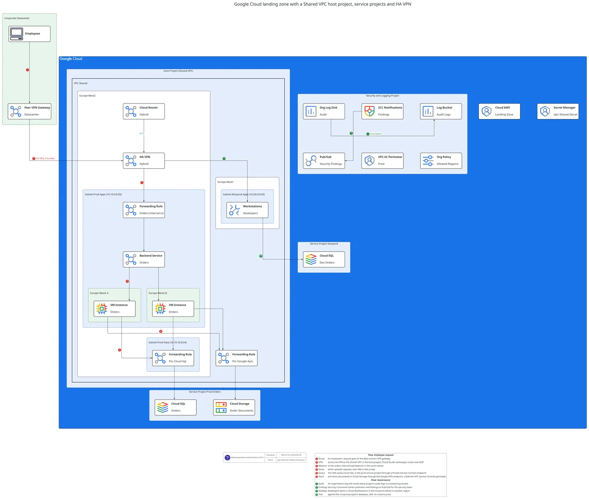{ width=1400 height=1186 loading=lazy .no-lightbox }](https://raw.githubusercontent.com/patrickchugh/terravision/main/examples/graphs/gcp-shared-vpc-landing-zone.png)

**Ask your AI assistant:**

> Draw a Google Cloud landing zone with a Shared VPC in a host project spanning europe-west2 and europe-west1, HA VPN and Cloud Router to a corporate data centre, prod VMs in two zones behind an internal load balancer, Private Service Connect endpoints for Cloud SQL and Google APIs, prod and nonprod service projects, Cloud Workstations, and a security project with an organisation log sink, Security Command Center notifications, organisation policy and a VPC Service Controls perimeter.

**Or reproduce it exactly** from the source file [gcp-shared-vpc-landing-zone.tvg.json](https://github.com/patrickchugh/terravision/blob/main/examples/graphs/gcp-shared-vpc-landing-zone.tvg.json) and its title, CIDR ranges, arrow labels and numbered flow steps in [gcp-shared-vpc-landing-zone.annotations.yml](https://github.com/patrickchugh/terravision/blob/main/examples/graphs/gcp-shared-vpc-landing-zone.annotations.yml):

```bash
terravision draw --source gcp-shared-vpc-landing-zone.tvg.json --annotate gcp-shared-vpc-landing-zone.annotations.yml --format svg      # or png, pdf
terravision draw --source gcp-shared-vpc-landing-zone.tvg.json --annotate gcp-shared-vpc-landing-zone.annotations.yml --format drawio   # editable in draw.io or Lucidchart
```

Download: [PNG](https://raw.githubusercontent.com/patrickchugh/terravision/main/examples/graphs/gcp-shared-vpc-landing-zone.png) · [SVG](https://raw.githubusercontent.com/patrickchugh/terravision/main/examples/graphs/gcp-shared-vpc-landing-zone.svg) · [source graph](https://raw.githubusercontent.com/patrickchugh/terravision/main/examples/graphs/gcp-shared-vpc-landing-zone.tvg.json) · [annotations: title, CIDR ranges, labels, flows](https://raw.githubusercontent.com/patrickchugh/terravision/main/examples/graphs/gcp-shared-vpc-landing-zone.annotations.yml)

## Google Cloud Run microservices architecture diagram { #google-cloud-run-microservices-architecture-diagram }

An online shop built as microservices on Cloud Run. A global external Application Load Balancer with Cloud Armor sends shoppers to the storefront through a serverless NEG, and the storefront calls the orders and payments services, which accept only internal traffic. The services reach the VPC through Direct VPC egress: Memorystore for sessions, Cloud SQL through a Private Service Connect endpoint, and Pub/Sub and Firestore through the Google APIs endpoint. Order events are pushed to a notifications service by a Pub/Sub subscription, and the payments service calls the payment provider through Cloud NAT. Cloud Build builds the images into Artifact Registry and Cloud Deploy rolls them out as a canary.

[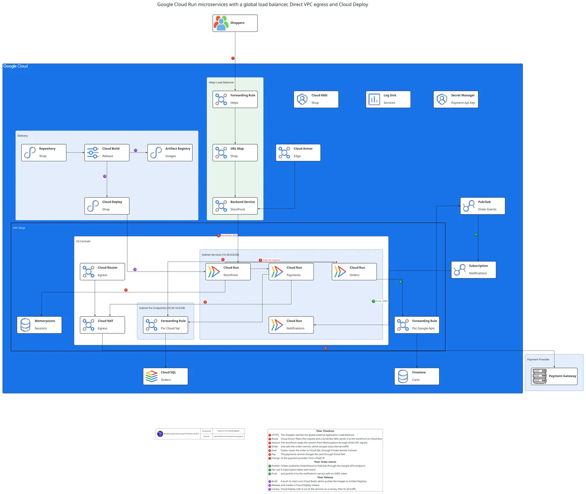{ width=1400 height=1179 loading=lazy .no-lightbox }](https://raw.githubusercontent.com/patrickchugh/terravision/main/examples/graphs/gcp-cloud-run-microservices.png)

**Ask your AI assistant:**

> Draw Google Cloud Run microservices with a global external Application Load Balancer, Cloud Armor and a serverless NEG to a storefront service, internal orders, payments and notifications services with Direct VPC egress in us-central1, Memorystore, Private Service Connect endpoints for Cloud SQL and Google APIs, Firestore, a Pub/Sub topic with a push subscription, Cloud NAT to a payment provider, and Cloud Build, Artifact Registry and Cloud Deploy for releases.

**Or reproduce it exactly** from the source file [gcp-cloud-run-microservices.tvg.json](https://github.com/patrickchugh/terravision/blob/main/examples/graphs/gcp-cloud-run-microservices.tvg.json) and its title, CIDR ranges, arrow labels and numbered flow steps in [gcp-cloud-run-microservices.annotations.yml](https://github.com/patrickchugh/terravision/blob/main/examples/graphs/gcp-cloud-run-microservices.annotations.yml):

```bash
terravision draw --source gcp-cloud-run-microservices.tvg.json --annotate gcp-cloud-run-microservices.annotations.yml --format svg      # or png, pdf
terravision draw --source gcp-cloud-run-microservices.tvg.json --annotate gcp-cloud-run-microservices.annotations.yml --format drawio   # editable in draw.io or Lucidchart
```

Download: [PNG](https://raw.githubusercontent.com/patrickchugh/terravision/main/examples/graphs/gcp-cloud-run-microservices.png) · [SVG](https://raw.githubusercontent.com/patrickchugh/terravision/main/examples/graphs/gcp-cloud-run-microservices.svg) · [source graph](https://raw.githubusercontent.com/patrickchugh/terravision/main/examples/graphs/gcp-cloud-run-microservices.tvg.json) · [annotations: title, CIDR ranges, labels, flows](https://raw.githubusercontent.com/patrickchugh/terravision/main/examples/graphs/gcp-cloud-run-microservices.annotations.yml)

## Google Cloud event-driven architecture diagram { #google-cloud-event-driven-architecture-diagram }

Event-driven invoice processing on Google Cloud. Suppliers upload invoice PDFs to Cloud Storage with signed URLs, and each upload fires an Eventarc trigger that runs an extract function. The function reads the invoice with a Document AI invoice parser, saves it in Firestore and publishes an event to Pub/Sub, where a BigQuery subscription records it and a dead-letter topic catches failures. A second trigger runs a validate function, which starts a Workflows approval for large invoices that waits for the finance team in a Cloud Run app. Approved invoices go to the ERP through Cloud NAT, the functions reach Google APIs through Private Google Access, and a nightly Cloud Run job reconciles payments.

[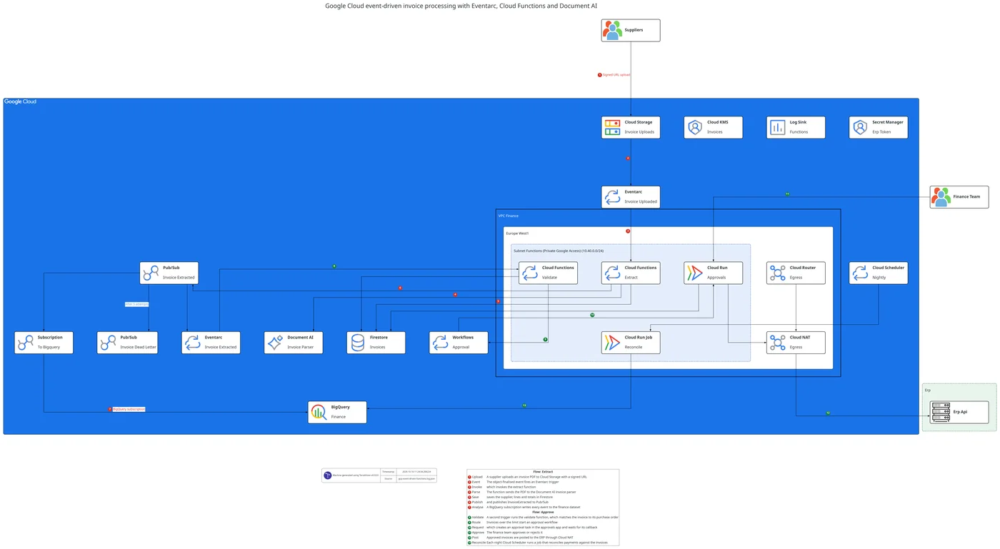{ width=1400 height=769 loading=lazy .no-lightbox }](https://raw.githubusercontent.com/patrickchugh/terravision/main/examples/graphs/gcp-event-driven-functions.png)

**Ask your AI assistant:**

> Draw Google Cloud event-driven invoice processing with suppliers uploading to Cloud Storage, an Eventarc trigger to an extract Cloud Function using a Document AI processor and Firestore, a Pub/Sub topic with a BigQuery subscription and a dead-letter topic, a second Eventarc trigger to a validate function, a Workflows approval with a Cloud Run approvals app for the finance team, a Cloud NAT path to the ERP, and a nightly Cloud Scheduler job running a Cloud Run job.

**Or reproduce it exactly** from the source file [gcp-event-driven-functions.tvg.json](https://github.com/patrickchugh/terravision/blob/main/examples/graphs/gcp-event-driven-functions.tvg.json) and its title, CIDR ranges, arrow labels and numbered flow steps in [gcp-event-driven-functions.annotations.yml](https://github.com/patrickchugh/terravision/blob/main/examples/graphs/gcp-event-driven-functions.annotations.yml):

```bash
terravision draw --source gcp-event-driven-functions.tvg.json --annotate gcp-event-driven-functions.annotations.yml --format svg      # or png, pdf
terravision draw --source gcp-event-driven-functions.tvg.json --annotate gcp-event-driven-functions.annotations.yml --format drawio   # editable in draw.io or Lucidchart
```

Download: [PNG](https://raw.githubusercontent.com/patrickchugh/terravision/main/examples/graphs/gcp-event-driven-functions.png) · [SVG](https://raw.githubusercontent.com/patrickchugh/terravision/main/examples/graphs/gcp-event-driven-functions.svg) · [source graph](https://raw.githubusercontent.com/patrickchugh/terravision/main/examples/graphs/gcp-event-driven-functions.tvg.json) · [annotations: title, CIDR ranges, labels, flows](https://raw.githubusercontent.com/patrickchugh/terravision/main/examples/graphs/gcp-event-driven-functions.annotations.yml)

## Google Cloud streaming analytics with BigQuery architecture diagram { #google-cloud-streaming-bigquery-architecture-diagram }

Real-time game telemetry on Google Cloud. Game clients send events to a global external load balancer with Cloud Armor rate limits, and a collector on Cloud Run checks each batch and publishes it to Pub/Sub, with a dead-letter topic for bad messages. A streaming Dataflow job reads the subscription with exactly-once processing, writes every event to BigQuery through the Storage Write API, and keeps each player's score and session in Bigtable. Dataflow also scores suspicious sessions with a cheat detection model on a Vertex AI endpoint. A leaderboard API on Cloud Run reads Bigtable in milliseconds, and analysts explore the BigQuery data in Looker.

[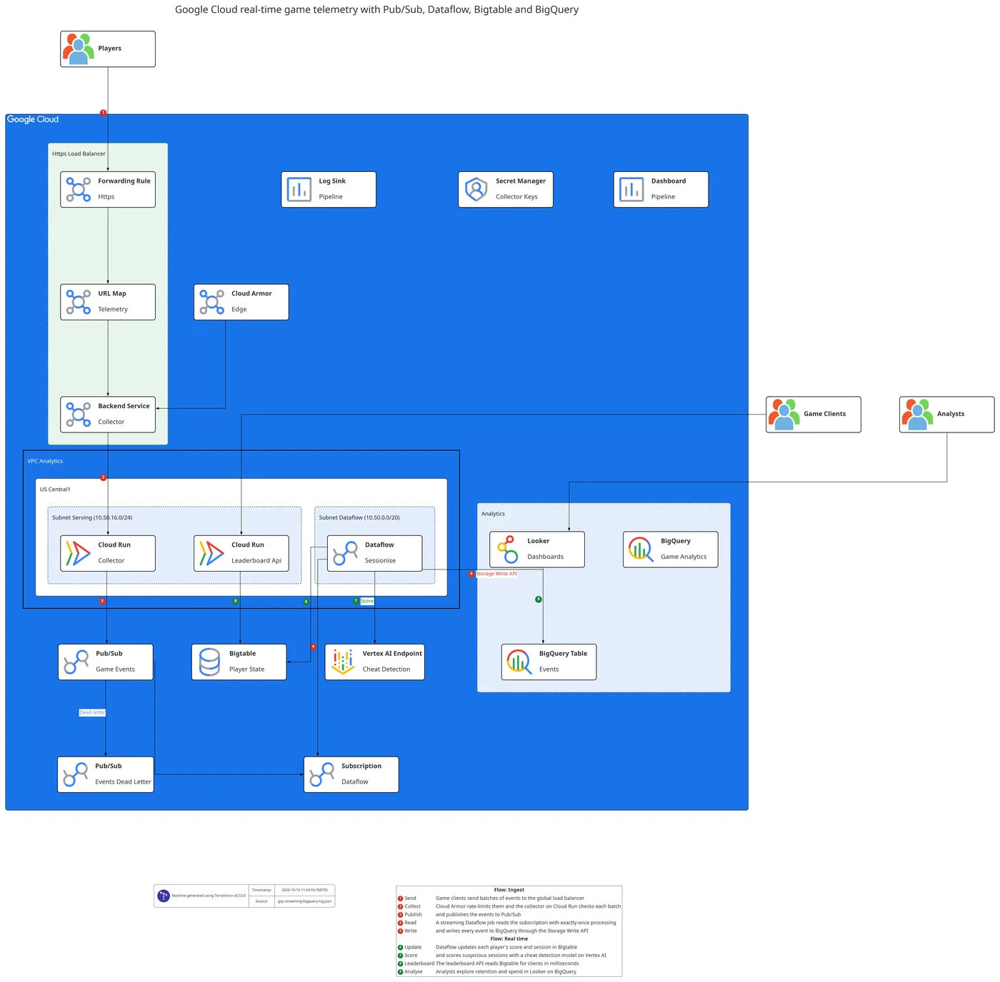{ width=1400 height=1376 loading=lazy .no-lightbox }](https://raw.githubusercontent.com/patrickchugh/terravision/main/examples/graphs/gcp-streaming-bigquery.png)

**Ask your AI assistant:**

> Draw Google Cloud real-time game telemetry with a global external load balancer and Cloud Armor in front of a Cloud Run collector, a Pub/Sub topic with a dead-letter topic, a streaming Dataflow job in its own subnet writing to a BigQuery table and Bigtable and scoring with a Vertex AI endpoint, a leaderboard API on Cloud Run reading Bigtable, Looker dashboards for analysts, and Secret Manager and Cloud Monitoring as shared services.

**Or reproduce it exactly** from the source file [gcp-streaming-bigquery.tvg.json](https://github.com/patrickchugh/terravision/blob/main/examples/graphs/gcp-streaming-bigquery.tvg.json) and its title, CIDR ranges, arrow labels and numbered flow steps in [gcp-streaming-bigquery.annotations.yml](https://github.com/patrickchugh/terravision/blob/main/examples/graphs/gcp-streaming-bigquery.annotations.yml):

```bash
terravision draw --source gcp-streaming-bigquery.tvg.json --annotate gcp-streaming-bigquery.annotations.yml --format svg      # or png, pdf
terravision draw --source gcp-streaming-bigquery.tvg.json --annotate gcp-streaming-bigquery.annotations.yml --format drawio   # editable in draw.io or Lucidchart
```

Download: [PNG](https://raw.githubusercontent.com/patrickchugh/terravision/main/examples/graphs/gcp-streaming-bigquery.png) · [SVG](https://raw.githubusercontent.com/patrickchugh/terravision/main/examples/graphs/gcp-streaming-bigquery.svg) · [source graph](https://raw.githubusercontent.com/patrickchugh/terravision/main/examples/graphs/gcp-streaming-bigquery.tvg.json) · [annotations: title, CIDR ranges, labels, flows](https://raw.githubusercontent.com/patrickchugh/terravision/main/examples/graphs/gcp-streaming-bigquery.annotations.yml)

## Google Cloud Vertex AI MLOps architecture diagram { #google-cloud-vertex-ai-mlops-architecture-diagram }

An MLOps platform on Vertex AI inside a VPC Service Controls perimeter. Data scientists reach Workbench notebooks through Identity-Aware Proxy, and a merge to main in GitHub runs Cloud Build, which builds the training image into Artifact Registry and starts a Vertex AI pipeline in the training subnet. The pipeline reads BigQuery and writes artifacts to Cloud Storage through the Google APIs endpoint, and registers the evaluated model. An approved version is deployed to a private Vertex AI endpoint, which the claims app on Cloud Run calls through a Private Service Connect address. The endpoint reads customer features from the Vertex AI online feature store and logs requests to BigQuery for monitoring.

[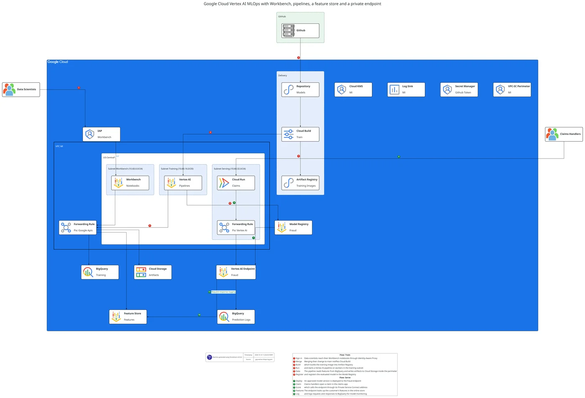{ width=1400 height=953 loading=lazy .no-lightbox }](https://raw.githubusercontent.com/patrickchugh/terravision/main/examples/graphs/gcp-vertex-mlops.png)

**Ask your AI assistant:**

> Draw Google Cloud Vertex AI MLOps with data scientists using Workbench through IAP, GitHub and a Cloud Build trigger building into Artifact Registry and starting Vertex AI Pipelines in a training subnet, BigQuery and Cloud Storage through a Private Service Connect Google APIs endpoint, the Model Registry, a Vertex AI endpoint behind a PSC address called by a Cloud Run claims app, a feature online store, BigQuery prediction logs, and a VPC Service Controls perimeter.

**Or reproduce it exactly** from the source file [gcp-vertex-mlops.tvg.json](https://github.com/patrickchugh/terravision/blob/main/examples/graphs/gcp-vertex-mlops.tvg.json) and its title, CIDR ranges, arrow labels and numbered flow steps in [gcp-vertex-mlops.annotations.yml](https://github.com/patrickchugh/terravision/blob/main/examples/graphs/gcp-vertex-mlops.annotations.yml):

```bash
terravision draw --source gcp-vertex-mlops.tvg.json --annotate gcp-vertex-mlops.annotations.yml --format svg      # or png, pdf
terravision draw --source gcp-vertex-mlops.tvg.json --annotate gcp-vertex-mlops.annotations.yml --format drawio   # editable in draw.io or Lucidchart
```

Download: [PNG](https://raw.githubusercontent.com/patrickchugh/terravision/main/examples/graphs/gcp-vertex-mlops.png) · [SVG](https://raw.githubusercontent.com/patrickchugh/terravision/main/examples/graphs/gcp-vertex-mlops.svg) · [source graph](https://raw.githubusercontent.com/patrickchugh/terravision/main/examples/graphs/gcp-vertex-mlops.tvg.json) · [annotations: title, CIDR ranges, labels, flows](https://raw.githubusercontent.com/patrickchugh/terravision/main/examples/graphs/gcp-vertex-mlops.annotations.yml)

## Google Cloud IoT telemetry architecture diagram { #google-cloud-iot-telemetry-architecture-diagram }

Factory telemetry on Google Cloud with self-managed MQTT brokers, the usual pattern since IoT Core was retired. Line sensors report to an edge gateway on the factory site, which connects over MQTT with TLS using a device certificate from Certificate Authority Service. A passthrough network load balancer spreads connections over brokers in two zones, and the brokers bridge every message to Pub/Sub. A streaming Dataflow job cleans the readings, writes them to Bigtable for time-series lookups and to BigQuery for Looker dashboards, and publishes anomalies to a second topic. A maintenance service on Cloud Run opens a work order in Firestore and pages the on-call engineer through Cloud NAT.

[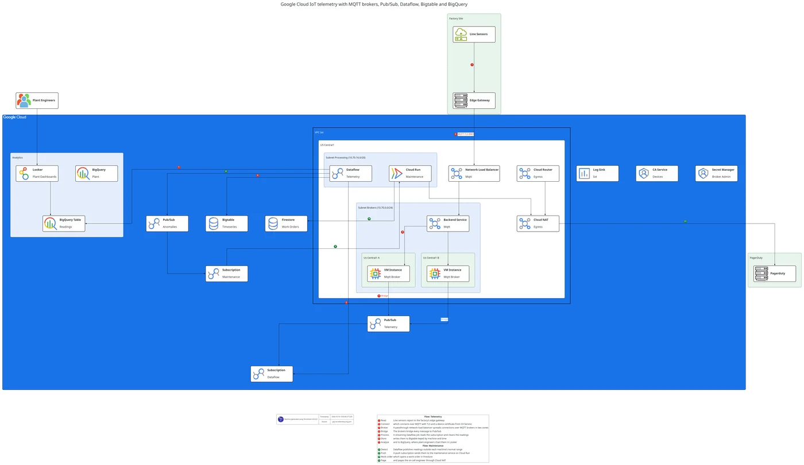{ width=1400 height=811 loading=lazy .no-lightbox }](https://raw.githubusercontent.com/patrickchugh/terravision/main/examples/graphs/gcp-iot-telemetry.png)

**Ask your AI assistant:**

> Draw Google Cloud IoT telemetry with line sensors and an edge gateway on a factory site, a passthrough network load balancer to MQTT broker VMs in two zones, CA Service device certificates, a Pub/Sub telemetry topic, a streaming Dataflow job writing to Bigtable and BigQuery and publishing anomalies, a Cloud Run maintenance service with Firestore work orders, Cloud NAT to PagerDuty, and Looker dashboards for plant engineers.

**Or reproduce it exactly** from the source file [gcp-iot-telemetry.tvg.json](https://github.com/patrickchugh/terravision/blob/main/examples/graphs/gcp-iot-telemetry.tvg.json) and its title, CIDR ranges, arrow labels and numbered flow steps in [gcp-iot-telemetry.annotations.yml](https://github.com/patrickchugh/terravision/blob/main/examples/graphs/gcp-iot-telemetry.annotations.yml):

```bash
terravision draw --source gcp-iot-telemetry.tvg.json --annotate gcp-iot-telemetry.annotations.yml --format svg      # or png, pdf
terravision draw --source gcp-iot-telemetry.tvg.json --annotate gcp-iot-telemetry.annotations.yml --format drawio   # editable in draw.io or Lucidchart
```

Download: [PNG](https://raw.githubusercontent.com/patrickchugh/terravision/main/examples/graphs/gcp-iot-telemetry.png) · [SVG](https://raw.githubusercontent.com/patrickchugh/terravision/main/examples/graphs/gcp-iot-telemetry.svg) · [source graph](https://raw.githubusercontent.com/patrickchugh/terravision/main/examples/graphs/gcp-iot-telemetry.tvg.json) · [annotations: title, CIDR ranges, labels, flows](https://raw.githubusercontent.com/patrickchugh/terravision/main/examples/graphs/gcp-iot-telemetry.annotations.yml)

## Google Cloud Interconnect hybrid network architecture diagram { #google-cloud-interconnect-hybrid-architecture-diagram }

A corporate data centre connected to Google Cloud over Dedicated Interconnect, with HA VPN as a backup. The data centre's edge routers use two VLAN attachments in different edge availability domains, and Cloud Router exchanges routes with them over BGP. Users reach an ERP behind an internal load balancer, on VMs in two zones that use Cloud SQL over private services access. Data centre DNS forwards Google Cloud zones to a Cloud DNS inbound server policy, and a forwarding zone sends corporate names back. Backups go to Cloud Storage through a Private Service Connect endpoint that Cloud Router advertises to the data centre.

[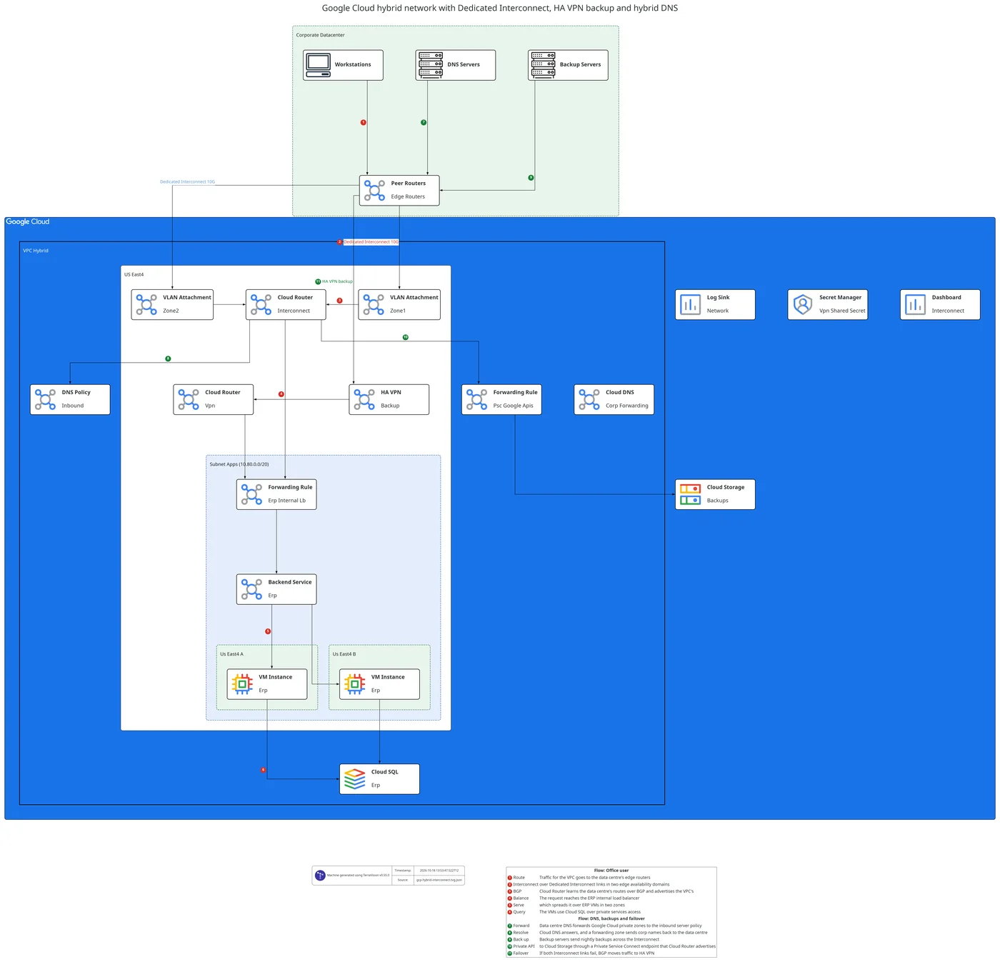{ width=1400 height=1347 loading=lazy .no-lightbox }](https://raw.githubusercontent.com/patrickchugh/terravision/main/examples/graphs/gcp-hybrid-interconnect.png)

**Ask your AI assistant:**

> Draw a Google Cloud hybrid network with workstations, DNS and backup servers and edge routers in a corporate data centre, Dedicated Interconnect VLAN attachments in two edge availability domains to a Cloud Router, an HA VPN gateway with its own Cloud Router as backup, an ERP internal load balancer and VMs in two zones, Cloud SQL, a Cloud DNS inbound policy and forwarding zone, and a Private Service Connect endpoint to Cloud Storage.

**Or reproduce it exactly** from the source file [gcp-hybrid-interconnect.tvg.json](https://github.com/patrickchugh/terravision/blob/main/examples/graphs/gcp-hybrid-interconnect.tvg.json) and its title, CIDR ranges, arrow labels and numbered flow steps in [gcp-hybrid-interconnect.annotations.yml](https://github.com/patrickchugh/terravision/blob/main/examples/graphs/gcp-hybrid-interconnect.annotations.yml):

```bash
terravision draw --source gcp-hybrid-interconnect.tvg.json --annotate gcp-hybrid-interconnect.annotations.yml --format svg      # or png, pdf
terravision draw --source gcp-hybrid-interconnect.tvg.json --annotate gcp-hybrid-interconnect.annotations.yml --format drawio   # editable in draw.io or Lucidchart
```

Download: [PNG](https://raw.githubusercontent.com/patrickchugh/terravision/main/examples/graphs/gcp-hybrid-interconnect.png) · [SVG](https://raw.githubusercontent.com/patrickchugh/terravision/main/examples/graphs/gcp-hybrid-interconnect.svg) · [source graph](https://raw.githubusercontent.com/patrickchugh/terravision/main/examples/graphs/gcp-hybrid-interconnect.tvg.json) · [annotations: title, CIDR ranges, labels, flows](https://raw.githubusercontent.com/patrickchugh/terravision/main/examples/graphs/gcp-hybrid-interconnect.annotations.yml)

## Google Cloud multi-region disaster recovery architecture diagram { #google-cloud-multi-region-disaster-recovery-architecture-diagram }

A shop served from two Google Cloud regions, us-east1 and us-west1, in one global VPC. A global external Application Load Balancer with Cloud Armor sends each customer to the nearest healthy region's Cloud Run service through serverless NEGs. Sessions are in multi-region Firestore and invoices in a dual-region bucket, so either region can serve anyone, while orders are written to a Cloud SQL primary in us-east1 that replicates to a read replica in us-west1. If us-east1 is lost, the load balancer moves all traffic to us-west1, and an uptime check fires an alert that runs a Workflows failover to promote the replica. Each region has its own Memorystore cache and Pub/Sub workers.

[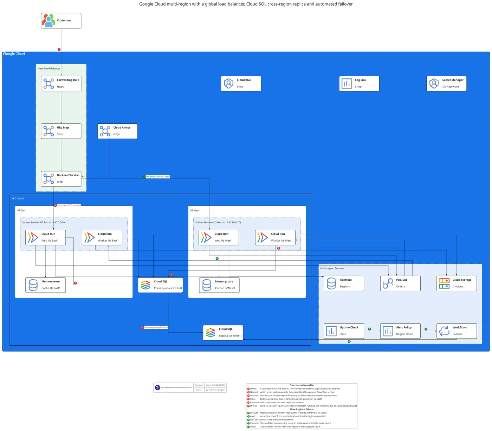{ width=1400 height=1227 loading=lazy .no-lightbox }](https://raw.githubusercontent.com/patrickchugh/terravision/main/examples/graphs/gcp-multi-region-dr.png)

**Ask your AI assistant:**

> Draw a Google Cloud multi-region design in one global VPC with us-east1 and us-west1, a global external Application Load Balancer with Cloud Armor and serverless NEGs to Cloud Run web services in each region, Cloud Run workers and Memorystore per region, a Cloud SQL primary with a cross-region read replica, multi-region Firestore sessions, Pub/Sub, a dual-region Cloud Storage bucket, and an uptime check and alert policy starting a Workflows failover.

**Or reproduce it exactly** from the source file [gcp-multi-region-dr.tvg.json](https://github.com/patrickchugh/terravision/blob/main/examples/graphs/gcp-multi-region-dr.tvg.json) and its title, CIDR ranges, arrow labels and numbered flow steps in [gcp-multi-region-dr.annotations.yml](https://github.com/patrickchugh/terravision/blob/main/examples/graphs/gcp-multi-region-dr.annotations.yml):

```bash
terravision draw --source gcp-multi-region-dr.tvg.json --annotate gcp-multi-region-dr.annotations.yml --format svg      # or png, pdf
terravision draw --source gcp-multi-region-dr.tvg.json --annotate gcp-multi-region-dr.annotations.yml --format drawio   # editable in draw.io or Lucidchart
```

Download: [PNG](https://raw.githubusercontent.com/patrickchugh/terravision/main/examples/graphs/gcp-multi-region-dr.png) · [SVG](https://raw.githubusercontent.com/patrickchugh/terravision/main/examples/graphs/gcp-multi-region-dr.svg) · [source graph](https://raw.githubusercontent.com/patrickchugh/terravision/main/examples/graphs/gcp-multi-region-dr.tvg.json) · [annotations: title, CIDR ranges, labels, flows](https://raw.githubusercontent.com/patrickchugh/terravision/main/examples/graphs/gcp-multi-region-dr.annotations.yml)

## Google Cloud static website with CI/CD architecture diagram { #google-cloud-static-site-cicd-architecture-diagram }

A static website on Cloud Storage behind a global external Application Load Balancer with Cloud CDN, released from GitHub by Cloud Build. Cloud DNS points the site at the load balancer, whose HTTPS proxy uses a Certificate Manager certificate, and the URL map serves pages from a backend bucket and sends /api calls through Cloud Armor to an API on Cloud Run. Members sign in with Identity Platform, the API reads content from Firestore, and contact form messages go through Pub/Sub to a function that emails the team. Each pull request builds a preview copy of the site, and a merge to main publishes the site, invalidates the CDN cache and deploys the API.

[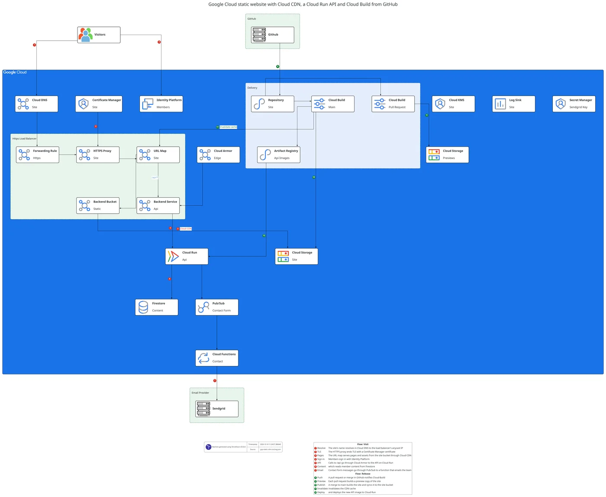{ width=1400 height=1149 loading=lazy .no-lightbox }](https://raw.githubusercontent.com/patrickchugh/terravision/main/examples/graphs/gcp-static-site-cicd.png)

**Ask your AI assistant:**

> Draw a Google Cloud static website with Cloud DNS, a global external Application Load Balancer with a Certificate Manager certificate, a backend bucket with Cloud CDN for a Cloud Storage site bucket, a Cloud Armor protected Cloud Run API with Firestore, Identity Platform sign-in, Pub/Sub and a Cloud Function emailing contact forms, and GitHub with Cloud Build triggers publishing the site, preview builds, cache invalidation and Artifact Registry.

**Or reproduce it exactly** from the source file [gcp-static-site-cicd.tvg.json](https://github.com/patrickchugh/terravision/blob/main/examples/graphs/gcp-static-site-cicd.tvg.json) and its title, CIDR ranges, arrow labels and numbered flow steps in [gcp-static-site-cicd.annotations.yml](https://github.com/patrickchugh/terravision/blob/main/examples/graphs/gcp-static-site-cicd.annotations.yml):

```bash
terravision draw --source gcp-static-site-cicd.tvg.json --annotate gcp-static-site-cicd.annotations.yml --format svg      # or png, pdf
terravision draw --source gcp-static-site-cicd.tvg.json --annotate gcp-static-site-cicd.annotations.yml --format drawio   # editable in draw.io or Lucidchart
```

Download: [PNG](https://raw.githubusercontent.com/patrickchugh/terravision/main/examples/graphs/gcp-static-site-cicd.png) · [SVG](https://raw.githubusercontent.com/patrickchugh/terravision/main/examples/graphs/gcp-static-site-cicd.svg) · [source graph](https://raw.githubusercontent.com/patrickchugh/terravision/main/examples/graphs/gcp-static-site-cicd.tvg.json) · [annotations: title, CIDR ranges, labels, flows](https://raw.githubusercontent.com/patrickchugh/terravision/main/examples/graphs/gcp-static-site-cicd.annotations.yml)

## Google Cloud Batch HPC architecture diagram { #google-cloud-batch-hpc-architecture-diagram }

A nightly Monte Carlo risk simulation on Google Cloud Batch. At close of market Cloud Scheduler starts a Workflows run, which exports the day's market data from BigQuery as scenario files and submits a Batch job with thousands of tasks. Batch runs them on Spot VMs across three zones in a Private Google Access subnet, retrying any task whose VM is preempted, with the engine image from Artifact Registry. The tasks share intermediate files on Managed Lustre and write value-at-risk results to BigQuery. The workflow reports the run's status to a risk portal on Cloud Run, where analysts can start ad-hoc runs, and they read the reports in Looker.

[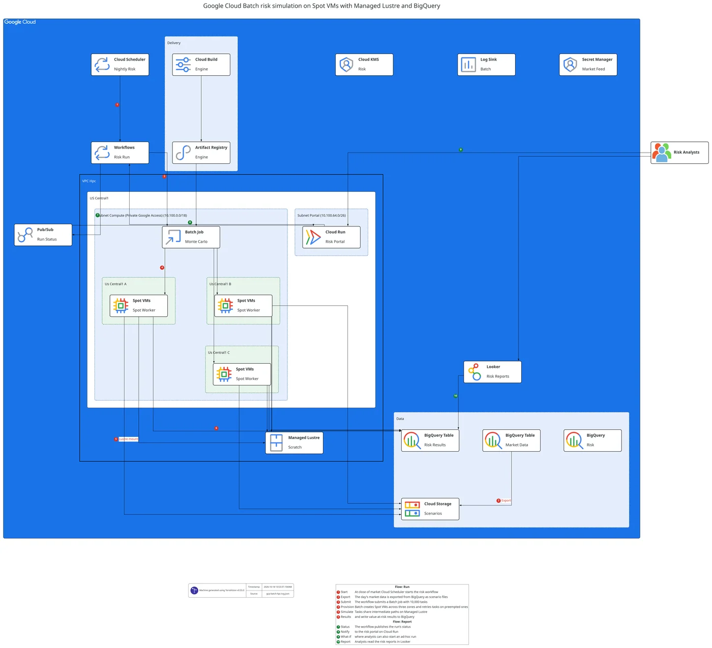{ width=1400 height=1274 loading=lazy .no-lightbox }](https://raw.githubusercontent.com/patrickchugh/terravision/main/examples/graphs/gcp-batch-hpc.png)

**Ask your AI assistant:**

> Draw Google Cloud Batch HPC for nightly Monte Carlo risk with Cloud Scheduler starting a Workflows run, a Batch job on Spot VMs across three zones in a Private Google Access subnet, Managed Lustre scratch, BigQuery market data exported to Cloud Storage scenarios and value-at-risk results in BigQuery, a Pub/Sub status topic, a Cloud Run risk portal, Looker reports, and Cloud Build with Artifact Registry for the engine image.

**Or reproduce it exactly** from the source file [gcp-batch-hpc.tvg.json](https://github.com/patrickchugh/terravision/blob/main/examples/graphs/gcp-batch-hpc.tvg.json) and its title, CIDR ranges, arrow labels and numbered flow steps in [gcp-batch-hpc.annotations.yml](https://github.com/patrickchugh/terravision/blob/main/examples/graphs/gcp-batch-hpc.annotations.yml):

```bash
terravision draw --source gcp-batch-hpc.tvg.json --annotate gcp-batch-hpc.annotations.yml --format svg      # or png, pdf
terravision draw --source gcp-batch-hpc.tvg.json --annotate gcp-batch-hpc.annotations.yml --format drawio   # editable in draw.io or Lucidchart
```

Download: [PNG](https://raw.githubusercontent.com/patrickchugh/terravision/main/examples/graphs/gcp-batch-hpc.png) · [SVG](https://raw.githubusercontent.com/patrickchugh/terravision/main/examples/graphs/gcp-batch-hpc.svg) · [source graph](https://raw.githubusercontent.com/patrickchugh/terravision/main/examples/graphs/gcp-batch-hpc.tvg.json) · [annotations: title, CIDR ranges, labels, flows](https://raw.githubusercontent.com/patrickchugh/terravision/main/examples/graphs/gcp-batch-hpc.annotations.yml)

## Google Cloud SaaS multi-tenant architecture diagram { #google-cloud-saas-multi-tenant-architecture-diagram }

A multi-tenant SaaS application on Google Cloud with pooled and silo tiers. Each tenant's users sign in to their own Identity Platform tenant, and a global external load balancer serves every tenant domain from a Certificate Manager map. Shared-tier tenants go to a pooled Cloud Run service that looks the tenant up in Firestore and reads AlloyDB with row-level security, while a premium tenant's host name routes to its own service and its own Cloud SQL in a separate project, encrypted with its own key. An onboarding service takes sign-ups from Pub/Sub, creates the Identity Platform tenant, and for premium tenants runs Terraform in Cloud Build to create the silo project. Usage events from both tiers go to BigQuery for billing.

[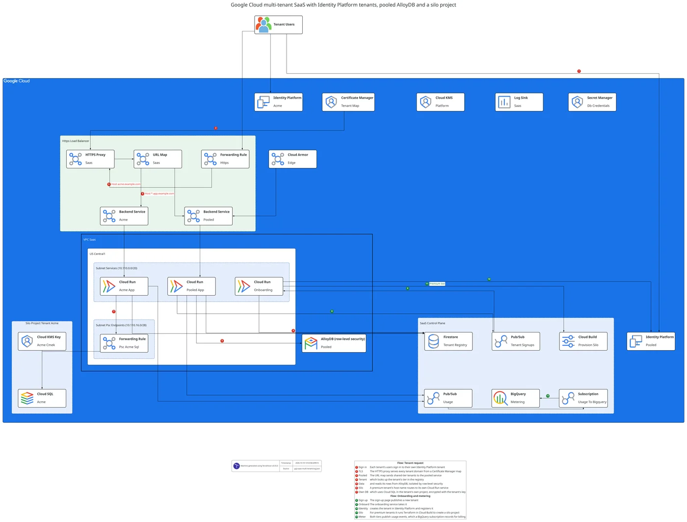{ width=1400 height=1063 loading=lazy .no-lightbox }](https://raw.githubusercontent.com/patrickchugh/terravision/main/examples/graphs/gcp-saas-multi-tenant.png)

**Ask your AI assistant:**

> Draw a Google Cloud multi-tenant SaaS with Identity Platform tenants, a global external load balancer with a Certificate Manager map and host rules, pooled and silo Cloud Run services with Direct VPC egress, AlloyDB with row-level security, a premium tenant project with Cloud SQL through Private Service Connect and a CMEK key, a Firestore tenant registry, a Pub/Sub onboarding service with a Cloud Build silo trigger, and usage metering into BigQuery.

**Or reproduce it exactly** from the source file [gcp-saas-multi-tenant.tvg.json](https://github.com/patrickchugh/terravision/blob/main/examples/graphs/gcp-saas-multi-tenant.tvg.json) and its title, CIDR ranges, arrow labels and numbered flow steps in [gcp-saas-multi-tenant.annotations.yml](https://github.com/patrickchugh/terravision/blob/main/examples/graphs/gcp-saas-multi-tenant.annotations.yml):

```bash
terravision draw --source gcp-saas-multi-tenant.tvg.json --annotate gcp-saas-multi-tenant.annotations.yml --format svg      # or png, pdf
terravision draw --source gcp-saas-multi-tenant.tvg.json --annotate gcp-saas-multi-tenant.annotations.yml --format drawio   # editable in draw.io or Lucidchart
```

Download: [PNG](https://raw.githubusercontent.com/patrickchugh/terravision/main/examples/graphs/gcp-saas-multi-tenant.png) · [SVG](https://raw.githubusercontent.com/patrickchugh/terravision/main/examples/graphs/gcp-saas-multi-tenant.svg) · [source graph](https://raw.githubusercontent.com/patrickchugh/terravision/main/examples/graphs/gcp-saas-multi-tenant.tvg.json) · [annotations: title, CIDR ranges, labels, flows](https://raw.githubusercontent.com/patrickchugh/terravision/main/examples/graphs/gcp-saas-multi-tenant.annotations.yml)

## Google Cloud payments processing architecture diagram { #google-cloud-payments-processing-architecture-diagram }

A PCI DSS card payments platform with the cardholder data environment in its own project inside a VPC Service Controls perimeter. Merchants reach a global external load balancer with Cloud Armor, and Apigee checks each merchant's key, quota and payload before reaching the payment API through Private Service Connect. An internal load balancer sends payments to pods on a private GKE cluster under Binary Authorization, which tokenise card numbers in a Cloud SQL vault encrypted with a Cloud HSM key, record transactions in Spanner and publish captures to Pub/Sub. Authorisations and the nightly settlement file from a Cloud Run job leave only through Cloud NAT. Sensitive Data Protection scans for stray card numbers.

[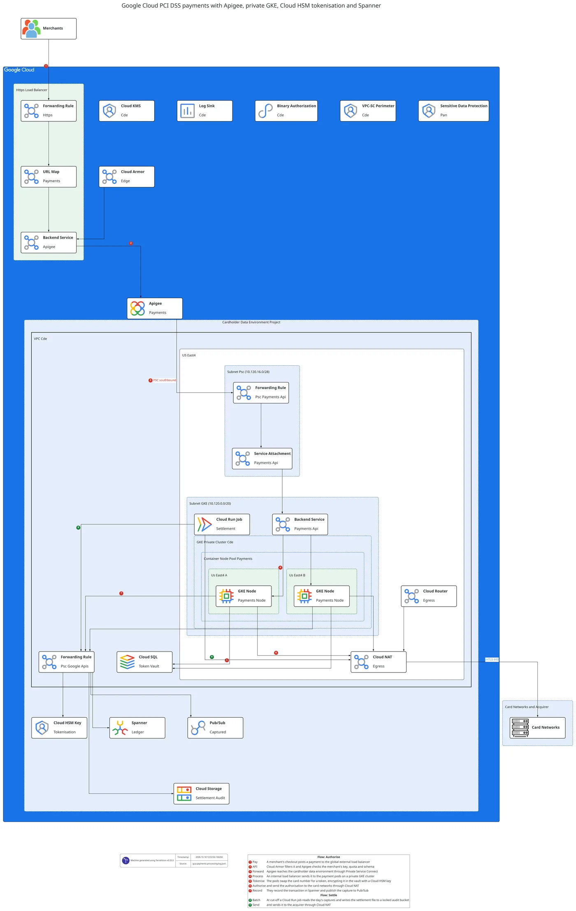{ width=1400 height=2215 loading=lazy .no-lightbox }](https://raw.githubusercontent.com/patrickchugh/terravision/main/examples/graphs/gcp-payments-processing.png)

**Ask your AI assistant:**

> Draw a Google Cloud PCI DSS payments platform with a global external load balancer and Cloud Armor in front of Apigee, Private Service Connect to an internal load balancer and a private GKE cluster in two zones, a Cloud SQL token vault with a Cloud HSM key, a Spanner ledger, Pub/Sub captures, a Cloud Run settlement job writing to a locked audit bucket, Cloud NAT to the card networks, and Binary Authorization and VPC Service Controls as shared services.

**Or reproduce it exactly** from the source file [gcp-payments-processing.tvg.json](https://github.com/patrickchugh/terravision/blob/main/examples/graphs/gcp-payments-processing.tvg.json) and its title, CIDR ranges, arrow labels and numbered flow steps in [gcp-payments-processing.annotations.yml](https://github.com/patrickchugh/terravision/blob/main/examples/graphs/gcp-payments-processing.annotations.yml):

```bash
terravision draw --source gcp-payments-processing.tvg.json --annotate gcp-payments-processing.annotations.yml --format svg      # or png, pdf
terravision draw --source gcp-payments-processing.tvg.json --annotate gcp-payments-processing.annotations.yml --format drawio   # editable in draw.io or Lucidchart
```

Download: [PNG](https://raw.githubusercontent.com/patrickchugh/terravision/main/examples/graphs/gcp-payments-processing.png) · [SVG](https://raw.githubusercontent.com/patrickchugh/terravision/main/examples/graphs/gcp-payments-processing.svg) · [source graph](https://raw.githubusercontent.com/patrickchugh/terravision/main/examples/graphs/gcp-payments-processing.tvg.json) · [annotations: title, CIDR ranges, labels, flows](https://raw.githubusercontent.com/patrickchugh/terravision/main/examples/graphs/gcp-payments-processing.annotations.yml)

## Google Cloud Security Command Center architecture diagram { #google-cloud-security-command-center-architecture-diagram }

Security operations for a Google Cloud organisation, run from a dedicated security project. In the workload project, Cloud NGFW Enterprise inspects the web VMs' traffic and blocks known exploits before it leaves through Cloud NAT. An organisation log sink gathers threat, audit and flow logs into a log bucket linked to BigQuery, where a log-based metric and alert policy notify the SOC when threats spike. Security Command Center publishes high-severity findings to Pub/Sub, and a function fixes them automatically, such as removing public access from a bucket. A Cloud Asset feed reports IAM changes to a review function, and Sensitive Data Protection scans customer uploads.

[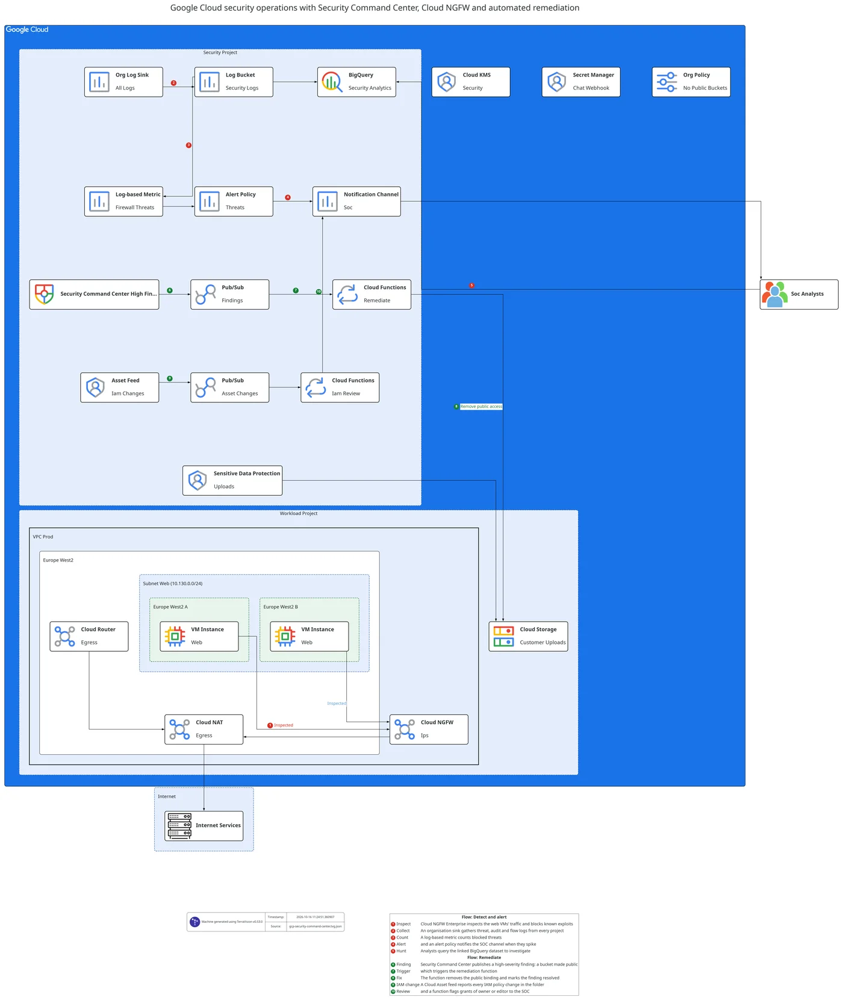{ width=1400 height=1660 loading=lazy .no-lightbox }](https://raw.githubusercontent.com/patrickchugh/terravision/main/examples/graphs/gcp-security-command-center.png)

**Ask your AI assistant:**

> Draw Google Cloud security operations with a workload project holding web VMs in two zones behind Cloud NGFW Enterprise and Cloud NAT, and a security project with an organisation log sink, a log bucket linked to BigQuery, a log-based metric and alert policy notifying SOC analysts, Security Command Center notifications to Pub/Sub triggering a remediation Cloud Function, a Cloud Asset feed for IAM changes, and Sensitive Data Protection scanning a bucket.

**Or reproduce it exactly** from the source file [gcp-security-command-center.tvg.json](https://github.com/patrickchugh/terravision/blob/main/examples/graphs/gcp-security-command-center.tvg.json) and its title, CIDR ranges, arrow labels and numbered flow steps in [gcp-security-command-center.annotations.yml](https://github.com/patrickchugh/terravision/blob/main/examples/graphs/gcp-security-command-center.annotations.yml):

```bash
terravision draw --source gcp-security-command-center.tvg.json --annotate gcp-security-command-center.annotations.yml --format svg      # or png, pdf
terravision draw --source gcp-security-command-center.tvg.json --annotate gcp-security-command-center.annotations.yml --format drawio   # editable in draw.io or Lucidchart
```

Download: [PNG](https://raw.githubusercontent.com/patrickchugh/terravision/main/examples/graphs/gcp-security-command-center.png) · [SVG](https://raw.githubusercontent.com/patrickchugh/terravision/main/examples/graphs/gcp-security-command-center.svg) · [source graph](https://raw.githubusercontent.com/patrickchugh/terravision/main/examples/graphs/gcp-security-command-center.tvg.json) · [annotations: title, CIDR ranges, labels, flows](https://raw.githubusercontent.com/patrickchugh/terravision/main/examples/graphs/gcp-security-command-center.annotations.yml)

## Google Cloud video processing architecture diagram { #google-cloud-video-processing-architecture-diagram }

Video upload, transcoding and streaming on Google Cloud. Creators sign in with Identity Platform and upload source videos straight to Cloud Storage with a signed URL from the studio API on Cloud Run. Each upload fires Eventarc, which starts a Workflows run that creates a Transcoder API job from an HLS and DASH template, waits for its state on Pub/Sub, makes thumbnails with a Cloud Run job and publishes the title in Firestore. Viewers reach a global external load balancer, where the catalogue API lists titles and signs a CDN cookie, and the segments stream from the renditions bucket through Cloud CDN. Watch events go through Pub/Sub to BigQuery for analytics.

[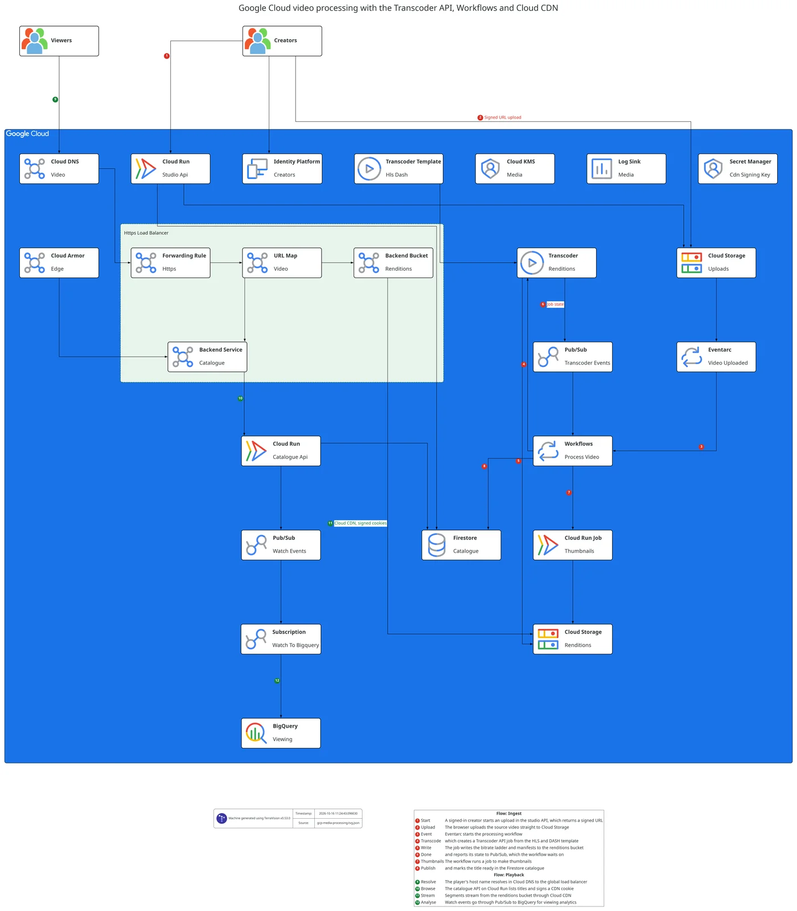{ width=1400 height=1599 loading=lazy .no-lightbox }](https://raw.githubusercontent.com/patrickchugh/terravision/main/examples/graphs/gcp-media-processing.png)

**Ask your AI assistant:**

> Draw Google Cloud video processing with creators signing in with Identity Platform and uploading to Cloud Storage with a signed URL from a Cloud Run studio API, Eventarc starting a Workflows run with a Transcoder API job and template, Pub/Sub job events, a Cloud Run thumbnails job, a Firestore catalogue, Cloud DNS and a global load balancer with Cloud CDN for renditions and a Cloud Run catalogue API, and watch events into BigQuery.

**Or reproduce it exactly** from the source file [gcp-media-processing.tvg.json](https://github.com/patrickchugh/terravision/blob/main/examples/graphs/gcp-media-processing.tvg.json) and its title, CIDR ranges, arrow labels and numbered flow steps in [gcp-media-processing.annotations.yml](https://github.com/patrickchugh/terravision/blob/main/examples/graphs/gcp-media-processing.annotations.yml):

```bash
terravision draw --source gcp-media-processing.tvg.json --annotate gcp-media-processing.annotations.yml --format svg      # or png, pdf
terravision draw --source gcp-media-processing.tvg.json --annotate gcp-media-processing.annotations.yml --format drawio   # editable in draw.io or Lucidchart
```

Download: [PNG](https://raw.githubusercontent.com/patrickchugh/terravision/main/examples/graphs/gcp-media-processing.png) · [SVG](https://raw.githubusercontent.com/patrickchugh/terravision/main/examples/graphs/gcp-media-processing.svg) · [source graph](https://raw.githubusercontent.com/patrickchugh/terravision/main/examples/graphs/gcp-media-processing.tvg.json) · [annotations: title, CIDR ranges, labels, flows](https://raw.githubusercontent.com/patrickchugh/terravision/main/examples/graphs/gcp-media-processing.annotations.yml)

## Google Cloud VM three-tier migration architecture diagram { #google-cloud-vm-three-tier-migration-architecture-diagram }

A three-tier web shop moved from a corporate data centre to Compute Engine. Migrate to Virtual Machines replicates the web and app VMs' disks over HA VPN and turns them into images for the instance templates, while Database Migration Service keeps Cloud SQL for MySQL in sync from the source binlog until cutover. After cutover a global external load balancer with Cloud Armor sends customers to a web tier managed instance group in two zones, which shares content on Filestore. The web VMs call the app tier's managed instance group through an internal load balancer, and the app VMs use a regional HA Cloud SQL instance. Payment calls leave through Cloud NAT.

[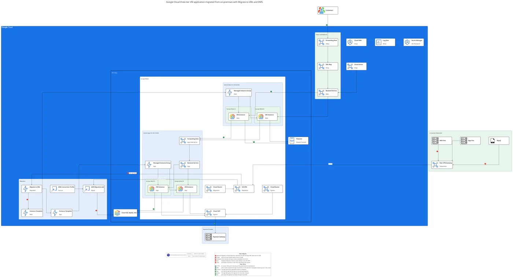{ width=1400 height=758 loading=lazy .no-lightbox }](https://raw.githubusercontent.com/patrickchugh/terravision/main/examples/graphs/gcp-vm-three-tier-migrate.png)

**Ask your AI assistant:**

> Draw a Google Cloud three-tier VM migration with web and app VMs and MySQL in a corporate data centre connected by HA VPN, Migrate to Virtual Machines images and instance templates, Database Migration Service to Cloud SQL for MySQL HA, a global external load balancer with Cloud Armor to a web managed instance group in two zones, an internal load balancer to an app managed instance group, Filestore shared content, and Cloud NAT to a payment provider.

**Or reproduce it exactly** from the source file [gcp-vm-three-tier-migrate.tvg.json](https://github.com/patrickchugh/terravision/blob/main/examples/graphs/gcp-vm-three-tier-migrate.tvg.json) and its title, CIDR ranges, arrow labels and numbered flow steps in [gcp-vm-three-tier-migrate.annotations.yml](https://github.com/patrickchugh/terravision/blob/main/examples/graphs/gcp-vm-three-tier-migrate.annotations.yml):

```bash
terravision draw --source gcp-vm-three-tier-migrate.tvg.json --annotate gcp-vm-three-tier-migrate.annotations.yml --format svg      # or png, pdf
terravision draw --source gcp-vm-three-tier-migrate.tvg.json --annotate gcp-vm-three-tier-migrate.annotations.yml --format drawio   # editable in draw.io or Lucidchart
```

Download: [PNG](https://raw.githubusercontent.com/patrickchugh/terravision/main/examples/graphs/gcp-vm-three-tier-migrate.png) · [SVG](https://raw.githubusercontent.com/patrickchugh/terravision/main/examples/graphs/gcp-vm-three-tier-migrate.svg) · [source graph](https://raw.githubusercontent.com/patrickchugh/terravision/main/examples/graphs/gcp-vm-three-tier-migrate.tvg.json) · [annotations: title, CIDR ranges, labels, flows](https://raw.githubusercontent.com/patrickchugh/terravision/main/examples/graphs/gcp-vm-three-tier-migrate.annotations.yml)

## How were these diagrams made?

Each one is a short JSON file that lists the resources and what they connect to or sit inside, rendered by TerraVision. An AI assistant writes that file for you from a plain-English description, or TerraVision derives the diagram from Terraform code. A diagram drawn from a prompt will differ in detail from the example; the source file reproduces it exactly.

The CIDR ranges on networks and subnets the labels on arrows and the numbered flow steps come from a small annotation file next to each graph: `update:` sets the ranges, `connect:` the arrow labels and `flows:` the steps and their legend. Your assistant sets them through the `attributes`, `edge_labels` and `flows` options when it draws; ask it to *"show how a request flows through it"*. Annotation files with graphs need TerraVision 0.52.0 or later.

## Can I get logical groups like these from Terraform?

Yes. Groups such as "Fulfilment workflow" or "Ingestion" are part of the graph. Ask your assistant for them when you describe a design. Starting from Terraform, export the graph with `terravision graphdata --source ./infra --outfile architecture.tvg.json`, add the groups to the JSON (or ask your assistant to), and draw it with `terravision draw --source architecture.tvg.json`.

## Can I edit these diagrams?

Yes. Ask your assistant to change the design in plain words, or render the source file with `--format drawio` and open it in draw.io or Lucidchart to move, restyle or annotate anything by hand. SVG output opens in any vector editor.

## Can I use these diagrams in client documents and presentations?

Yes. TerraVision's AGPL-3.0 licence covers the software, not the diagrams you make with it, so you can use them in proposals, client documents, slides and books, commercially or not. The cloud icons belong to AWS, Microsoft and Google, which allow their use in architecture diagrams; follow their guidelines, such as not distorting or recolouring the icons.

## Can I get the Terraform for one of these architectures?

Yes. After drawing a design with your AI assistant, ask it to write the Terraform. See [diagram to Terraform](diagram-to-terraform.md).

## Related

- [AI cloud architecture diagram generator](ai-cloud-architecture-diagram-generator.md)
- [AWS](aws-architecture-diagram-generator.md), [Azure](azure-architecture-diagram-generator.md) and [Google Cloud](gcp-architecture-diagram-generator.md) diagram generators
- [Graph Format](graph-format.md): write or edit the source files yourself
