# Cloud architecture diagram examples

Example architecture diagrams for AWS, Azure and Google Cloud, drawn by TerraVision with each provider's official icons. Every example comes with a prompt you can give to Claude or ChatGPT to draw something similar, and the source file that reproduces it exactly. Use them as starting points: ask your assistant to change one, or download it and edit it in draw.io.

They are drawn the way enterprises deploy: workloads sit in VPCs, subnets and availability zones, and reach managed services through private endpoints (VPC endpoints, Azure private endpoints, Private Service Connect) rather than the internet. Each provider's official grouping conventions are built in, not generic boxes. Every network and subnet is labelled with its CIDR range, and numbered steps with a legend show how requests and data move through the design.

!!! note "Your results will vary"
    A diagram drawn from a prompt depends on the AI model behind your assistant. Larger, more capable models follow the prompt more closely and add more of the detail shown here; smaller models may leave services out or group them differently. Ask for what is missing in a follow-up message, or use the source file under each example to reproduce it exactly.

| Example | Cloud |
|---|---|
| [AWS three-tier web application architecture diagram](#aws-three-tier-web-application-architecture-diagram) | AWS |
| [Amazon EKS with Karpenter architecture diagram](#amazon-eks-karpenter-architecture-diagram) | AWS |
| [AWS serverless event-driven architecture diagram](#aws-serverless-event-driven-architecture-diagram) | AWS |
| [AWS data lake architecture diagram](#aws-data-lake-architecture-diagram) | AWS |
| [AWS multi-region failover architecture diagram](#aws-multi-region-failover-architecture-diagram) | AWS |
| [AWS multi-account network with Direct Connect architecture diagram](#aws-multi-account-network-architecture-diagram) | AWS |
| [AWS event-driven order processing architecture diagram](#aws-event-driven-order-processing-architecture-diagram) | AWS |
| [Amazon ECS on Fargate API architecture diagram](#amazon-ecs-fargate-api-architecture-diagram) | AWS |
| [AWS real-time streaming analytics architecture diagram](#aws-streaming-analytics-architecture-diagram) | AWS |
| [Amazon SageMaker MLOps architecture diagram](#amazon-sagemaker-mlops-architecture-diagram) | AWS |
| [AWS IoT telemetry architecture diagram](#aws-iot-telemetry-architecture-diagram) | AWS |
| [AWS Direct Connect hybrid architecture diagram](#aws-direct-connect-hybrid-architecture-diagram) | AWS |
| [AWS static website with CI/CD architecture diagram](#aws-static-site-cicd-architecture-diagram) | AWS |
| [AWS Batch HPC architecture diagram](#aws-batch-hpc-architecture-diagram) | AWS |
| [AWS SaaS multi-tenant architecture diagram](#aws-saas-multi-tenant-architecture-diagram) | AWS |
| [AWS payments processing architecture diagram](#aws-payments-processing-architecture-diagram) | AWS |
| [AWS security logging architecture diagram](#aws-security-logging-architecture-diagram) | AWS |
| [AWS video processing architecture diagram](#aws-media-processing-architecture-diagram) | AWS |
| [AWS VM lift-and-shift migration architecture diagram](#aws-vm-lift-and-shift-architecture-diagram) | AWS |
| [Azure three-tier web application architecture diagram](#azure-three-tier-web-application-architecture-diagram) | Azure |
| [Azure hub-and-spoke network architecture diagram](#azure-hub-and-spoke-architecture-diagram) | Azure |
| [Azure AKS microservices architecture diagram](#azure-aks-architecture-diagram) | Azure |
| [Azure App Service customer portal architecture diagram](#azure-app-service-customer-portal-architecture-diagram) | Azure |
| [Google Cloud three-tier web application architecture diagram](#google-cloud-three-tier-web-application-architecture-diagram) | Google Cloud |
| [Google Cloud GKE microservices architecture diagram](#google-cloud-gke-architecture-diagram) | Google Cloud |
| [Google Cloud data pipeline architecture diagram](#google-cloud-data-pipeline-architecture-diagram) | Google Cloud |
| [Google Cloud serverless API architecture diagram](#google-cloud-serverless-api-architecture-diagram) | Google Cloud |

All examples are also published as a dataset on Hugging Face: https://huggingface.co/datasets/patrickchugh/terravision-cloud-diagrams

!!! tip "The quickest way to make one of these your own"
    Install TerraVision in [Claude Desktop or the ChatGPT desktop app](ai-assistants.md), paste the prompt under any example, then keep talking: *"add a WAF"*, *"make it multi-region"*, *"show how a request flows through it"*, *"write the Terraform for this"*.

## AWS three-tier web application architecture diagram { #aws-three-tier-web-application-architecture-diagram }

A classic three-tier web application on AWS. CloudFront serves a static site from S3 and routes requests to Application Load Balancers in two availability zones. Each zone has a public subnet (load balancer and NAT gateway), a private subnet (EC2 application servers in an Auto Scaling group) and a data subnet (Aurora PostgreSQL and ElastiCache). A CloudWatch alarm on CPU drives a target-tracking policy that scales the group out and in. The app servers reach S3 through a gateway VPC endpoint and Secrets Manager through an interface endpoint in each private subnet, so that traffic never crosses the internet.

[{ width=1400 height=1595 .no-lightbox }](https://raw.githubusercontent.com/patrickchugh/terravision/main/examples/graphs/three-tier-web.png)

**Ask your AI assistant:**

> Draw an AWS three-tier web app: CloudFront in front of an S3 static site and an Application Load Balancer, EC2 app servers in an Auto Scaling group across private subnets in two availability zones, scaled by a CloudWatch CPU alarm, Aurora PostgreSQL and ElastiCache in data subnets, NAT gateways in the public subnets, an S3 gateway endpoint for an uploads bucket and a Secrets Manager interface endpoint in each private subnet.

**Or reproduce it exactly** from the source file [three-tier-web.tvg.json](https://github.com/patrickchugh/terravision/blob/main/examples/graphs/three-tier-web.tvg.json) and its title, CIDR ranges, arrow labels and numbered flow steps in [three-tier-web.annotations.yml](https://github.com/patrickchugh/terravision/blob/main/examples/graphs/three-tier-web.annotations.yml):

```bash
terravision draw --source three-tier-web.tvg.json --annotate three-tier-web.annotations.yml --format svg      # or png, pdf
terravision draw --source three-tier-web.tvg.json --annotate three-tier-web.annotations.yml --format drawio   # editable in draw.io or Lucidchart
```

Download: [PNG](https://raw.githubusercontent.com/patrickchugh/terravision/main/examples/graphs/three-tier-web.png) · [SVG](https://raw.githubusercontent.com/patrickchugh/terravision/main/examples/graphs/three-tier-web.svg) · [source graph](https://raw.githubusercontent.com/patrickchugh/terravision/main/examples/graphs/three-tier-web.tvg.json) · [annotations: title, CIDR ranges, labels, flows](https://raw.githubusercontent.com/patrickchugh/terravision/main/examples/graphs/three-tier-web.annotations.yml)

## Amazon EKS with Karpenter architecture diagram { #amazon-eks-karpenter-architecture-diagram }

A Kubernetes platform on Amazon EKS that scales its nodes with Karpenter. The VPC spans three availability zones. In each zone, a public subnet holds an Application Load Balancer and a NAT gateway, and a private subnet holds the Karpenter controller, a Karpenter NodePool of On-Demand and Spot nodes, and interface VPC endpoints for ECR, EC2 and SQS. A data subnet holds an Aurora PostgreSQL instance. Nodes pull image layers through an S3 gateway endpoint. The EKS control plane sits in its own AWS-managed account, and an EventBridge rule sends Spot interruption warnings to the SQS queue Karpenter reads.

[{ width=1400 height=1089 loading=lazy .no-lightbox }](https://raw.githubusercontent.com/patrickchugh/terravision/main/examples/graphs/aws-eks-karpenter.png)

**Ask your AI assistant:**

> Draw an EKS cluster that uses Karpenter for node autoscaling, across three availability zones: an ALB and NAT gateway in each public subnet; the Karpenter controller, a NodePool of On-Demand and Spot nodes and interface VPC endpoints for ECR, EC2 and SQS in each private subnet; Aurora PostgreSQL in data subnets; an S3 gateway endpoint; Route 53 in front; and the EventBridge rule and SQS queue Karpenter uses for Spot interruptions.

**Or reproduce it exactly** from the source file [aws-eks-karpenter.tvg.json](https://github.com/patrickchugh/terravision/blob/main/examples/graphs/aws-eks-karpenter.tvg.json) and its title, CIDR ranges, arrow labels and numbered flow steps in [aws-eks-karpenter.annotations.yml](https://github.com/patrickchugh/terravision/blob/main/examples/graphs/aws-eks-karpenter.annotations.yml):

```bash
terravision draw --source aws-eks-karpenter.tvg.json --annotate aws-eks-karpenter.annotations.yml --format svg      # or png, pdf
terravision draw --source aws-eks-karpenter.tvg.json --annotate aws-eks-karpenter.annotations.yml --format drawio   # editable in draw.io or Lucidchart
```

Download: [PNG](https://raw.githubusercontent.com/patrickchugh/terravision/main/examples/graphs/aws-eks-karpenter.png) · [SVG](https://raw.githubusercontent.com/patrickchugh/terravision/main/examples/graphs/aws-eks-karpenter.svg) · [source graph](https://raw.githubusercontent.com/patrickchugh/terravision/main/examples/graphs/aws-eks-karpenter.tvg.json) · [annotations: title, CIDR ranges, labels, flows](https://raw.githubusercontent.com/patrickchugh/terravision/main/examples/graphs/aws-eks-karpenter.annotations.yml)

## AWS serverless event-driven architecture diagram { #aws-serverless-event-driven-architecture-diagram }

A serverless order platform whose Lambda functions run inside a VPC, as most enterprises require. Customers call an HTTP API on API Gateway, authenticated with Cognito, which invokes order Lambdas in private subnets across two availability zones. The functions reach DynamoDB through a gateway VPC endpoint, and EventBridge, SNS and Secrets Manager through interface endpoints in a dedicated endpoints subnet in each zone. Only the payment step leaves the VPC, through NAT gateways, to reach an external payment provider. The EventBridge bus fans out to a Step Functions fulfilment workflow, an SQS notifications queue with a dead-letter queue, and Firehose to an S3 event lake catalogued by Glue and queried with Athena.

[{ width=1400 height=1108 loading=lazy .no-lightbox }](https://raw.githubusercontent.com/patrickchugh/terravision/main/examples/graphs/aws-serverless-event-driven.png)

**Ask your AI assistant:**

> Draw an AWS serverless event-driven order system with every Lambda in a VPC across two availability zones: API Gateway with Cognito invoking order Lambdas in private subnets, a DynamoDB gateway endpoint, interface endpoints for EventBridge, SNS and Secrets Manager in an endpoints subnet per zone, and NAT gateways only for the payment provider. The EventBridge bus fans out to a Step Functions fulfilment workflow, an SQS notifications queue with a DLQ, and Firehose to an S3 data lake with Glue and Athena.

**Or reproduce it exactly** from the source file [aws-serverless-event-driven.tvg.json](https://github.com/patrickchugh/terravision/blob/main/examples/graphs/aws-serverless-event-driven.tvg.json) and its title, CIDR ranges, arrow labels and numbered flow steps in [aws-serverless-event-driven.annotations.yml](https://github.com/patrickchugh/terravision/blob/main/examples/graphs/aws-serverless-event-driven.annotations.yml):

```bash
terravision draw --source aws-serverless-event-driven.tvg.json --annotate aws-serverless-event-driven.annotations.yml --format svg      # or png, pdf
terravision draw --source aws-serverless-event-driven.tvg.json --annotate aws-serverless-event-driven.annotations.yml --format drawio   # editable in draw.io or Lucidchart
```

Download: [PNG](https://raw.githubusercontent.com/patrickchugh/terravision/main/examples/graphs/aws-serverless-event-driven.png) · [SVG](https://raw.githubusercontent.com/patrickchugh/terravision/main/examples/graphs/aws-serverless-event-driven.svg) · [source graph](https://raw.githubusercontent.com/patrickchugh/terravision/main/examples/graphs/aws-serverless-event-driven.tvg.json) · [annotations: title, CIDR ranges, labels, flows](https://raw.githubusercontent.com/patrickchugh/terravision/main/examples/graphs/aws-serverless-event-driven.annotations.yml)

## AWS data lake architecture diagram { #aws-data-lake-architecture-diagram }

A data lake and analytics platform on AWS whose processing runs inside a VPC. Across two availability zones, private subnets hold DMS replication from an Aurora MySQL source, Glue jobs, EMR Serverless Spark, Amazon MWAA (Airflow) orchestration and Redshift Serverless. All of them read and write S3 through a gateway VPC endpoint, and reach the Glue Data Catalog and Secrets Manager through interface endpoints in each zone. Outside the VPC, Kinesis, Firehose and Transfer Family ingest clickstream and partner files into the raw S3 zone, Lake Formation governs access, and analysts use QuickSight over Athena.

[{ width=1400 height=1089 loading=lazy .no-lightbox }](https://raw.githubusercontent.com/patrickchugh/terravision/main/examples/graphs/aws-data-lake.png)

**Ask your AI assistant:**

> Draw an AWS data lake with processing in a VPC across two availability zones: DMS from Aurora MySQL, Glue jobs, EMR Serverless, MWAA and Redshift Serverless in private subnets, an S3 gateway endpoint, and Glue and Secrets Manager interface endpoints in each zone. Kinesis, Firehose and Transfer Family land data in a raw S3 zone, Glue writes a curated zone, Lake Formation governs it, and QuickSight and Athena serve analysts.

**Or reproduce it exactly** from the source file [aws-data-lake.tvg.json](https://github.com/patrickchugh/terravision/blob/main/examples/graphs/aws-data-lake.tvg.json) and its title, CIDR ranges, arrow labels and numbered flow steps in [aws-data-lake.annotations.yml](https://github.com/patrickchugh/terravision/blob/main/examples/graphs/aws-data-lake.annotations.yml):

```bash
terravision draw --source aws-data-lake.tvg.json --annotate aws-data-lake.annotations.yml --format svg      # or png, pdf
terravision draw --source aws-data-lake.tvg.json --annotate aws-data-lake.annotations.yml --format drawio   # editable in draw.io or Lucidchart
```

Download: [PNG](https://raw.githubusercontent.com/patrickchugh/terravision/main/examples/graphs/aws-data-lake.png) · [SVG](https://raw.githubusercontent.com/patrickchugh/terravision/main/examples/graphs/aws-data-lake.svg) · [source graph](https://raw.githubusercontent.com/patrickchugh/terravision/main/examples/graphs/aws-data-lake.tvg.json) · [annotations: title, CIDR ranges, labels, flows](https://raw.githubusercontent.com/patrickchugh/terravision/main/examples/graphs/aws-data-lake.annotations.yml)

## AWS multi-region failover architecture diagram { #aws-multi-region-failover-architecture-diagram }

An active-passive multi-region design on AWS. Route 53 failover routing sends users to the primary region (us-east-1) and switches to the standby region (eu-west-1) when health checks fail. Each region has a VPC across two availability zones, with Application Load Balancers in public subnets, ECS on Fargate services in application subnets and Aurora PostgreSQL in data subnets. The services reach DynamoDB through a gateway VPC endpoint in their own region. Aurora Global Database replicates from the primary to the standby, DynamoDB global tables replicate session data, and S3 cross-region replication copies assets.

[{ width=1400 height=1779 loading=lazy .no-lightbox }](https://raw.githubusercontent.com/patrickchugh/terravision/main/examples/graphs/aws-multi-region.png)

**Ask your AI assistant:**

> Draw an AWS active-passive multi-region architecture: Route 53 failover between a primary region and a standby region, each with a VPC across two availability zones, ALBs in public subnets, ECS Fargate services in app subnets, Aurora PostgreSQL in data subnets and a DynamoDB gateway endpoint. Show Aurora Global Database replication, DynamoDB global tables and S3 cross-region replication between the regions.

**Or reproduce it exactly** from the source file [aws-multi-region.tvg.json](https://github.com/patrickchugh/terravision/blob/main/examples/graphs/aws-multi-region.tvg.json) and its title, CIDR ranges, arrow labels and numbered flow steps in [aws-multi-region.annotations.yml](https://github.com/patrickchugh/terravision/blob/main/examples/graphs/aws-multi-region.annotations.yml):

```bash
terravision draw --source aws-multi-region.tvg.json --annotate aws-multi-region.annotations.yml --format svg      # or png, pdf
terravision draw --source aws-multi-region.tvg.json --annotate aws-multi-region.annotations.yml --format drawio   # editable in draw.io or Lucidchart
```

Download: [PNG](https://raw.githubusercontent.com/patrickchugh/terravision/main/examples/graphs/aws-multi-region.png) · [SVG](https://raw.githubusercontent.com/patrickchugh/terravision/main/examples/graphs/aws-multi-region.svg) · [source graph](https://raw.githubusercontent.com/patrickchugh/terravision/main/examples/graphs/aws-multi-region.tvg.json) · [annotations: title, CIDR ranges, labels, flows](https://raw.githubusercontent.com/patrickchugh/terravision/main/examples/graphs/aws-multi-region.annotations.yml)

## AWS multi-account network with Direct Connect architecture diagram { #aws-multi-account-network-architecture-diagram }

A hub-and-spoke network for an AWS organisation, connected to the corporate data centre. The data centre's router reaches AWS over a 10 Gbps Direct Connect connection and a transit virtual interface to a Direct Connect gateway, associated with a Transit Gateway in the network account, with a site-to-site VPN to the Transit Gateway as the backup path. All traffic between the data centre, the production, development and shared services spoke VPCs and the internet passes through AWS Network Firewall in a central inspection VPC, whose Transit Gateway attachments run in appliance mode in two availability zones; a central egress VPC holds the NAT gateways and the internet gateway. The flows show office staff reaching an internal Application Load Balancer and ECS Fargate orders service, that service calling the on-premises ERP system's REST API over Direct Connect, and a development instance reaching the internet through central inspection and egress.

[{ width=1400 height=1629 loading=lazy .no-lightbox }](https://raw.githubusercontent.com/patrickchugh/terravision/main/examples/graphs/aws-multi-account-network.png)

**Ask your AI assistant:**

> Draw an AWS multi-account network: a corporate data centre with office staff, an ERP server and a router connected by Direct Connect and a Direct Connect gateway to a Transit Gateway in a network account, with a site-to-site VPN as backup; an inspection VPC with Network Firewall in two availability zones; a central egress VPC with NAT gateways; and spoke VPCs for production (internal ALB, ECS Fargate, RDS), development (EC2) and shared services (VPC endpoints, Directory Service).

**Or reproduce it exactly** from the source file [aws-multi-account-network.tvg.json](https://github.com/patrickchugh/terravision/blob/main/examples/graphs/aws-multi-account-network.tvg.json) and its title, CIDR ranges, arrow labels and numbered flow steps in [aws-multi-account-network.annotations.yml](https://github.com/patrickchugh/terravision/blob/main/examples/graphs/aws-multi-account-network.annotations.yml):

```bash
terravision draw --source aws-multi-account-network.tvg.json --annotate aws-multi-account-network.annotations.yml --format svg      # or png, pdf
terravision draw --source aws-multi-account-network.tvg.json --annotate aws-multi-account-network.annotations.yml --format drawio   # editable in draw.io or Lucidchart
```

Download: [PNG](https://raw.githubusercontent.com/patrickchugh/terravision/main/examples/graphs/aws-multi-account-network.png) · [SVG](https://raw.githubusercontent.com/patrickchugh/terravision/main/examples/graphs/aws-multi-account-network.svg) · [source graph](https://raw.githubusercontent.com/patrickchugh/terravision/main/examples/graphs/aws-multi-account-network.tvg.json) · [annotations: title, CIDR ranges, labels, flows](https://raw.githubusercontent.com/patrickchugh/terravision/main/examples/graphs/aws-multi-account-network.annotations.yml)

## AWS event-driven order processing architecture diagram { #aws-event-driven-order-processing-architecture-diagram }

An order processing system on AWS built from queues and functions, with every Lambda inside a VPC. Mobile clients call an API Gateway REST API, protected by AWS WAF and a Cognito authorizer, which invokes a create-order Lambda in private subnets across two availability zones. The functions reach DynamoDB through a gateway VPC endpoint and SQS and SNS through interface endpoints in an endpoints subnet per zone, so the VPC needs no internet route at all. An SQS queue drives the fulfilment Lambda, which notifies customers through SNS; both the queue and the notifications have dead-letter queues. DynamoDB streams every order change through Kinesis Data Streams and Firehose to an S3 archive, catalogued by a Glue crawler and queried with Athena.

[{ width=1400 height=2813 loading=lazy .no-lightbox }](https://raw.githubusercontent.com/patrickchugh/terravision/main/examples/graphs/aws-event-driven.png)

**Ask your AI assistant:**

> Draw an AWS event-driven order system with Lambdas in a VPC across two availability zones: mobile clients call an API Gateway REST API with WAF and a Cognito authorizer, a create-order Lambda saves to DynamoDB through a gateway endpoint and queues on SQS, a fulfilment Lambda notifies through SNS, SQS and SNS are reached through interface endpoints and have dead-letter queues, and DynamoDB changes flow through Kinesis and Firehose to an S3 archive with Glue and Athena.

**Or reproduce it exactly** from the source file [aws-event-driven.tvg.json](https://github.com/patrickchugh/terravision/blob/main/examples/graphs/aws-event-driven.tvg.json) and its title, CIDR ranges, arrow labels and numbered flow steps in [aws-event-driven.annotations.yml](https://github.com/patrickchugh/terravision/blob/main/examples/graphs/aws-event-driven.annotations.yml):

```bash
terravision draw --source aws-event-driven.tvg.json --annotate aws-event-driven.annotations.yml --format svg      # or png, pdf
terravision draw --source aws-event-driven.tvg.json --annotate aws-event-driven.annotations.yml --format drawio   # editable in draw.io or Lucidchart
```

Download: [PNG](https://raw.githubusercontent.com/patrickchugh/terravision/main/examples/graphs/aws-event-driven.png) · [SVG](https://raw.githubusercontent.com/patrickchugh/terravision/main/examples/graphs/aws-event-driven.svg) · [source graph](https://raw.githubusercontent.com/patrickchugh/terravision/main/examples/graphs/aws-event-driven.tvg.json) · [annotations: title, CIDR ranges, labels, flows](https://raw.githubusercontent.com/patrickchugh/terravision/main/examples/graphs/aws-event-driven.annotations.yml)

## Amazon ECS on Fargate API architecture diagram { #amazon-ecs-fargate-api-architecture-diagram }

A containerised API on Amazon ECS with AWS Fargate, spread across two availability zones. Route 53 points clients at an Application Load Balancer, protected by AWS WAF, in the public subnets, which sends requests to API tasks in private subnets. The tasks cache in ElastiCache and store orders in Aurora PostgreSQL in data subnets, and reach SQS, Secrets Manager and ECR through interface endpoints and S3 through a gateway endpoint. A worker service consumes the SQS queue, with a dead-letter queue for failures, and is the only part that leaves the VPC, through the NAT gateways, to call an email provider.

[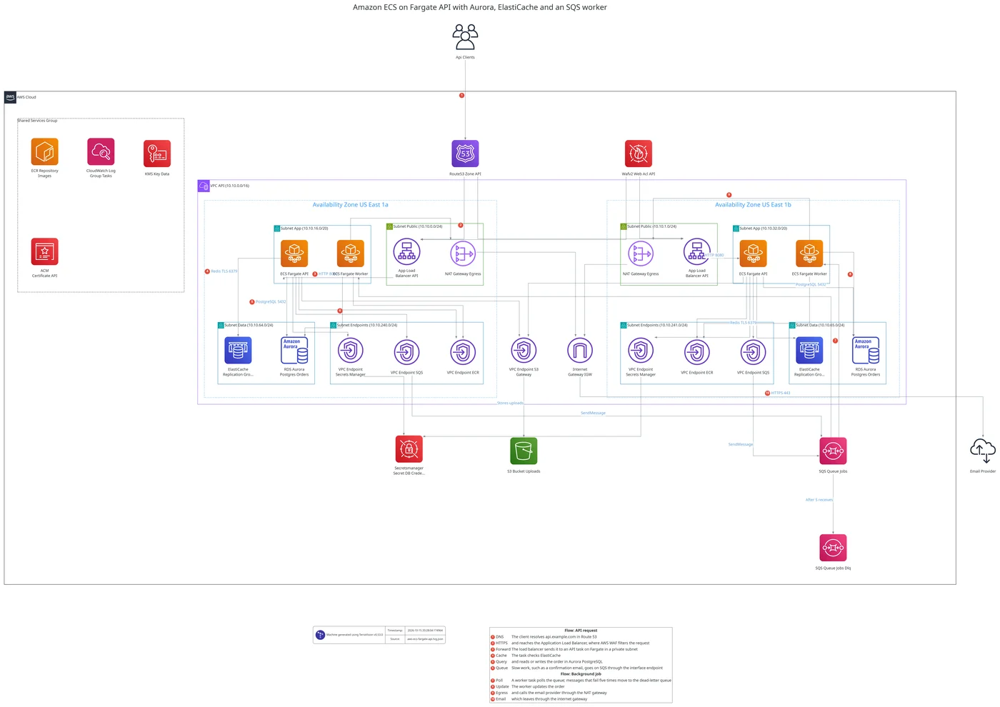{ width=1400 height=990 loading=lazy .no-lightbox }](https://raw.githubusercontent.com/patrickchugh/terravision/main/examples/graphs/aws-ecs-fargate-api.png)

**Ask your AI assistant:**

> Draw an Amazon ECS on Fargate API across two availability zones: Route 53 and an Application Load Balancer with AWS WAF in public subnets, API and worker tasks in private subnets, Aurora PostgreSQL and ElastiCache in data subnets, interface endpoints for ECR, SQS and Secrets Manager, an S3 gateway endpoint, an SQS job queue with a dead-letter queue feeding the worker, and NAT gateways for the worker's calls to an email provider.

**Or reproduce it exactly** from the source file [aws-ecs-fargate-api.tvg.json](https://github.com/patrickchugh/terravision/blob/main/examples/graphs/aws-ecs-fargate-api.tvg.json) and its title, CIDR ranges, arrow labels and numbered flow steps in [aws-ecs-fargate-api.annotations.yml](https://github.com/patrickchugh/terravision/blob/main/examples/graphs/aws-ecs-fargate-api.annotations.yml):

```bash
terravision draw --source aws-ecs-fargate-api.tvg.json --annotate aws-ecs-fargate-api.annotations.yml --format svg      # or png, pdf
terravision draw --source aws-ecs-fargate-api.tvg.json --annotate aws-ecs-fargate-api.annotations.yml --format drawio   # editable in draw.io or Lucidchart
```

Download: [PNG](https://raw.githubusercontent.com/patrickchugh/terravision/main/examples/graphs/aws-ecs-fargate-api.png) · [SVG](https://raw.githubusercontent.com/patrickchugh/terravision/main/examples/graphs/aws-ecs-fargate-api.svg) · [source graph](https://raw.githubusercontent.com/patrickchugh/terravision/main/examples/graphs/aws-ecs-fargate-api.tvg.json) · [annotations: title, CIDR ranges, labels, flows](https://raw.githubusercontent.com/patrickchugh/terravision/main/examples/graphs/aws-ecs-fargate-api.annotations.yml)

## AWS real-time streaming analytics architecture diagram { #aws-streaming-analytics-architecture-diagram }

A streaming analytics platform on AWS that serves the same click stream to search, a warehouse and a lake. Mobile apps write events to Kinesis Data Streams. Inside a VPC across two availability zones, a Managed Service for Apache Flink application reads the stream through an interface endpoint, enriches the events and indexes them in Amazon OpenSearch Service, checkpointing to S3 through a gateway endpoint. Redshift Serverless ingests the same stream into a materialised view that QuickSight queries over a VPC connection. Firehose delivers every event as Parquet to an S3 event lake, catalogued by Glue and queried with Athena.

[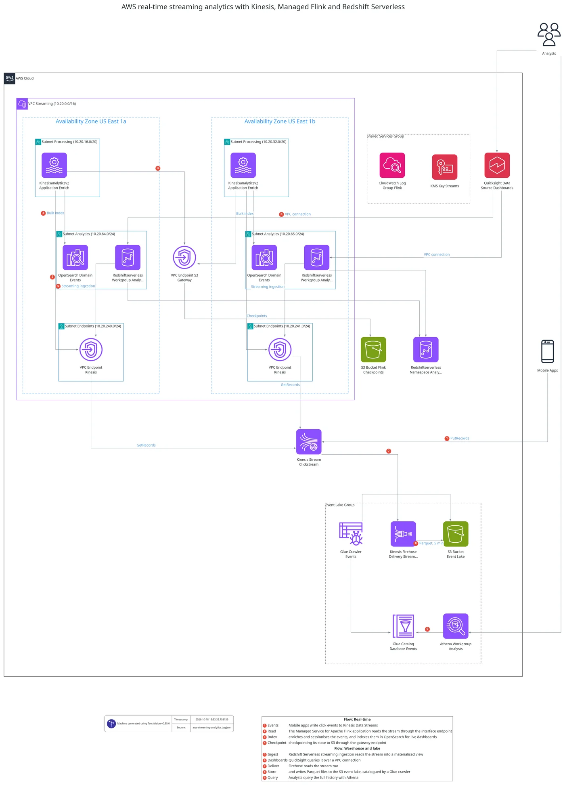{ width=1400 height=1944 loading=lazy .no-lightbox }](https://raw.githubusercontent.com/patrickchugh/terravision/main/examples/graphs/aws-streaming-analytics.png)

**Ask your AI assistant:**

> Draw an AWS real-time streaming analytics platform: mobile apps writing to Kinesis Data Streams, a Managed Service for Apache Flink application in private subnets across two availability zones reading through a Kinesis interface endpoint and indexing into OpenSearch, Redshift Serverless with streaming ingestion queried by QuickSight, an S3 gateway endpoint for Flink checkpoints, and Firehose delivering Parquet to an S3 event lake with a Glue crawler and Athena.

**Or reproduce it exactly** from the source file [aws-streaming-analytics.tvg.json](https://github.com/patrickchugh/terravision/blob/main/examples/graphs/aws-streaming-analytics.tvg.json) and its title, CIDR ranges, arrow labels and numbered flow steps in [aws-streaming-analytics.annotations.yml](https://github.com/patrickchugh/terravision/blob/main/examples/graphs/aws-streaming-analytics.annotations.yml):

```bash
terravision draw --source aws-streaming-analytics.tvg.json --annotate aws-streaming-analytics.annotations.yml --format svg      # or png, pdf
terravision draw --source aws-streaming-analytics.tvg.json --annotate aws-streaming-analytics.annotations.yml --format drawio   # editable in draw.io or Lucidchart
```

Download: [PNG](https://raw.githubusercontent.com/patrickchugh/terravision/main/examples/graphs/aws-streaming-analytics.png) · [SVG](https://raw.githubusercontent.com/patrickchugh/terravision/main/examples/graphs/aws-streaming-analytics.svg) · [source graph](https://raw.githubusercontent.com/patrickchugh/terravision/main/examples/graphs/aws-streaming-analytics.tvg.json) · [annotations: title, CIDR ranges, labels, flows](https://raw.githubusercontent.com/patrickchugh/terravision/main/examples/graphs/aws-streaming-analytics.annotations.yml)

## Amazon SageMaker MLOps architecture diagram { #amazon-sagemaker-mlops-architecture-diagram }

An MLOps platform on Amazon SageMaker with no path to the internet. Data scientists reach SageMaker Studio, running in VPC-only mode across two availability zones, through Client VPN, and build features in Feature Store. Each week an EventBridge Scheduler schedule starts a Step Functions workflow that runs a SageMaker pipeline, registers the evaluated model in the Model Registry and deploys the approved version to a real-time endpoint with a blue/green update. The customer app calls API Gateway, whose Lambda function in the VPC scores customers through the SageMaker runtime interface endpoint. Studio and training reach S3 through a gateway endpoint and the SageMaker API through interface endpoints.

[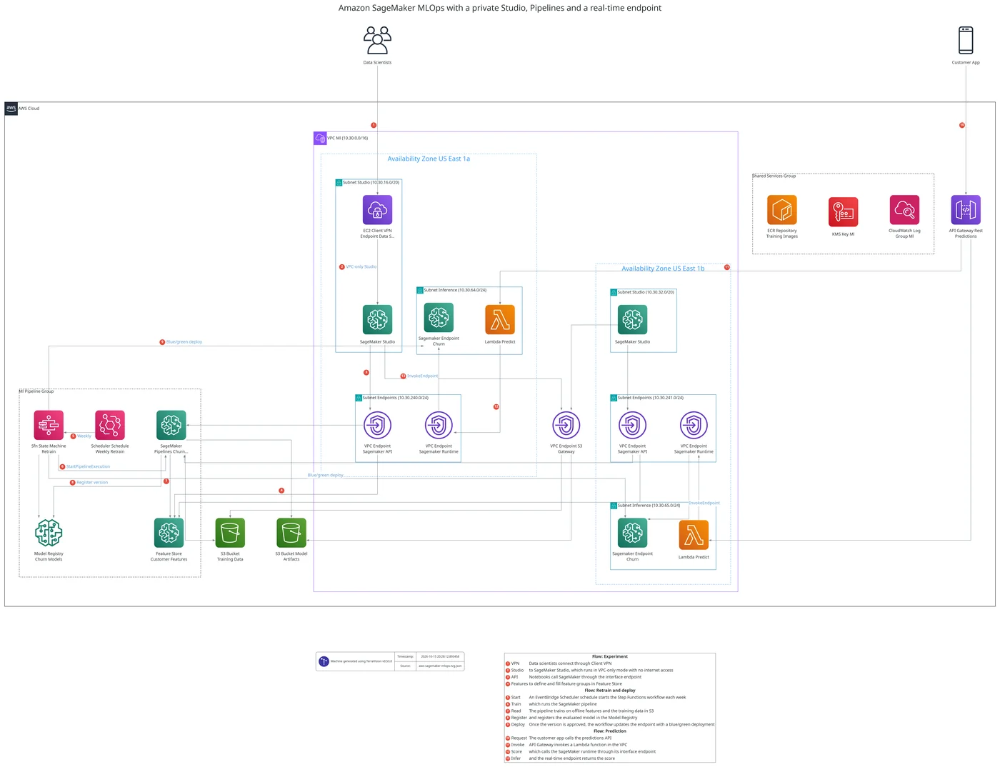{ width=1400 height=1074 loading=lazy .no-lightbox }](https://raw.githubusercontent.com/patrickchugh/terravision/main/examples/graphs/aws-sagemaker-mlops.png)

**Ask your AI assistant:**

> Draw an Amazon SageMaker MLOps platform in a VPC across two availability zones: SageMaker Studio in VPC-only mode reached through Client VPN, Feature Store, a Step Functions retraining workflow started weekly by EventBridge Scheduler that runs SageMaker Pipelines and registers models in the Model Registry, a real-time endpoint called by a Lambda function behind API Gateway, SageMaker API and runtime interface endpoints, and an S3 gateway endpoint for training data and model artifacts.

**Or reproduce it exactly** from the source file [aws-sagemaker-mlops.tvg.json](https://github.com/patrickchugh/terravision/blob/main/examples/graphs/aws-sagemaker-mlops.tvg.json) and its title, CIDR ranges, arrow labels and numbered flow steps in [aws-sagemaker-mlops.annotations.yml](https://github.com/patrickchugh/terravision/blob/main/examples/graphs/aws-sagemaker-mlops.annotations.yml):

```bash
terravision draw --source aws-sagemaker-mlops.tvg.json --annotate aws-sagemaker-mlops.annotations.yml --format svg      # or png, pdf
terravision draw --source aws-sagemaker-mlops.tvg.json --annotate aws-sagemaker-mlops.annotations.yml --format drawio   # editable in draw.io or Lucidchart
```

Download: [PNG](https://raw.githubusercontent.com/patrickchugh/terravision/main/examples/graphs/aws-sagemaker-mlops.png) · [SVG](https://raw.githubusercontent.com/patrickchugh/terravision/main/examples/graphs/aws-sagemaker-mlops.svg) · [source graph](https://raw.githubusercontent.com/patrickchugh/terravision/main/examples/graphs/aws-sagemaker-mlops.tvg.json) · [annotations: title, CIDR ranges, labels, flows](https://raw.githubusercontent.com/patrickchugh/terravision/main/examples/graphs/aws-sagemaker-mlops.annotations.yml)

## AWS IoT telemetry architecture diagram { #aws-iot-telemetry-architecture-diagram }

An IoT telemetry platform on AWS for a wind farm. Turbine sensors report to an AWS IoT Greengrass gateway on site, which publishes to AWS IoT Core over MQTT with TLS, using device certificates and policies from the registry. One IoT rule sends readings to Kinesis Data Streams, where Lambda functions in a VPC across two availability zones aggregate them and write to Amazon Timestream through an interface endpoint, for operators watching Amazon Managed Grafana. A second rule feeds an IoT Events detector model that raises over-speed alarms through SNS, and a third archives every message to S3 through Firehose.

[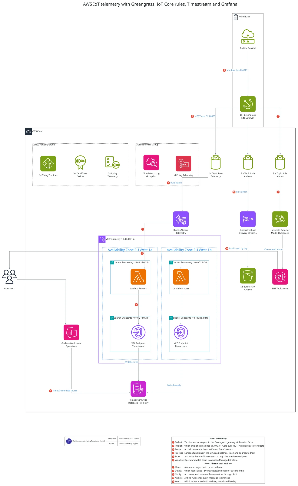{ width=1400 height=2281 loading=lazy .no-lightbox }](https://raw.githubusercontent.com/patrickchugh/terravision/main/examples/graphs/aws-iot-telemetry.png)

**Ask your AI assistant:**

> Draw an AWS IoT telemetry platform for a wind farm: turbine sensors and an IoT Greengrass gateway on site publishing to IoT Core, IoT rules routing readings to Kinesis Data Streams, alarms to an IoT Events detector model with SNS alerts, and everything to Firehose and an S3 archive, with Lambda functions in a VPC across two availability zones writing to Timestream through an interface endpoint for operators using Amazon Managed Grafana.

**Or reproduce it exactly** from the source file [aws-iot-telemetry.tvg.json](https://github.com/patrickchugh/terravision/blob/main/examples/graphs/aws-iot-telemetry.tvg.json) and its title, CIDR ranges, arrow labels and numbered flow steps in [aws-iot-telemetry.annotations.yml](https://github.com/patrickchugh/terravision/blob/main/examples/graphs/aws-iot-telemetry.annotations.yml):

```bash
terravision draw --source aws-iot-telemetry.tvg.json --annotate aws-iot-telemetry.annotations.yml --format svg      # or png, pdf
terravision draw --source aws-iot-telemetry.tvg.json --annotate aws-iot-telemetry.annotations.yml --format drawio   # editable in draw.io or Lucidchart
```

Download: [PNG](https://raw.githubusercontent.com/patrickchugh/terravision/main/examples/graphs/aws-iot-telemetry.png) · [SVG](https://raw.githubusercontent.com/patrickchugh/terravision/main/examples/graphs/aws-iot-telemetry.svg) · [source graph](https://raw.githubusercontent.com/patrickchugh/terravision/main/examples/graphs/aws-iot-telemetry.tvg.json) · [annotations: title, CIDR ranges, labels, flows](https://raw.githubusercontent.com/patrickchugh/terravision/main/examples/graphs/aws-iot-telemetry.annotations.yml)

## AWS Direct Connect hybrid architecture diagram { #aws-direct-connect-hybrid-architecture-diagram }

A hybrid design that runs an ERP system in AWS for a head office, with all traffic on private links. The office router reaches a Transit Gateway over Direct Connect, a transit virtual interface and a Direct Connect gateway, with a site-to-site VPN as the backup path. Staff use the application through an internal Application Load Balancer and EC2 servers in two availability zones, backed by Multi-AZ RDS for Oracle. Route 53 Resolver inbound and outbound endpoints resolve names in both directions, an on-premises File Gateway stores SMB shares in S3 through Storage Gateway and S3 interface endpoints, and AWS Backup protects the servers and database.

[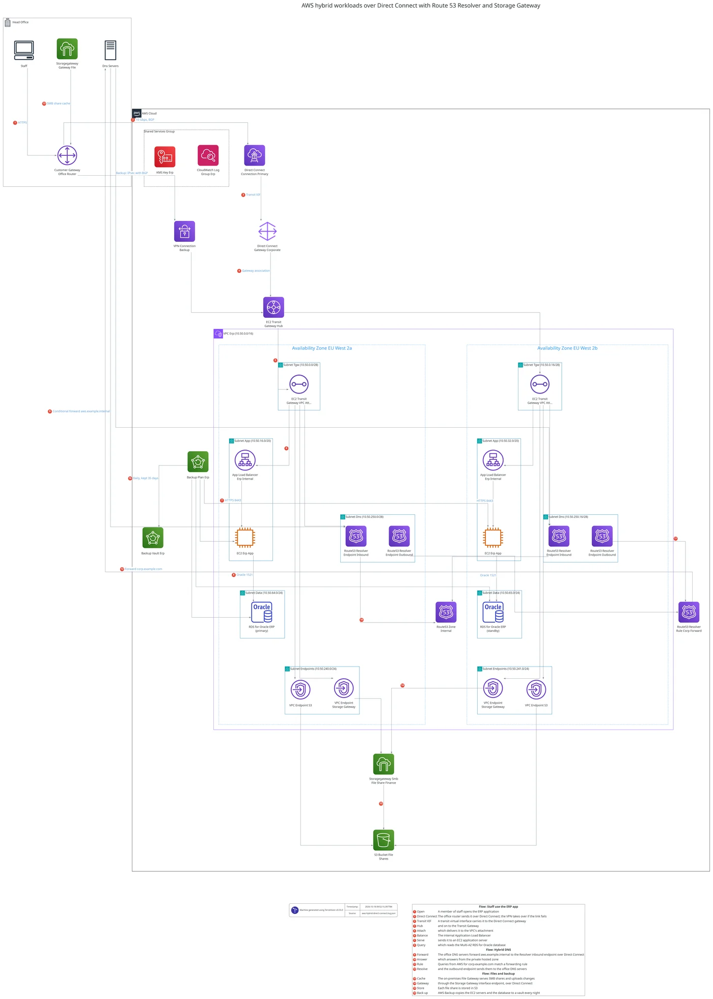{ width=1400 height=1962 loading=lazy .no-lightbox }](https://raw.githubusercontent.com/patrickchugh/terravision/main/examples/graphs/aws-hybrid-direct-connect.png)

**Ask your AI assistant:**

> Draw an AWS hybrid network for a head office: staff, DNS servers, a File Gateway and a router connected by Direct Connect, a transit VIF and a Direct Connect gateway to a Transit Gateway, with a site-to-site VPN as backup, and a VPC across two availability zones with an internal ALB, EC2 app servers, Multi-AZ RDS for Oracle, Route 53 Resolver inbound and outbound endpoints with a private hosted zone, Storage Gateway and S3 interface endpoints, and AWS Backup.

**Or reproduce it exactly** from the source file [aws-hybrid-direct-connect.tvg.json](https://github.com/patrickchugh/terravision/blob/main/examples/graphs/aws-hybrid-direct-connect.tvg.json) and its title, CIDR ranges, arrow labels and numbered flow steps in [aws-hybrid-direct-connect.annotations.yml](https://github.com/patrickchugh/terravision/blob/main/examples/graphs/aws-hybrid-direct-connect.annotations.yml):

```bash
terravision draw --source aws-hybrid-direct-connect.tvg.json --annotate aws-hybrid-direct-connect.annotations.yml --format svg      # or png, pdf
terravision draw --source aws-hybrid-direct-connect.tvg.json --annotate aws-hybrid-direct-connect.annotations.yml --format drawio   # editable in draw.io or Lucidchart
```

Download: [PNG](https://raw.githubusercontent.com/patrickchugh/terravision/main/examples/graphs/aws-hybrid-direct-connect.png) · [SVG](https://raw.githubusercontent.com/patrickchugh/terravision/main/examples/graphs/aws-hybrid-direct-connect.svg) · [source graph](https://raw.githubusercontent.com/patrickchugh/terravision/main/examples/graphs/aws-hybrid-direct-connect.tvg.json) · [annotations: title, CIDR ranges, labels, flows](https://raw.githubusercontent.com/patrickchugh/terravision/main/examples/graphs/aws-hybrid-direct-connect.annotations.yml)

## AWS static website with CI/CD architecture diagram { #aws-static-site-cicd-architecture-diagram }

A static website on AWS with a fully automated release. Route 53 points visitors at CloudFront, protected by AWS WAF and serving an ACM certificate, which reads the site from a private S3 bucket through origin access control and fails over to a replica bucket in a second Region. Lambda@Edge adds security headers, and access logs go to S3. A push to GitHub starts CodePipeline through a CodeConnections connection: CodeBuild builds the site, deploys it to a staging bucket and distribution, runs browser tests, then syncs production and invalidates the cache. SNS and AWS Chatbot post releases and error-rate alarms to Slack.

[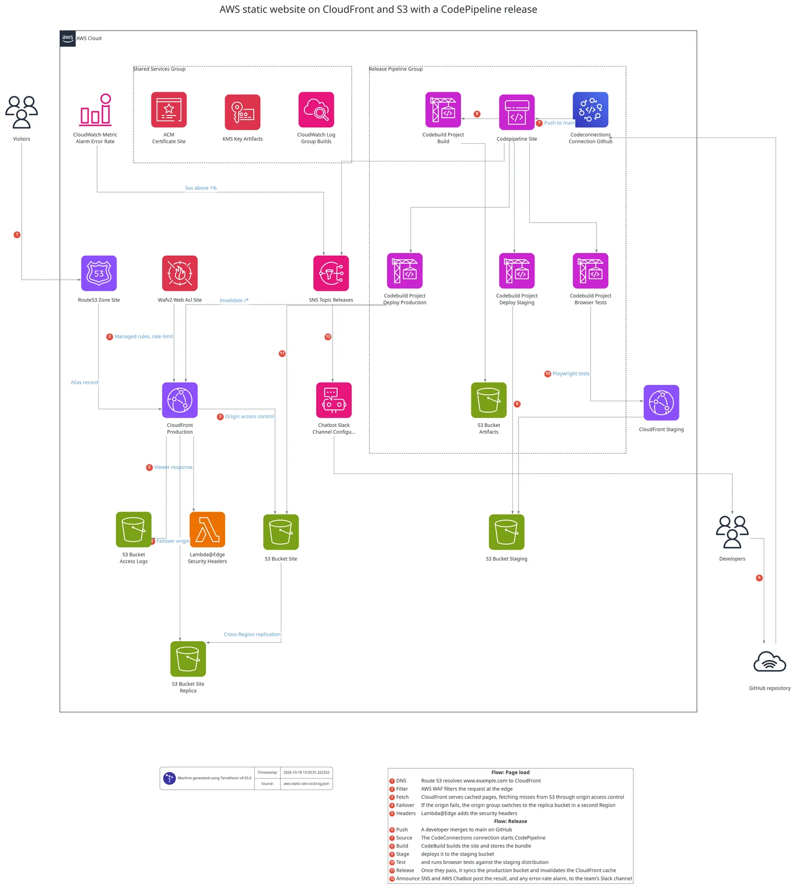{ width=1400 height=1563 loading=lazy .no-lightbox }](https://raw.githubusercontent.com/patrickchugh/terravision/main/examples/graphs/aws-static-site-cicd.png)

**Ask your AI assistant:**

> Draw an AWS static website with CI/CD: Route 53, AWS WAF and an ACM certificate on a CloudFront distribution reading a private S3 bucket through origin access control, with a cross-Region replica bucket as failover origin, Lambda@Edge security headers and an access-log bucket, and a release where a GitHub push through CodeConnections starts CodePipeline, whose CodeBuild projects build, deploy to a staging bucket and distribution, run browser tests and deploy production, with SNS and AWS Chatbot notifying Slack.

**Or reproduce it exactly** from the source file [aws-static-site-cicd.tvg.json](https://github.com/patrickchugh/terravision/blob/main/examples/graphs/aws-static-site-cicd.tvg.json) and its title, CIDR ranges, arrow labels and numbered flow steps in [aws-static-site-cicd.annotations.yml](https://github.com/patrickchugh/terravision/blob/main/examples/graphs/aws-static-site-cicd.annotations.yml):

```bash
terravision draw --source aws-static-site-cicd.tvg.json --annotate aws-static-site-cicd.annotations.yml --format svg      # or png, pdf
terravision draw --source aws-static-site-cicd.tvg.json --annotate aws-static-site-cicd.annotations.yml --format drawio   # editable in draw.io or Lucidchart
```

Download: [PNG](https://raw.githubusercontent.com/patrickchugh/terravision/main/examples/graphs/aws-static-site-cicd.png) · [SVG](https://raw.githubusercontent.com/patrickchugh/terravision/main/examples/graphs/aws-static-site-cicd.svg) · [source graph](https://raw.githubusercontent.com/patrickchugh/terravision/main/examples/graphs/aws-static-site-cicd.tvg.json) · [annotations: title, CIDR ranges, labels, flows](https://raw.githubusercontent.com/patrickchugh/terravision/main/examples/graphs/aws-static-site-cicd.annotations.yml)

## AWS Batch HPC architecture diagram { #aws-batch-hpc-architecture-diagram }

A genomics pipeline on AWS Batch that runs thousands of jobs on EC2 Spot. Uploading a sequencing run to S3 fires an EventBridge rule that starts a Step Functions workflow, which submits array jobs to Batch compute environments in private subnets across two availability zones and tracks the run in DynamoDB. The Spot workers pull their container image through an ECR interface endpoint, send logs through a CloudWatch Logs endpoint and read their input from FSx for Lustre, which lazy-loads it from the upload bucket. Results go to S3 through a gateway endpoint, and SNS tells the researchers when the run is done.

[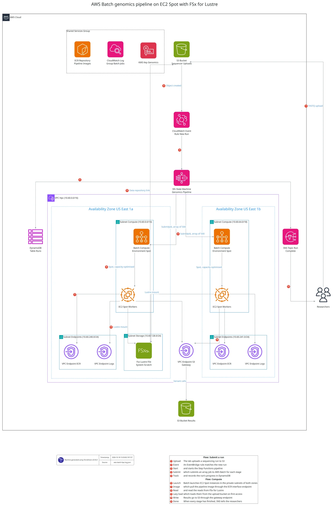{ width=1400 height=2122 loading=lazy .no-lightbox }](https://raw.githubusercontent.com/patrickchugh/terravision/main/examples/graphs/aws-batch-hpc.png)

**Ask your AI assistant:**

> Draw an AWS Batch HPC genomics pipeline: an S3 upload triggering an EventBridge rule and a Step Functions workflow that submits array jobs to AWS Batch compute environments running EC2 Spot instances in private subnets across two availability zones, FSx for Lustre linked to the upload bucket, ECR and CloudWatch Logs interface endpoints, an S3 gateway endpoint for results, a DynamoDB run table and SNS notifications to researchers.

**Or reproduce it exactly** from the source file [aws-batch-hpc.tvg.json](https://github.com/patrickchugh/terravision/blob/main/examples/graphs/aws-batch-hpc.tvg.json) and its title, CIDR ranges, arrow labels and numbered flow steps in [aws-batch-hpc.annotations.yml](https://github.com/patrickchugh/terravision/blob/main/examples/graphs/aws-batch-hpc.annotations.yml):

```bash
terravision draw --source aws-batch-hpc.tvg.json --annotate aws-batch-hpc.annotations.yml --format svg      # or png, pdf
terravision draw --source aws-batch-hpc.tvg.json --annotate aws-batch-hpc.annotations.yml --format drawio   # editable in draw.io or Lucidchart
```

Download: [PNG](https://raw.githubusercontent.com/patrickchugh/terravision/main/examples/graphs/aws-batch-hpc.png) · [SVG](https://raw.githubusercontent.com/patrickchugh/terravision/main/examples/graphs/aws-batch-hpc.svg) · [source graph](https://raw.githubusercontent.com/patrickchugh/terravision/main/examples/graphs/aws-batch-hpc.tvg.json) · [annotations: title, CIDR ranges, labels, flows](https://raw.githubusercontent.com/patrickchugh/terravision/main/examples/graphs/aws-batch-hpc.annotations.yml)

## AWS SaaS multi-tenant architecture diagram { #aws-saas-multi-tenant-architecture-diagram }

A multi-tenant SaaS product on AWS that mixes pooled and silo tenancy. Tenant users call an API Gateway HTTP API, which validates their token against Cognito and passes the request over a VPC link to internal load balancers in two availability zones. Shared-tier tenants go to a pooled ECS Fargate service that keeps each tenant in its own schema in an Aurora PostgreSQL cluster, while a premium tenant has its own service and cluster; every service reads the tenant registry in DynamoDB and tenant files in S3 through gateway endpoints. The control plane publishes lifecycle events through an EventBridge interface endpoint, starting a Step Functions provisioning workflow and metering usage through Firehose to S3.

[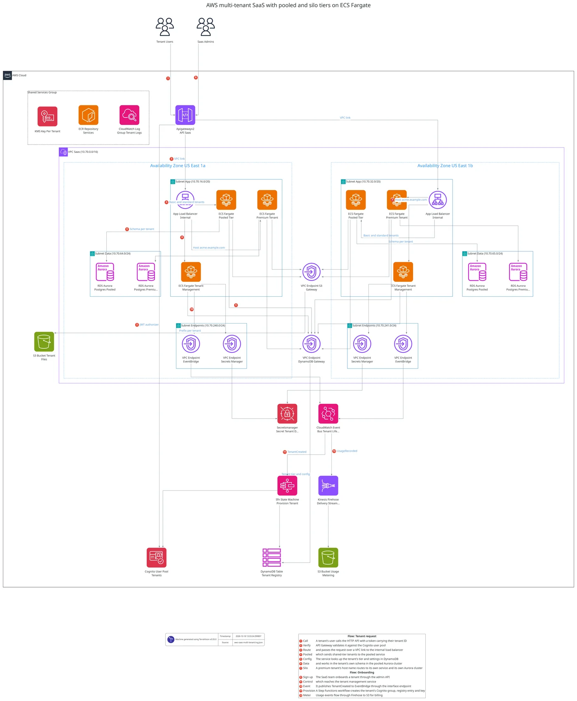{ width=1400 height=1701 loading=lazy .no-lightbox }](https://raw.githubusercontent.com/patrickchugh/terravision/main/examples/graphs/aws-saas-multi-tenant.png)

**Ask your AI assistant:**

> Draw an AWS multi-tenant SaaS platform: API Gateway HTTP API with a Cognito JWT authorizer and a VPC link to internal ALBs across two availability zones, ECS Fargate services for a pooled tier, a premium silo tenant and the control plane, Aurora PostgreSQL with a schema per tenant plus a dedicated premium cluster, a DynamoDB tenant registry and S3 tenant files through gateway endpoints, EventBridge and Secrets Manager interface endpoints, a Step Functions provisioning workflow and Firehose usage metering.

**Or reproduce it exactly** from the source file [aws-saas-multi-tenant.tvg.json](https://github.com/patrickchugh/terravision/blob/main/examples/graphs/aws-saas-multi-tenant.tvg.json) and its title, CIDR ranges, arrow labels and numbered flow steps in [aws-saas-multi-tenant.annotations.yml](https://github.com/patrickchugh/terravision/blob/main/examples/graphs/aws-saas-multi-tenant.annotations.yml):

```bash
terravision draw --source aws-saas-multi-tenant.tvg.json --annotate aws-saas-multi-tenant.annotations.yml --format svg      # or png, pdf
terravision draw --source aws-saas-multi-tenant.tvg.json --annotate aws-saas-multi-tenant.annotations.yml --format drawio   # editable in draw.io or Lucidchart
```

Download: [PNG](https://raw.githubusercontent.com/patrickchugh/terravision/main/examples/graphs/aws-saas-multi-tenant.png) · [SVG](https://raw.githubusercontent.com/patrickchugh/terravision/main/examples/graphs/aws-saas-multi-tenant.svg) · [source graph](https://raw.githubusercontent.com/patrickchugh/terravision/main/examples/graphs/aws-saas-multi-tenant.tvg.json) · [annotations: title, CIDR ranges, labels, flows](https://raw.githubusercontent.com/patrickchugh/terravision/main/examples/graphs/aws-saas-multi-tenant.annotations.yml)

## AWS payments processing architecture diagram { #aws-payments-processing-architecture-diagram }

A card payments platform on AWS designed for the resilience and isolation that PCI DSS workloads need. Merchants call an API Gateway REST API over mutual TLS, behind AWS WAF, which reaches Network Load Balancers through a VPC link; authorisation and settlement services run on ECS Fargate across three availability zones. Authorisation records an idempotency key in DynamoDB through a gateway endpoint, uses CloudHSM for card keys, asks the card network for approval over PrivateLink and writes to an Aurora PostgreSQL ledger with readers in every zone. Approved payments go through an SQS FIFO queue to the settlement service, and Secrets Manager and SQS are reached through interface endpoints.

[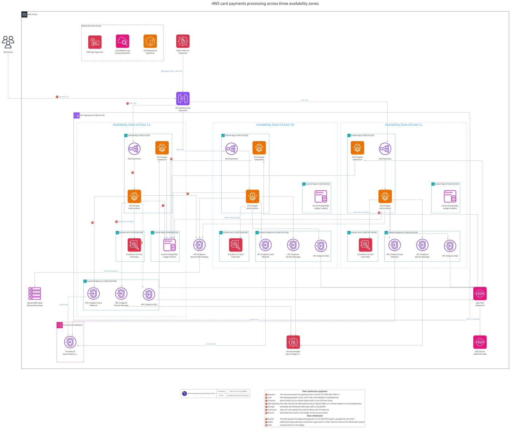{ width=1400 height=1177 loading=lazy .no-lightbox }](https://raw.githubusercontent.com/patrickchugh/terravision/main/examples/graphs/aws-payments-processing.png)

**Ask your AI assistant:**

> Draw an AWS card payments platform across three availability zones: API Gateway with mutual TLS and AWS WAF, a VPC link to Network Load Balancers, ECS Fargate authorisation and settlement services, Aurora PostgreSQL Multi-AZ with a writer and readers, a DynamoDB idempotency table through a gateway endpoint, an SQS FIFO settlement queue with a dead-letter queue, CloudHSM in its own subnets, KMS, a Secrets Manager interface endpoint and a PrivateLink endpoint to the card network.

**Or reproduce it exactly** from the source file [aws-payments-processing.tvg.json](https://github.com/patrickchugh/terravision/blob/main/examples/graphs/aws-payments-processing.tvg.json) and its title, CIDR ranges, arrow labels and numbered flow steps in [aws-payments-processing.annotations.yml](https://github.com/patrickchugh/terravision/blob/main/examples/graphs/aws-payments-processing.annotations.yml):

```bash
terravision draw --source aws-payments-processing.tvg.json --annotate aws-payments-processing.annotations.yml --format svg      # or png, pdf
terravision draw --source aws-payments-processing.tvg.json --annotate aws-payments-processing.annotations.yml --format drawio   # editable in draw.io or Lucidchart
```

Download: [PNG](https://raw.githubusercontent.com/patrickchugh/terravision/main/examples/graphs/aws-payments-processing.png) · [SVG](https://raw.githubusercontent.com/patrickchugh/terravision/main/examples/graphs/aws-payments-processing.svg) · [source graph](https://raw.githubusercontent.com/patrickchugh/terravision/main/examples/graphs/aws-payments-processing.tvg.json) · [annotations: title, CIDR ranges, labels, flows](https://raw.githubusercontent.com/patrickchugh/terravision/main/examples/graphs/aws-payments-processing.annotations.yml)

## AWS security logging architecture diagram { #aws-security-logging-architecture-diagram }

Security logging and threat detection for an AWS organisation, laid out by account as AWS Control Tower does. An organisation trail in the management account, and Config and VPC flow logs from the workload accounts, write to S3 buckets with Object Lock in a dedicated log archive account, where investigators query them with Athena through Glue tables. In the security tooling account, a delegated GuardDuty administrator and Config rules feed Security Hub. An EventBridge rule sends high and critical findings to a remediation Lambda function, to Slack through SNS and AWS Chatbot, and through Firehose to an OpenSearch domain in a private VPC.

[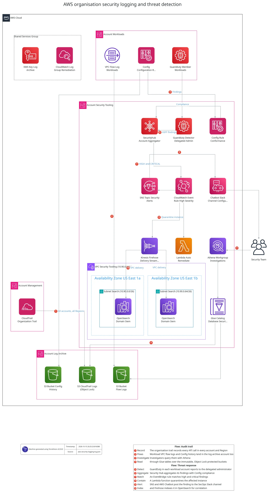{ width=1400 height=2567 loading=lazy .no-lightbox }](https://raw.githubusercontent.com/patrickchugh/terravision/main/examples/graphs/aws-security-logging.png)

**Ask your AI assistant:**

> Draw AWS organisation security logging by account: an organisation CloudTrail trail in the management account; Config, GuardDuty and VPC flow logs in workload accounts; a log archive account with S3 buckets using Object Lock; and a security tooling account with the delegated GuardDuty administrator, Security Hub, Config rules, an EventBridge rule for high-severity findings driving a remediation Lambda, SNS and AWS Chatbot to Slack, Firehose to OpenSearch in a VPC, and Athena with Glue.

**Or reproduce it exactly** from the source file [aws-security-logging.tvg.json](https://github.com/patrickchugh/terravision/blob/main/examples/graphs/aws-security-logging.tvg.json) and its title, CIDR ranges, arrow labels and numbered flow steps in [aws-security-logging.annotations.yml](https://github.com/patrickchugh/terravision/blob/main/examples/graphs/aws-security-logging.annotations.yml):

```bash
terravision draw --source aws-security-logging.tvg.json --annotate aws-security-logging.annotations.yml --format svg      # or png, pdf
terravision draw --source aws-security-logging.tvg.json --annotate aws-security-logging.annotations.yml --format drawio   # editable in draw.io or Lucidchart
```

Download: [PNG](https://raw.githubusercontent.com/patrickchugh/terravision/main/examples/graphs/aws-security-logging.png) · [SVG](https://raw.githubusercontent.com/patrickchugh/terravision/main/examples/graphs/aws-security-logging.svg) · [source graph](https://raw.githubusercontent.com/patrickchugh/terravision/main/examples/graphs/aws-security-logging.tvg.json) · [annotations: title, CIDR ranges, labels, flows](https://raw.githubusercontent.com/patrickchugh/terravision/main/examples/graphs/aws-security-logging.annotations.yml)

## AWS video processing architecture diagram { #aws-media-processing-architecture-diagram }

A serverless video-on-demand platform on AWS. Creators get presigned URLs from an API Gateway HTTP API, authenticated with Cognito, and upload master files straight to S3, where masters move to S3 Glacier after 30 days. An EventBridge rule starts a Step Functions workflow that probes the file with Lambda, transcodes an adaptive bitrate ladder with AWS Elemental MediaConvert, moderates and tags it with Rekognition, publishes it to a DynamoDB catalogue and notifies the creator through SNS. Members browse the catalogue through the same API, which signs short-lived CloudFront URLs, and CloudFront with AWS WAF serves the HLS segments from S3 through origin access control.

[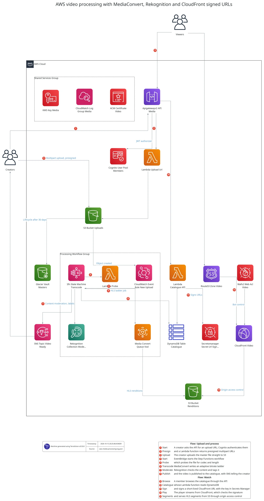{ width=1400 height=2653 loading=lazy .no-lightbox }](https://raw.githubusercontent.com/patrickchugh/terravision/main/examples/graphs/aws-media-processing.png)

**Ask your AI assistant:**

> Draw an AWS video-on-demand platform: creators uploading through presigned URLs from an API Gateway HTTP API with Cognito, an S3 upload bucket archiving masters to Glacier, an EventBridge rule starting a Step Functions workflow with a Lambda probe, MediaConvert, Rekognition moderation, a DynamoDB catalogue and SNS notifications, and viewers streaming HLS from S3 through CloudFront with signed URLs, origin access control, AWS WAF and Route 53.

**Or reproduce it exactly** from the source file [aws-media-processing.tvg.json](https://github.com/patrickchugh/terravision/blob/main/examples/graphs/aws-media-processing.tvg.json) and its title, CIDR ranges, arrow labels and numbered flow steps in [aws-media-processing.annotations.yml](https://github.com/patrickchugh/terravision/blob/main/examples/graphs/aws-media-processing.annotations.yml):

```bash
terravision draw --source aws-media-processing.tvg.json --annotate aws-media-processing.annotations.yml --format svg      # or png, pdf
terravision draw --source aws-media-processing.tvg.json --annotate aws-media-processing.annotations.yml --format drawio   # editable in draw.io or Lucidchart
```

Download: [PNG](https://raw.githubusercontent.com/patrickchugh/terravision/main/examples/graphs/aws-media-processing.png) · [SVG](https://raw.githubusercontent.com/patrickchugh/terravision/main/examples/graphs/aws-media-processing.svg) · [source graph](https://raw.githubusercontent.com/patrickchugh/terravision/main/examples/graphs/aws-media-processing.tvg.json) · [annotations: title, CIDR ranges, labels, flows](https://raw.githubusercontent.com/patrickchugh/terravision/main/examples/graphs/aws-media-processing.annotations.yml)

## AWS VM lift-and-shift migration architecture diagram { #aws-vm-lift-and-shift-architecture-diagram }

A Windows three-tier application moved from a data centre to AWS with AWS Application Migration Service. The agent on each on-premises server replicates its disks over a site-to-site VPN to a replication server in a staging subnet, and at cutover the web and app tiers launch as EC2 instances in Auto Scaling groups across two availability zones. Customers reach the IIS web tier through an internet-facing Application Load Balancer, the web tier calls the app tier through an internal one, and the app tier uses Multi-AZ RDS for SQL Server and FSx for Windows File Server joined to AWS Managed Microsoft AD. Systems Manager patches the instances through interface endpoints, AWS Backup protects the data, and NAT gateways give the app tier outbound access.

[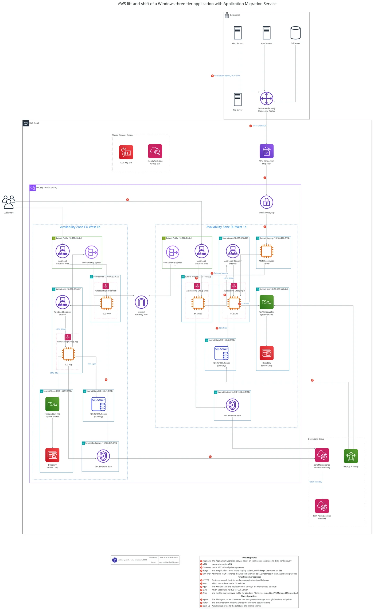{ width=1400 height=2277 loading=lazy .no-lightbox }](https://raw.githubusercontent.com/patrickchugh/terravision/main/examples/graphs/aws-vm-lift-and-shift.png)

**Ask your AI assistant:**

> Draw an AWS lift-and-shift of a Windows three-tier app: on-premises web, app, SQL Server and file servers replicating with Application Migration Service over a site-to-site VPN to a replication server in a staging subnet; then, across two availability zones, an internet-facing ALB, EC2 web and app Auto Scaling groups with an internal ALB, Multi-AZ RDS for SQL Server, FSx for Windows File Server with AWS Managed Microsoft AD, NAT gateways, Systems Manager patching through interface endpoints and AWS Backup.

**Or reproduce it exactly** from the source file [aws-vm-lift-and-shift.tvg.json](https://github.com/patrickchugh/terravision/blob/main/examples/graphs/aws-vm-lift-and-shift.tvg.json) and its title, CIDR ranges, arrow labels and numbered flow steps in [aws-vm-lift-and-shift.annotations.yml](https://github.com/patrickchugh/terravision/blob/main/examples/graphs/aws-vm-lift-and-shift.annotations.yml):

```bash
terravision draw --source aws-vm-lift-and-shift.tvg.json --annotate aws-vm-lift-and-shift.annotations.yml --format svg      # or png, pdf
terravision draw --source aws-vm-lift-and-shift.tvg.json --annotate aws-vm-lift-and-shift.annotations.yml --format drawio   # editable in draw.io or Lucidchart
```

Download: [PNG](https://raw.githubusercontent.com/patrickchugh/terravision/main/examples/graphs/aws-vm-lift-and-shift.png) · [SVG](https://raw.githubusercontent.com/patrickchugh/terravision/main/examples/graphs/aws-vm-lift-and-shift.svg) · [source graph](https://raw.githubusercontent.com/patrickchugh/terravision/main/examples/graphs/aws-vm-lift-and-shift.tvg.json) · [annotations: title, CIDR ranges, labels, flows](https://raw.githubusercontent.com/patrickchugh/terravision/main/examples/graphs/aws-vm-lift-and-shift.annotations.yml)

## Azure three-tier web application architecture diagram { #azure-three-tier-web-application-architecture-diagram }

A three-tier web application on Azure. DNS and Front Door with WAF sit in front of a Static Web App and an Application Gateway in its own subnet. Container Apps run across two zones inside a virtual network, Azure SQL sits behind a private endpoint in the data subnet, and a NAT gateway provides outbound access. Key Vault, Log Analytics and the container registry are drawn as shared services.

[{ width=1400 height=2190 loading=lazy .no-lightbox }](https://raw.githubusercontent.com/patrickchugh/terravision/main/examples/graphs/azure-three-tier.png)

**Ask your AI assistant:**

> Draw an Azure three-tier web app: Front Door with WAF, a Static Web App, Application Gateway in its own subnet, Container Apps across two zones, Azure SQL behind a private endpoint, a NAT gateway, and Key Vault, Log Analytics and a container registry as shared services.

**Or reproduce it exactly** from the source file [azure-three-tier.tvg.json](https://github.com/patrickchugh/terravision/blob/main/examples/graphs/azure-three-tier.tvg.json) and its title, CIDR ranges, arrow labels and numbered flow steps in [azure-three-tier.annotations.yml](https://github.com/patrickchugh/terravision/blob/main/examples/graphs/azure-three-tier.annotations.yml):

```bash
terravision draw --source azure-three-tier.tvg.json --annotate azure-three-tier.annotations.yml --format svg      # or png, pdf
terravision draw --source azure-three-tier.tvg.json --annotate azure-three-tier.annotations.yml --format drawio   # editable in draw.io or Lucidchart
```

Download: [PNG](https://raw.githubusercontent.com/patrickchugh/terravision/main/examples/graphs/azure-three-tier.png) · [SVG](https://raw.githubusercontent.com/patrickchugh/terravision/main/examples/graphs/azure-three-tier.svg) · [source graph](https://raw.githubusercontent.com/patrickchugh/terravision/main/examples/graphs/azure-three-tier.tvg.json) · [annotations: title, CIDR ranges, labels, flows](https://raw.githubusercontent.com/patrickchugh/terravision/main/examples/graphs/azure-three-tier.annotations.yml)

## Azure hub-and-spoke network architecture diagram { #azure-hub-and-spoke-architecture-diagram }

An Azure hub-and-spoke landing zone. The hub virtual network, in a connectivity resource group, holds a VPN gateway to the head office, Azure Firewall with a central firewall policy, Azure Bastion for administration and a Private DNS Resolver. Two spoke virtual networks are peered to the hub. The web workload spoke has an Application Gateway in front of a virtual machine scale set across two zones, which an autoscale setting scales out above 70% CPU and in below 30%, with Azure SQL behind a private endpoint. The internal apps spoke has a Windows virtual machine and PostgreSQL Flexible Server behind a private endpoint. Outbound traffic leaves through the firewall's public IP.

[{ width=1400 height=1846 loading=lazy .no-lightbox }](https://raw.githubusercontent.com/patrickchugh/terravision/main/examples/graphs/azure-hub-spoke.png)

**Ask your AI assistant:**

> Draw an Azure hub-and-spoke landing zone: a hub VNet with a VPN gateway to the head office, Azure Firewall with a firewall policy, Bastion and a Private DNS Resolver, peered to two spokes. One spoke runs a public web app (Application Gateway, a VM scale set across two zones with a CPU autoscale setting, Azure SQL via private endpoint). The other runs an internal Windows VM with PostgreSQL Flexible Server via private endpoint. Send outbound traffic through the firewall.

**Or reproduce it exactly** from the source file [azure-hub-spoke.tvg.json](https://github.com/patrickchugh/terravision/blob/main/examples/graphs/azure-hub-spoke.tvg.json) and its title, CIDR ranges, arrow labels and numbered flow steps in [azure-hub-spoke.annotations.yml](https://github.com/patrickchugh/terravision/blob/main/examples/graphs/azure-hub-spoke.annotations.yml):

```bash
terravision draw --source azure-hub-spoke.tvg.json --annotate azure-hub-spoke.annotations.yml --format svg      # or png, pdf
terravision draw --source azure-hub-spoke.tvg.json --annotate azure-hub-spoke.annotations.yml --format drawio   # editable in draw.io or Lucidchart
```

Download: [PNG](https://raw.githubusercontent.com/patrickchugh/terravision/main/examples/graphs/azure-hub-spoke.png) · [SVG](https://raw.githubusercontent.com/patrickchugh/terravision/main/examples/graphs/azure-hub-spoke.svg) · [source graph](https://raw.githubusercontent.com/patrickchugh/terravision/main/examples/graphs/azure-hub-spoke.tvg.json) · [annotations: title, CIDR ranges, labels, flows](https://raw.githubusercontent.com/patrickchugh/terravision/main/examples/graphs/azure-hub-spoke.annotations.yml)

## Azure AKS microservices architecture diagram { #azure-aks-architecture-diagram }

Microservices on Azure Kubernetes Service. Front Door with a WAF policy routes customers to an Application Gateway in its own subnet, which sends traffic to AKS node pools across three availability zones; the cluster autoscaler adds and removes nodes as pods need them. The services reach Cosmos DB, Service Bus and Azure Managed Redis only through private endpoints in a dedicated subnet. A NAT gateway handles outbound traffic. Container Registry, Key Vault, Log Analytics and Azure Monitor are shared services.

[{ width=1400 height=1108 loading=lazy .no-lightbox }](https://raw.githubusercontent.com/patrickchugh/terravision/main/examples/graphs/azure-aks.png)

**Ask your AI assistant:**

> Draw an AKS microservices platform on Azure: Front Door with WAF in front of an Application Gateway, an AKS cluster with autoscaling node pools across three zones, Cosmos DB, Service Bus and Redis reached through private endpoints in their own subnet, a NAT gateway for egress, and ACR, Key Vault, Log Analytics and Azure Monitor as shared services.

**Or reproduce it exactly** from the source file [azure-aks.tvg.json](https://github.com/patrickchugh/terravision/blob/main/examples/graphs/azure-aks.tvg.json) and its title, CIDR ranges, arrow labels and numbered flow steps in [azure-aks.annotations.yml](https://github.com/patrickchugh/terravision/blob/main/examples/graphs/azure-aks.annotations.yml):

```bash
terravision draw --source azure-aks.tvg.json --annotate azure-aks.annotations.yml --format svg      # or png, pdf
terravision draw --source azure-aks.tvg.json --annotate azure-aks.annotations.yml --format drawio   # editable in draw.io or Lucidchart
```

Download: [PNG](https://raw.githubusercontent.com/patrickchugh/terravision/main/examples/graphs/azure-aks.png) · [SVG](https://raw.githubusercontent.com/patrickchugh/terravision/main/examples/graphs/azure-aks.svg) · [source graph](https://raw.githubusercontent.com/patrickchugh/terravision/main/examples/graphs/azure-aks.tvg.json) · [annotations: title, CIDR ranges, labels, flows](https://raw.githubusercontent.com/patrickchugh/terravision/main/examples/graphs/azure-aks.annotations.yml)

## Azure App Service customer portal architecture diagram { #azure-app-service-customer-portal-architecture-diagram }

A customer portal on Azure App Service with no public endpoints behind Front Door. Azure DNS points customers at Front Door, whose WAF policy filters requests before they reach a Linux web app over a Private Link origin. The web app sits in its own VNet integration subnet and calls an API Function App through the API's private endpoint; the API and a worker Function App share a second integration subnet. Azure SQL, Service Bus, Blob Storage and Azure Managed Redis are reached only through private endpoints in a dedicated subnet. The flows show a claim being saved and queued, then the worker writing its PDF and emailing the customer through a NAT gateway with a fixed public IP.

[{ width=1400 height=2013 loading=lazy .no-lightbox }](https://raw.githubusercontent.com/patrickchugh/terravision/main/examples/graphs/azure-web-app.png)

**Ask your AI assistant:**

> Draw an Azure customer portal: Azure DNS and Front Door with a WAF policy reaching a Linux App Service over a Private Link origin, the web app and two Function Apps (API and worker) in VNet integration subnets, private endpoints for the API, Azure SQL, Service Bus, Blob Storage and Redis in their own subnet, a NAT gateway with a public IP for outbound email, and Key Vault, Application Insights, Log Analytics and private DNS zones as shared services.

**Or reproduce it exactly** from the source file [azure-web-app.tvg.json](https://github.com/patrickchugh/terravision/blob/main/examples/graphs/azure-web-app.tvg.json) and its title, CIDR ranges, arrow labels and numbered flow steps in [azure-web-app.annotations.yml](https://github.com/patrickchugh/terravision/blob/main/examples/graphs/azure-web-app.annotations.yml):

```bash
terravision draw --source azure-web-app.tvg.json --annotate azure-web-app.annotations.yml --format svg      # or png, pdf
terravision draw --source azure-web-app.tvg.json --annotate azure-web-app.annotations.yml --format drawio   # editable in draw.io or Lucidchart
```

Download: [PNG](https://raw.githubusercontent.com/patrickchugh/terravision/main/examples/graphs/azure-web-app.png) · [SVG](https://raw.githubusercontent.com/patrickchugh/terravision/main/examples/graphs/azure-web-app.svg) · [source graph](https://raw.githubusercontent.com/patrickchugh/terravision/main/examples/graphs/azure-web-app.tvg.json) · [annotations: title, CIDR ranges, labels, flows](https://raw.githubusercontent.com/patrickchugh/terravision/main/examples/graphs/azure-web-app.annotations.yml)

## Google Cloud three-tier web application architecture diagram { #google-cloud-three-tier-web-application-architecture-diagram }

A three-tier web application on Google Cloud. A global HTTPS load balancer with Cloud Armor serves a React site from Cloud Storage and routes API traffic to a regional managed instance group whose VMs are spread across two zones in us-central1. Its autoscaler keeps average CPU near 60%, between two and ten VMs, and autohealing recreates any VM that fails the health check. Cloud Router and Cloud NAT give the VMs outbound access without external IPs. Cloud SQL and Memorystore sit on the VPC network on private IPs, alongside Secret Manager, logging and Artifact Registry.

[{ width=1400 height=1226 loading=lazy .no-lightbox }](https://raw.githubusercontent.com/patrickchugh/terravision/main/examples/graphs/gcp-three-tier.png)

**Ask your AI assistant:**

> Draw a GCP three-tier web app: a global HTTPS load balancer with Cloud Armor and a backend bucket serving a React site from Cloud Storage, a regional managed instance group across two zones that autoscales on CPU and autoheals on a health check, Cloud SQL and Memorystore on private IPs, Cloud Router and Cloud NAT, Secret Manager and Artifact Registry.

**Or reproduce it exactly** from the source file [gcp-three-tier.tvg.json](https://github.com/patrickchugh/terravision/blob/main/examples/graphs/gcp-three-tier.tvg.json) and its title, CIDR ranges, arrow labels and numbered flow steps in [gcp-three-tier.annotations.yml](https://github.com/patrickchugh/terravision/blob/main/examples/graphs/gcp-three-tier.annotations.yml):

```bash
terravision draw --source gcp-three-tier.tvg.json --annotate gcp-three-tier.annotations.yml --format svg      # or png, pdf
terravision draw --source gcp-three-tier.tvg.json --annotate gcp-three-tier.annotations.yml --format drawio   # editable in draw.io or Lucidchart
```

Download: [PNG](https://raw.githubusercontent.com/patrickchugh/terravision/main/examples/graphs/gcp-three-tier.png) · [SVG](https://raw.githubusercontent.com/patrickchugh/terravision/main/examples/graphs/gcp-three-tier.svg) · [source graph](https://raw.githubusercontent.com/patrickchugh/terravision/main/examples/graphs/gcp-three-tier.tvg.json) · [annotations: title, CIDR ranges, labels, flows](https://raw.githubusercontent.com/patrickchugh/terravision/main/examples/graphs/gcp-three-tier.annotations.yml)

## Google Cloud GKE microservices architecture diagram { #google-cloud-gke-architecture-diagram }

Microservices on Google Kubernetes Engine with private service access. A global HTTPS load balancer with Cloud Armor routes customers to a regional GKE cluster in europe-west2, whose application node pool spans three zones. The Horizontal Pod Autoscaler scales the storefront pods, and the cluster autoscaler adds and removes nodes in each zone to fit them. The nodes reach Cloud SQL through a Private Service Connect endpoint in their subnet, and Pub/Sub through a Private Service Connect endpoint for Google APIs, so no service traffic crosses the internet. Order events trigger a Cloud Run fulfilment service backed by Firestore and stream to BigQuery. Cloud Router and Cloud NAT provide egress, alongside Artifact Registry, Secret Manager and logging.

[{ width=1400 height=2864 loading=lazy .no-lightbox }](https://raw.githubusercontent.com/patrickchugh/terravision/main/examples/graphs/gcp-gke.png)

**Ask your AI assistant:**

> Draw a GKE microservices platform on Google Cloud: a global HTTPS load balancer with Cloud Armor, a regional GKE cluster with a node pool across three zones scaled by the cluster and Horizontal Pod Autoscalers, a Private Service Connect endpoint for Cloud SQL in the node subnet, a Private Service Connect endpoint for Google APIs used to reach Pub/Sub, Pub/Sub triggering a Cloud Run service that writes to Firestore, a BigQuery dataset, Cloud NAT, Artifact Registry and Secret Manager.

**Or reproduce it exactly** from the source file [gcp-gke.tvg.json](https://github.com/patrickchugh/terravision/blob/main/examples/graphs/gcp-gke.tvg.json) and its title, CIDR ranges, arrow labels and numbered flow steps in [gcp-gke.annotations.yml](https://github.com/patrickchugh/terravision/blob/main/examples/graphs/gcp-gke.annotations.yml):

```bash
terravision draw --source gcp-gke.tvg.json --annotate gcp-gke.annotations.yml --format svg      # or png, pdf
terravision draw --source gcp-gke.tvg.json --annotate gcp-gke.annotations.yml --format drawio   # editable in draw.io or Lucidchart
```

Download: [PNG](https://raw.githubusercontent.com/patrickchugh/terravision/main/examples/graphs/gcp-gke.png) · [SVG](https://raw.githubusercontent.com/patrickchugh/terravision/main/examples/graphs/gcp-gke.svg) · [source graph](https://raw.githubusercontent.com/patrickchugh/terravision/main/examples/graphs/gcp-gke.tvg.json) · [annotations: title, CIDR ranges, labels, flows](https://raw.githubusercontent.com/patrickchugh/terravision/main/examples/graphs/gcp-gke.annotations.yml)

## Google Cloud data pipeline architecture diagram { #google-cloud-data-pipeline-architecture-diagram }

A streaming and batch data platform on Google Cloud whose processing runs inside a VPC network. In europe-west2, a processing subnet holds a streaming Dataflow job, a batch Dataflow load and a Dataproc Serverless Spark transform, and an orchestration subnet holds Cloud Composer. The jobs reach Pub/Sub, Cloud Storage, BigQuery and Bigtable through a Private Service Connect endpoint for Google APIs, and Datastream captures changes from Cloud SQL on a private IP. BigQuery holds raw and curated datasets, Bigtable holds real-time features and Dataplex governs the lake. Looker dashboards, a Vertex AI churn model trained on the curated data and served from an endpoint, and a Cloud Run recommendations API serve the results.

[{ width=1400 height=1188 loading=lazy .no-lightbox }](https://raw.githubusercontent.com/patrickchugh/terravision/main/examples/graphs/gcp-data-pipeline.png)

**Ask your AI assistant:**

> Draw a Google Cloud data platform with processing in a VPC network: streaming and batch Dataflow jobs and a Dataproc Serverless transform in a processing subnet, Cloud Composer in an orchestration subnet, a Private Service Connect endpoint for Google APIs, and Cloud SQL on a private IP feeding Datastream. Pub/Sub and a Cloud Storage landing bucket for ingestion; raw and curated BigQuery datasets, Bigtable and Dataplex; Looker, Vertex AI and a Cloud Run API for serving.

**Or reproduce it exactly** from the source file [gcp-data-pipeline.tvg.json](https://github.com/patrickchugh/terravision/blob/main/examples/graphs/gcp-data-pipeline.tvg.json) and its title, CIDR ranges, arrow labels and numbered flow steps in [gcp-data-pipeline.annotations.yml](https://github.com/patrickchugh/terravision/blob/main/examples/graphs/gcp-data-pipeline.annotations.yml):

```bash
terravision draw --source gcp-data-pipeline.tvg.json --annotate gcp-data-pipeline.annotations.yml --format svg      # or png, pdf
terravision draw --source gcp-data-pipeline.tvg.json --annotate gcp-data-pipeline.annotations.yml --format drawio   # editable in draw.io or Lucidchart
```

Download: [PNG](https://raw.githubusercontent.com/patrickchugh/terravision/main/examples/graphs/gcp-data-pipeline.png) · [SVG](https://raw.githubusercontent.com/patrickchugh/terravision/main/examples/graphs/gcp-data-pipeline.svg) · [source graph](https://raw.githubusercontent.com/patrickchugh/terravision/main/examples/graphs/gcp-data-pipeline.tvg.json) · [annotations: title, CIDR ranges, labels, flows](https://raw.githubusercontent.com/patrickchugh/terravision/main/examples/graphs/gcp-data-pipeline.annotations.yml)

## Google Cloud serverless API architecture diagram { #google-cloud-serverless-api-architecture-diagram }

A serverless API on Google Cloud that keeps its service traffic on private paths. A global external Application Load Balancer with Cloud Armor sends requests through a serverless NEG to a Cloud Run service whose ingress accepts only the load balancer. Cloud Run and a Cloud Functions processor use Direct VPC egress into a subnet in us-central1, where they reach Memorystore on the VPC, Cloud SQL through a Private Service Connect endpoint, and Pub/Sub, BigQuery and Cloud Storage through a Private Service Connect endpoint for Google APIs. Eventarc delivers each Pub/Sub event to the processor, with a dead-letter topic for failures, and Cloud NAT handles outbound calls. A third flow shows Cloud Build deploying a new revision from Artifact Registry.

[{ width=1400 height=1726 loading=lazy .no-lightbox }](https://raw.githubusercontent.com/patrickchugh/terravision/main/examples/graphs/gcp-serverless-api.png)

**Ask your AI assistant:**

> Draw a serverless API on Google Cloud: a global HTTPS load balancer with Cloud Armor and a serverless NEG in front of Cloud Run, Cloud Run and a Cloud Function using Direct VPC egress into a subnet, Memorystore on the VPC, Cloud SQL Postgres through a Private Service Connect endpoint, a Private Service Connect endpoint for Google APIs, Pub/Sub with Eventarc and a dead-letter topic, BigQuery, Cloud Storage, Cloud NAT, and Cloud Build deploying from Artifact Registry.

**Or reproduce it exactly** from the source file [gcp-serverless-api.tvg.json](https://github.com/patrickchugh/terravision/blob/main/examples/graphs/gcp-serverless-api.tvg.json) and its title, CIDR ranges, arrow labels and numbered flow steps in [gcp-serverless-api.annotations.yml](https://github.com/patrickchugh/terravision/blob/main/examples/graphs/gcp-serverless-api.annotations.yml):

```bash
terravision draw --source gcp-serverless-api.tvg.json --annotate gcp-serverless-api.annotations.yml --format svg      # or png, pdf
terravision draw --source gcp-serverless-api.tvg.json --annotate gcp-serverless-api.annotations.yml --format drawio   # editable in draw.io or Lucidchart
```

Download: [PNG](https://raw.githubusercontent.com/patrickchugh/terravision/main/examples/graphs/gcp-serverless-api.png) · [SVG](https://raw.githubusercontent.com/patrickchugh/terravision/main/examples/graphs/gcp-serverless-api.svg) · [source graph](https://raw.githubusercontent.com/patrickchugh/terravision/main/examples/graphs/gcp-serverless-api.tvg.json) · [annotations: title, CIDR ranges, labels, flows](https://raw.githubusercontent.com/patrickchugh/terravision/main/examples/graphs/gcp-serverless-api.annotations.yml)

## How were these diagrams made?

Each one is a short JSON file that lists the resources and what they connect to or sit inside, rendered by TerraVision. An AI assistant writes that file for you from a plain-English description, or TerraVision derives the diagram from Terraform code. A diagram drawn from a prompt will differ in detail from the example; the source file reproduces it exactly.

The CIDR ranges on networks and subnets the labels on arrows and the numbered flow steps come from a small annotation file next to each graph: `update:` sets the ranges, `connect:` the arrow labels and `flows:` the steps and their legend. Your assistant sets them through the `attributes`, `edge_labels` and `flows` options when it draws; ask it to *"show how a request flows through it"*. Annotation files with graphs need TerraVision 0.52.0 or later.

## Can I get logical groups like these from Terraform?

Yes. Groups such as "Fulfilment workflow" or "Ingestion" are part of the graph. Ask your assistant for them when you describe a design. Starting from Terraform, export the graph with `terravision graphdata --source ./infra --outfile architecture.tvg.json`, add the groups to the JSON (or ask your assistant to), and draw it with `terravision draw --source architecture.tvg.json`.

## Can I edit these diagrams?

Yes. Ask your assistant to change the design in plain words, or render the source file with `--format drawio` and open it in draw.io or Lucidchart to move, restyle or annotate anything by hand. SVG output opens in any vector editor.

## Can I use these diagrams in client documents and presentations?

Yes. TerraVision's AGPL-3.0 licence covers the software, not the diagrams you make with it, so you can use them in proposals, client documents, slides and books, commercially or not. The cloud icons belong to AWS, Microsoft and Google, which allow their use in architecture diagrams; follow their guidelines, such as not distorting or recolouring the icons.

## Can I get the Terraform for one of these architectures?

Yes. After drawing a design with your AI assistant, ask it to write the Terraform. See [diagram to Terraform](diagram-to-terraform.md).

## Related

- [AI cloud architecture diagram generator](ai-cloud-architecture-diagram-generator.md)
- [AWS](aws-architecture-diagram-generator.md), [Azure](azure-architecture-diagram-generator.md) and [Google Cloud](gcp-architecture-diagram-generator.md) diagram generators
- [Graph Format](graph-format.md): write or edit the source files yourself
